# SET50 Adaptive Fear & Alpha System

**Notebook-based quantitative research project**

**Evidence cut-off:** 2026-11-19

This repository explores a research pipeline for classifying SET50 market conditions as Panic, FOMO, or Normal, mapping predictions to long-only actions, and comparing portfolio allocation methods. It is a research prototype—not a production trading system, investment recommendation, or verified-tradable backtest.

## Project overview

The workflow combines historical market data and membership evidence, feature engineering, a frozen Softmax model, strategy-action mappings, seven allocation methods, and a cost-aware Research Proxy simulation. The project is organized around sequential Jupyter notebooks, with datasets, model artifacts, run outputs, and audit evidence kept in separate directories.

### Research workflow

1. [01_dataset.ipynb](./01_dataset.ipynb) — collect and prepare the historical dataset.
2. [02_eda_parquet.ipynb](./02_eda_parquet.ipynb) — explore the saved Parquet data.
3. [03_feature_engineering.ipynb](./03_feature_engineering.ipynb) — construct targets and model features.
4. [04_model.ipynb](./04_model.ipynb) — train, compare, and evaluate model candidates; the documented baseline uses a frozen artifact.
5. [05_backtest.ipynb](./05_backtest.ipynb) and [06_research_backtest.ipynb](./06_research_backtest.ipynb) — historical and research-backtest development.
6. [07_dynamic_universe_portfolio_backtest_v2_corrected.ipynb](./07_dynamic_universe_portfolio_backtest_v2_corrected.ipynb) — corrected portfolio-engine implementation.
7. [08_set50_real_data_backtest_runner.ipynb](./08_set50_real_data_backtest_runner.ipynb) — Research Proxy runner.

The notebooks are not guaranteed to be independently reproducible from a clean checkout: input snapshots, environment definitions, and historical source-to-run provenance have documented limitations. Review the status and evidence below before executing any workflow.

### Repository structure

```text
.
├── 01_dataset.ipynb … 08_set50_real_data_backtest_runner.ipynb
├── phase_a_universe.py
├── dataset/
│   ├── parquet/
│   ├── summary/
│   └── verified_build_*/
├── models/
│   └── Original_Softmax_Final/
├── backtest_results/
│   ├── phase_* evidence and audits/
│   ├── notebook_* research-proxy runs/
│   └── project_retrospective_report/
├── md/
└── README.md
```

The existing notebook and evidence paths are intentionally retained. Run manifests and downstream notebooks refer to these paths and, in some cases, to exact file hashes; moving historical inputs or outputs would weaken traceability or break path-dependent workflows.

### AI-assisted development

AI tools were used as a development assistant to debug selected code, investigate root causes that were not immediately obvious, and help author portions of the implementation. This included assistance tracing notebook execution issues, data and lineage inconsistencies, and backtest accounting behavior. AI-generated suggestions were treated as hypotheses and checked against repository evidence and available validation; AI assistance does not replace human review, reproducibility checks, or independent financial validation.

### Current research status

The documented baseline is `RPR2-2DF88EE33C7C4A88BBE2CA46B3F79565`. Its output package reports 63 `COMPLETED_WITH_LIMITATIONS` combinations. The saved daily portfolio output has 150 equity observations per combination (149 observed return intervals), on an `OBSERVED_VENDOR_CALENDAR`.

| Status | Value |
|---|---|
| `RESEARCH_BACKTEST_GATE` (run-scoped) | `CONDITIONAL_OPEN` |
| `EXECUTION_VALIDATION_GATE` | `BLOCKED` |
| `Canonical_Historical_Gate` | `BLOCKED` |
| `PHASE_F` | `DO_NOT_BEGIN` |

Results are a `PRICE_RETURN` Research Proxy using vendor data and theoretical fractional shares. They are not verified exchange-tradable performance, do not establish Total Shareholder Return, and should not be interpreted as investment advice. See the [full retrospective](#comprehensive-technical-retrospective) for evidence, calculations, limitations, and lineage details.

## Contents

- [Project overview](#project-overview)
- [Research workflow](#research-workflow)
- [Repository structure](#repository-structure)
- [AI-assisted development](#ai-assisted-development)
- [Current research status](#current-research-status)
- [Comprehensive technical retrospective](#comprehensive-technical-retrospective)
- [Executive summary](#executive-summary)
- [Project timeline](#project-timeline)
- [Problem-resolution matrix](#problem-resolution-matrix)
- [Model performance summary](#model-performance-summary)
- [63-combination backtest results](#63-combination-backtest-results)
- [Evidence index](#evidence-index)
- [Research limitations](#research-limitations)
- [Reproducibility checklist](#reproducibility-checklist)
- [Report SHA-256 manifest](#report-sha-256-manifest)

## Comprehensive technical retrospective

**Purpose:** repository-based technical retrospective; not a journal manuscript, investment recommendation, or execution-validation report.  
**Primary backtest artifact reviewed:** `RPR2-2DF88EE33C7C4A88BBE2CA46B3F79565`  
**Status:** Research Proxy baseline only; canonical historical validation remains blocked.

### Executive finding

The repository documents a complete research pipeline from vendor OHLCV through market-state labels, cross-sectional features, a frozen multinomial logistic-regression model, strategy mapping, seven portfolio allocators, simulated execution, and 63 output combinations. The saved model test report and RPR2 outputs are concrete evidence of computations that were performed. They are not sufficient to establish exchange-tradable or fully reproducible historical performance.

The frozen model's 2026 classification report is dominated by the Normal class: test accuracy is 83.05%, but Panic F1 is 0.1075 and FOMO F1 is 0.1638. The RPR2 package reports 63 `COMPLETED_WITH_LIMITATIONS` combinations using a Yahoo-vendor observed calendar and theoretical fractional shares. From the existing exports, all daily cash-plus-market-value identities, total returns, maximum drawdowns, and transaction-cost totals reconcile numerically. That verifies arithmetic in the stored outputs, not source-data validity, prediction lineage, execution quality, or strategy efficacy.

Material limitations remain: 2017_H1 membership is unresolved; corporate actions and security identity have unresolved evidence; the exchange calendar and execution prices are not verified; the frozen model lacks an exact training-data hash; and the run-recorded Notebook 08 hash does not match the currently available Notebook 08 copies. A second RPR2 output folder exists under a different Run ID and Prediction Snapshot ID and is not merged into the named baseline in this report.

**Gate statement:** the RPR2 run manifest records run-scoped `RESEARCH_BACKTEST_GATE = CONDITIONAL_OPEN` and `EXECUTION_VALIDATION_GATE = BLOCKED`; canonical historical gate remains `BLOCKED`, and `PHASE_F = DO_NOT_BEGIN`. This retrospective changes none of them.

### 1. Objective and scope

This report reconstructs only what is supported by repository artifacts. It does not retrain the model, rerun predictions, rerun the backtest, refresh market data, modify existing outputs, or infer missing history. Claims are labeled as verified in an artifact, limited to a stated scope, or not verifiable. The deliverables alongside this report provide the executive summary, timeline, problem matrix, performance extracts, limitations, reproducibility checklist, evidence index, and SHA-256 manifest.

The central research question is whether market-state predictions can be mapped to constrained portfolio actions and compared across allocation methods. Predictive performance and portfolio performance are separate endpoints: a high overall classification accuracy can coexist with weak minority-class recall, and portfolio results also depend on action mapping, eligibility, execution assumptions, cash, risk estimates, and costs.

### 2. Evidence and interpretation rules

The principal evidence is the executed notebook state and its outputs, the frozen model metadata and test report, the verified-build data reports, Phase C–E decision and readiness artifacts, Notebook 07 implementation and verification materials, and the named RPR2 output package. See [Evidence_Index.csv](backtest_results/project_retrospective_report/Evidence_Index.csv) for claim-to-artifact mapping.

Use the following distinctions:

| Label | Meaning in this report |
|---|---|
| `VERIFIED` | A fact is directly present in a current file, hash, output table, or inspected implementation. It does not imply the complete research method is valid. |
| `LIMITED` | Evidence supports the claim only within its explicit scope (for example, synthetic tests or arithmetic on exported rows). |
| `NOT_VERIFIABLE` | Required source, run lineage, policy definition, or independent evidence is absent or conflicting. |
| `NOT_PERFORMED` | No evidence shows that the activity was executed in the relevant workstream. |
| `BLOCKED` | Project evidence or authorization does not support the stated research/execution conclusion. |

Saved notebook outputs are historical artifacts, not proof that their input files had the same bytes as current files. Hashes identify current files or manifest-recorded files; they do not fill absent historical lineage.

### 3. Project overview and pipeline

The system is intended to classify daily market conditions into Panic, FOMO, and Normal, then map those predicted classes into long-only Buy/Sell/Hold rules and portfolio allocation methods. A strategy-action Cartesian product makes the behavior of different Panic/FOMO responses comparable while holding Normal at Hold. Seven allocators provide different ways to deploy incremental cash; the simulation then accounts for vendor Open fills, costs, cash, holdings, marks, and returns.

```mermaid
flowchart LR
  A[Vendor OHLCV and membership evidence] --> B[Data quality and effective-date universe]
  B --> C[Target construction and feature engineering]
  C --> D[Temporal modeling dataset]
  D --> E[Time-ordered CV and model selection]
  E --> F[Frozen Softmax model]
  F --> G[2026 predictions]
  G --> H[Nine strategy action maps]
  H --> I[Seven allocation methods]
  I --> J[Next observed vendor Open simulation]
  J --> K[Cash, holdings, valuation and costs]
  K --> L[PRICE_RETURN metrics and reconciliation]
  L --> M[Research interpretation with execution gate blocked]
```



The diagram describes the intended and implemented research flow. Each link is not equally verified: the archived model-to-training-input link and the exact run-source link remain incomplete.

### 4. Data acquisition, sources, and lineage

| Data category | Repository evidence | Finding and boundary |
|---|---|---|
| Historical OHLCV | [01_dataset.ipynb](01_dataset.ipynb), [Report1_Historical_Data_Integrity.csv](dataset/verified_build_20261113_152948/Report1_Historical_Data_Integrity.csv) | A later staged integrity report covers 83 securities and 205,152 source rows over per-security spans from 2015-08-03 through 2026-11-13. It records no duplicate dates and no missing OHLCV rows in the staged files, while reporting out-of-range closes and zero-volume observations. Source vintages/settings vary; the original downloader used a rolling `10y` request and `auto_adjust=True`. |
| Feature Master | [SET50_Master_Dataset_DateSymbol_Sorted_VolZ_Fixed.parquet](dataset/verified_build_20261113_152948/SET50_Master_Dataset_DateSymbol_Sorted_VolZ_Fixed.parquet) | 198,532 rows, 17 columns, 83 symbols, 2,638 dates, 2016-01-04–2026-11-13. SHA-256 `7424f01e92d4f507b2a5956898e1ef30050de7a50c7c4ee9a9aa402af4271505`. The output is a feature candidate, not a fully hash-linked training set. |
| Execution snapshot | [SET50_Execution_OHLCV_2026_Yahoo_auto_adjust_false_snapshot.parquet](dataset/verified_build_20261113_152948/SET50_Execution_OHLCV_2026_Yahoo_auto_adjust_false_snapshot.parquet) and [sidecar](dataset/verified_build_20261113_152948/SET50_Execution_OHLCV_2026_Yahoo_auto_adjust_false_snapshot.json) | 17,430 rows, 83 symbols, 210 observed dates, 2026-01-05–2026-11-13. SHA-256 `14ca82c9a481118910952cfaaaeea08daecd6548d9d99e19a66e4d9c51ef986a`. Yahoo Finance/yfinance, raw prices (`auto_adjust=False`), not official SET execution prints. Exact historical request ticker list, interval, grouping, and source timezone are not established in the Phase C audit. |
| 2026 membership | [Phase C membership audit](backtest_results/phase_C_vendor_validation_20261116/membership_2026_primary_evidence_audit.csv), [universe coverage](backtest_results/phase_C_vendor_validation_20261116/tradable_universe_coverage_phase_C.csv) | The H1 and H2 local lists match 50/50 official SET PDF names. The RPR2 run excludes BANPU and GLOBAL; active research-universe sizes are 49 in each half-year. Membership verification does not verify calendar, prices, corporate actions, or tradability. |
| Corporate actions | [corporate_action_ledger_official.csv](backtest_results/corporate_action_ledger_official.csv), [Phase C relevance report](backtest_results/phase_C_vendor_validation_20261116/corporate_action_relevance_report.md) | 141 ledger rows remain unconfirmed in the consolidated evidence. No unverified event is applied in the RPR2 proxy; unverified distributions are excluded from PRICE_RETURN. An anomaly is not proof of a split or price correction. |
| Calendar | [RPR2 run manifest](backtest_results/notebook_08_research_proxy_v2/RPR2-2DF88EE33C7C4A88BBE2CA46B3F79565/run_manifest.json) | The experiment uses `OBSERVED_VENDOR_CALENDAR` with 210 dates, not a verified official SET calendar. |

The run manifest identifies the feature, execution, model, membership, corporate-action, policy, and blocker inputs by SHA-256 and records before/after hashes for several inputs. The current model artifact hash is `8ec9433bd5fa6419b7f6870f1058917b7fb3f6f0cb66cbc771a45f6956a048c7`. The model's training dataset is not serialized or hash-pinned, so the exact historical model fit cannot be reconstructed from current files.

### 5. Exploratory data analysis

[02_eda_parquet.ipynb](02_eda_parquet.ipynb) contains saved outputs for an ADVANC OHLCV sample, stock-file inventory, per-symbol date spans, a security-coverage timeline, and a histogram of first-observation years. Its sample source path is an older `stock_name_dateset` tree and the displayed ADVANC sample begins on 2016-11-11. It is not a full-cohort EDA report and does not substantiate comprehensive return, volume, correlation, outlier, or regime analysis.

Distribution counts are available from the feature/model artifacts and are reported below as dataset counts, not as findings from a complete EDA campaign. A detailed standardized EDA report is `NOT_VERIFIABLE` from the saved evidence. Do not infer volatility regimes, causal market behavior, or liquidity relationships from the few saved exploratory plots.

### 6. Data quality, cleaning, and preparation

The staged 83-security integrity report records 205,152 total rows, zero duplicate dates, and zero missing OHLCV rows; it also records 1,439 closes outside High/Low and 4,522 zero-volume rows. These are retained anomalies/diagnostics and are not, by themselves, proof of bad trades, suspensions, or vendor error. The report identifies incomplete coverage within the observed span for BANPU and SCB. The Feature Master is smaller because it is a separate membership/feature build.

The final Feature Master audit records unique `Date` + `Symbol`, valid effective-period labels, and rank values within 0–100 as passing checks. It also documents limited historical rank coverage: in 2017_H1 the local source has 49 nonblank membership names and only 43 file-backed members per day, leaving 720 member-date slots without VolRank/LiquidityRank; CorrRank has 736 missing member-date values. The same period is independently marked unresolved in the Phase D readiness record.

Eight expected historical symbols lacked source Parquets in the verified build: BPP, DTAC, GLOW, INTUCH, MTLS, PS, ROBINS, and TMB. They were not fabricated. For the 2026 proxy, BANPU is excluded for unresolved identity/conversion history and missing execution OHLC; GLOBAL is excluded by precautionary identity/price-basis policy. The exclusion of GLOBAL is not evidence that GLOBAL was a 2026 constituent.

### 7. Target construction and temporal alignment

Notebook 03 code defines one-day return as `Close_t / Close_(t-1) - 1`; volume Z-score compares current volume with a shifted prior-20-session mean and sample standard deviation; Panic is next-observed-day negative return with `vol_z >= 1.5`; FOMO is next-observed-day positive return with the same threshold; and Normal is the default. Notebook 04 constructs a `Target_Date` using the next trading date and aligns the label for modeling. The target is a prediction label; the portfolio action logic is based on predicted class, not the realized label.

The current full Master target counts are Normal 181,583, Panic 8,660, and FOMO 8,289. Notebook 04's complete-case candidate modeling frame contains 116,465 rows: Normal 105,238, Panic 5,044, and FOMO 6,183. The denominator changes because rows with missing targets/features are removed. In that saved modeling state, 108 rows lack a target, 2,709 have one or more missing features, and 58 have both; exact historical training bytes are not retained.

The target-alignment code and counts are inspectable, but exact alignment against an official exchange calendar is `NOT_VERIFIABLE`; the available market calendar is vendor-observed. The unresolved 2017_H1 membership also means the historical target/universe context is not fully validated.

### 8. Feature engineering

The six ordered model inputs in model metadata and the RPR2 manifest are:

1. `daily_return` — one-session close-to-close return.
2. `momentum_20d` — close relative to close 20 observations earlier, minus one.
3. `vol_z` — current volume standardized against a shifted 20-observation historical baseline.
4. `VolRank` — daily cross-sectional percentile rank of `volatility_ret` within the period universe.
5. `CorrRank` — rank of 60-observation correlation with a period market proxy.
6. `LiquidityRank` — rank of 20-observation average trading value (`Close × Volume`).

The local build audit records that the market proxy is constructed period by period from member returns and uses leave-one-out treatment for member correlations. Its rank-consistency report passes value bounds, date-symbol uniqueness, membership scope, and rank-source independence. These are implementation/audit checks; missing historical membership and source series remain limitations. The report does not establish a fully hash-bound feature pipeline for the frozen model's historical training run.

### 9. Modeling dataset and temporal split

Notebook 04's saved candidate path reads the VolZ_Fixed Master and effective-period membership, creates `Target_Date`, and filters to complete cases. Its candidate frame has 119,224 rows × 11 columns; its complete-case frame has 116,465 rows × 11 columns. The temporal split is by `Target_Date` year:

| Partition | Target-date period | Rows | Saved class evidence |
|---|---|---:|---|
| Train | 2016–2024 | 94,205 | Panic 4,114; FOMO 4,877; Normal 85,214 |
| Validation | 2025 | 11,824 | Panic 544; FOMO 617; Normal 10,663 |
| Test | 2026 | 10,436 | Panic 386; FOMO 689; Normal 9,361 |

The train sample count matches frozen-model metadata, and the validation/test counts match its recorded split sizes. That is a consistency check, not an input hash or proof of exact historical training data. Target-date grouping helps prevent stocks on one target date from being split across temporal folds; the saved notebook uses time-ordered folds rather than a random train/test split.

### 10. Model development and frozen artifact

The current artifact is [final_softmax_model.joblib](models/Original_Softmax_Final/final_softmax_model.joblib), a 1,969-byte joblib file. Its SHA-256 is recorded in [frozen_model_identity_report.md](backtest_results/training_model_lineage_audit/frozen_model_identity_report.md). Metadata describes a `StandardScaler` + multinomial Logistic Regression pipeline, SAGA solver, `max_iter=5000`, `random_state=42`, Argmax prediction, and six features in the order above. Selected parameters are `C=10`, `class_weight={0:10, 1:10, 2:1}`, and `l1_ratio=0`. Notebook 04's selected search ran 75 candidates over five time-ordered folds and selected by macro F1.

Other notebook experiments (including SMOTE and period-aware SMOTE) are candidate experiments, not interchangeable evidence for the frozen artifact. No evidence supports claiming that every tested sampler/search output fed the final artifact. The frozen model is not retrained in this retrospective.

### 11. Cross-validation, validation, and test evidence

The best saved five-fold CV result is mean Macro F1 `0.393627` (standard deviation `0.008106`); mean balanced accuracy is `0.399983`, and the saved mean negative log-loss is `-0.749305` (equivalent positive log-loss `0.749305`). The best parameter tuple matches the artifact metadata. The exact serialized training table and its hash are missing, so these metrics are reproducible only as saved notebook evidence, not from an immutable training-data package.

The saved 2025 validation output applies `grid_search.best_estimator_` with OOF-selected probability thresholds (`P(Panic) >= 0.31`, `P(FOMO) >= 0.39`; if both pass, choose the larger probability; otherwise default to Normal). It reports accuracy `0.805903` and Macro F1 `0.403221`. Rounded class metrics are Panic precision/recall/F1 `0.13/0.26/0.17` (n=544), FOMO `0.14/0.15/0.14` (n=617), and Normal `0.92/0.87/0.90` (n=10,663). The frozen metadata declares `Argmax`; therefore these thresholded validation metrics are **not** a same-rule validation result for the frozen artifact, and a matching 2025 Argmax metric was not located. A separate period-aware SMOTE validation output is another experiment and is not presented as frozen-model validation.

The frozen 2026 test artifact reports accuracy `0.8305`, Macro F1 `0.3936`, balanced accuracy `0.3932`, and log loss `0.7459`. Class metrics: Panic precision `0.1321`, recall `0.0907`, F1 `0.1075` (n=386); FOMO precision `0.1503`, recall `0.1800`, F1 `0.1638` (n=689); Normal precision `0.9103`, recall `0.9089`, F1 `0.9096` (n=9,361). Normal-class strength drives most overall accuracy. The model's minority-class detection is weak; accuracy alone would overstate utility for a Panic/FOMO action system.

The lineage audit finds no training-dataset hash and no cryptographic run link from the current model artifact to the archived original predictions. Archived predictions have 10,387 rows per combination versus 10,436 model test samples, a 49-row discrepancy without a documented explanation. The RPR2 proxy run generates a new prediction snapshot, but its Notebook 08 source provenance has a separate hash issue described below.

### 12. Troubleshooting and technical evolution

| Stage | Confirmed issue | Evidence-based disposition |
|---|---|---|
| Historical data | The original downloader's rolling `10y` request did not cover all requested history; missing source tickers and membership gaps remain. | Later staged build has longer security-specific spans; missing symbols remain unavailable rather than fabricated. |
| Historical membership | 2017_H1 has 49 nonblank names, one unresolved slot in source records, and 720 absent known-member rows across 120 dates. | Still `BLOCKED`; not reconciled by guessing. |
| Corporate actions / identities | 141 ledger events have no primary-source confirmation; BANPU conversion history and GLOBAL price-basis anomalies are unresolved. | Controlled exclusions in the proxy; no event was applied. |
| Rank/feature preparation | Effective-period rank checks and source-independence checks were added to the verified build. | Current build reports structural checks passing, with incomplete coverage explicitly retained. |
| Legacy archived backtest | Archive lacks exact inputs/code/model/run identity, uses an adjusted-Master price basis, omits the initial-equity baseline in return/CAGR calculations, and contains stale BANPU marks up to 93 calendar days. | Archive marked superseded and unsuitable as validated performance. |
| Research readiness | Phase C/D found only AOT as a four-row single-security diagnostic; 0 verified tradable rows and seven-method/full-63 execution blocked. | Canonical gate remained blocked; proxy-only scope was later authorized separately. |
| Research Proxy v2 CVaR | Legacy E-010/E-017 specifies 252 observations, while scoped E-030 revises only RPR2 to minimum 60 and an expanding cutoff at/on Predictor Date. | RPR2 uses E-030; no change to legacy/canonical policy or annualization threshold. |
| Notebook source provenance | RPR2-2DF manifest records Notebook 08 SHA `0dc604...`; the currently available sibling v2 notebook hashes to `7818c6...`, and the root Notebook 08 hashes to `101d16...` at this evidence cut-off. | Exact source used for the named run is `NOT_VERIFIABLE`. |

The decision to use an in-memory Notebook 07 engine adaptation for proxy-only assumptions is described in the RPR2 manifest. The frozen Notebook 07 hash is unchanged. The run is not evidence that the historical gate blockers were resolved.

### 13. Portfolio construction and backtest design

#### Strategy matrix

| ID | Panic | FOMO | Normal |
|---|---|---|---|
| S1 | Buy | Buy | Hold |
| S2 | Buy | Sell | Hold |
| S3 | Buy | Hold | Hold |
| S4 | Sell | Buy | Hold |
| S5 | Sell | Sell | Hold |
| S6 | Sell | Hold | Hold |
| S7 | Hold | Buy | Hold |
| S8 | Hold | Sell | Hold |
| S9 | Hold | Hold | Hold |

Notebook 07 maps predicted class to action and forces Normal to Hold. The portfolio is long-only, cash-funded, with no leverage or short selling. The approved sequence is Sell, forced exits, Buy, then Hold. The RPR2 exports include a strategy action log keyed by Run ID, Strategy ID, and allocation method.

#### Allocation methods

| Method | Approved inputs / constraint summary |
|---|---|
| EW | Equal incremental-cash allocation, 25% per-security cap, iterative redistribution, residual cash. |
| IV | Inverse volatility using 60 common-complete observations; fail closed on invalid input. |
| ERC | Equal relative risk contribution; 60-observation centered sample covariance; SLSQP; post-cap RC deviation tolerance 5%. |
| HRP | Same common return panel; sample correlation/covariance; single linkage, quasi-diagonalization, recursive bisection. |
| MinVar | Minimize `w'Σw`; 60 observations; `0 ≤ wᵢ ≤ 0.25`, `sum(w)=q_max`; SLSQP; residual cash. |
| CVaR | E-030 RPR2 scope: 95%, minimum 60 common-complete observations, expanding through all available history on/before Predictor Date; fractional tail and symmetric ties; HiGHS; fail closed. |
| MPT | 60-observation arithmetic mean and centered sample covariance; maximize `w'μ − 5w'Σw`; long-only, 25% cap, residual cash; SLSQP. |

The approved cross-method contract prohibits missing-value imputation, pairwise deletion, silent universe reduction, and allocator fallback. Failed or unavailable allocations retain cash.

#### Execution and accounting assumptions

The RPR2 run uses the next observed vendor date's raw Open, per-side slippage `0.001`, fee `0.0016799` on fill notional, and theoretical fractional shares. A missing Open is not substituted with Close. The run labels its output `PRICE_RETURN`, excludes unverified cash distributions, and does not claim Total Shareholder Return. These are proxy assumptions; they do not establish actual SET fills, board-lot compliance, or exchange tradability.

E-005/E-006 define stale-price treatment in verified exchange sessions, with a maximum of three subsequent sessions carried before unavailability and no invented values. RPR2's zero stale count is observed on its vendor calendar; it cannot establish stale-age compliance in verified SET sessions because no official calendar is supplied.

### 14. Research Proxy v2 result

The named baseline is [RPR2-2DF88EE33C7C4A88BBE2CA46B3F79565](backtest_results/notebook_08_research_proxy_v2/RPR2-2DF88EE33C7C4A88BBE2CA46B3F79565/run_manifest.json). The manifest records 210 observed vendor dates, a simulation period of 2026-03-31 through 2026-11-13, 149 observed sessions per performance record, 7,301 prediction rows, 53 research-eligible union symbols, active half-year universes of 49 each, two exclusions, 0 verified-tradable securities, and no model fit.

All 63 Strategy × Allocation combinations are present and marked `COMPLETED_WITH_LIMITATIONS`. Existing `performance_summary_63.csv` metrics are unannualized PRICE_RETURN. From those rows:

| Metric across combinations | Observed range / result |
|---|---:|
| Total PRICE_RETURN | 0.00% to 23.89% |
| Maximum drawdown | -8.39% to 0.00% |
| Average cash weight | 0.83% to 100.00% |
| Filled transaction count | 0 to 560 per combination |
| Transaction cost | 0 to 50,423.67 per combination |
| Turnover | 0 to 16.9342 as exported; implementation uses the inherited Notebook 07 definition and is not separately approved as a policy formula |
| Stale valuation count | 0 in all 63 output rows on the observed vendor calendar |
| Allocation failure count | 0 to 605 per combination |
| All-cash strategies | S5, S6, S8, S9: 0 transactions, 0% PRICE_RETURN, 100% average cash across all seven methods |

The transaction ledger contains 6,901 `FILLED`, 8,540 `NO_FILL`, and 63 `BLOCKED` rows. Filled-side fees sum to THB 333,736.72 and slippage to THB 198,630.66; total THB 532,367.38 matches the aggregate reported combination costs. The exported daily table contains 9,450 rows (150 marks per combination). Reconciliation performed for this report found `Cash + Market_Value = Portfolio_Equity` with zero maximum absolute residual; every combination begins at THB 1,000,000; recomputed unannualized return and maximum drawdown from daily equity exactly match the exported summary. These are output arithmetic checks only.

The CVaR audit has 541 records: 539 `WINDOW_VALID` and 2 `NOT_EVALUATED_NO_ELIGIBLE_BUYS`; valid windows span 61–209 common-complete observations. No 252-observation requirement is imposed on this scoped RPR2 run because E-030 supersedes that minimum only for RPR2. E-004's 252 verified-session annualization requirement remains unaffected; no annualized metrics are reported.

The separate folder `RPR2-34A9F42873AF435F85F143BBF33AB1E1` is a distinct Run ID with a different Prediction Snapshot ID and different artifact hashes. Its reports describe post-run export finalization. This retrospective uses only the explicitly named `RPR2-2DF...` result CSVs for the 63-combination summary; the folders are not treated as interchangeable.

### 15. Limitations

The full categorized list is in [Research_Limitations.md](backtest_results/project_retrospective_report/Research_Limitations.md). Key blockers include: incomplete 2017 membership and training-data identity; unverified corporate actions and issuer continuity; Yahoo vendor data and an observed rather than official calendar; missing execution provenance; 0 verified tradable names; no board-lot confirmation; proxy-only fractional shares; uncertain source-code identity for the run; minority-class performance weakness; short single-year OOS period; and multiple comparisons across 63 combinations.

These gaps constrain the interpretation of returns, drawdowns, turnover, stale valuation counts, allocation failures, and any strategy ranking. The existence of numerically consistent outputs does not make the economics or execution path valid.

### 16. Results and defensible interpretation

**Classifier:** The artifact predicts Normal well relative to the minority classes, but Panic recall is 9.07% and FOMO recall 18.00% in the saved test report. The evidence supports weak minority detection, not a claim that Panic/FOMO forecasts are reliable.

**Portfolio:** The 63-combination table describes one proxy run and a finite observed vendor period. It supports descriptive comparisons of the exported accounting outputs only. It does not establish that the highest-return combination is statistically superior, that allocation methods caused the differences, or that model quality translates into tradable alpha.

**Costs and cash:** Costs are material in absolute terms in the proxy, and the no-buy strategies correctly remain in cash in the output. The report does not attribute return changes causally to fees, risk allocation, or signals. That would require controlled counterfactual analysis and stronger input validation.

**Defensible:** the local artifact metrics and output tables contain the reported values; the stored daily accounting arithmetic and aggregate transaction costs reconcile; the RPR2 run is explicitly proxy-labeled; the gates remain constrained.

**Not defensible:** claims of official exchange tradability, verified SET-session performance, Total Shareholder Return, annualized performance, proof of causal alpha, fully reproducible exact historical model training, or verified historical backtest validity.

### 17. Research contributions

| Classification | Evidence-based statement |
|---|---|
| Demonstrated engineering contribution | The repository contains a temporal market-state classification pipeline, a six-feature cross-sectional input set, a nine-strategy action matrix, seven named allocation methods, and a lineage-aware Research Proxy output package. |
| Potential research contribution | Comparing action mappings and allocation methods under cash-only constraints and explicit transaction-cost assumptions may be a useful empirical design, subject to stronger validation and an independent period. |
| Hypothesis requiring literature review | Novelty of SET50 market-state classification, a specific cross-sectional proxy/ranking design, or the RPR2 CVaR policy. No literature review was conducted; no novelty claim is made. |

### 18. Prioritized future work

1. **Research interpretation (existing artifacts):** complete a reproducible metric and cost sensitivity analysis on the named RPR2 CSVs; preserve the distinction between the 2DF baseline and later run folders.
2. **Statistical analysis:** estimate uncertainty and compare strategies with pre-specified hypotheses, correction for 63 comparisons, and robustness checks; do not select a strategy solely by maximum return.
3. **Data validation:** resolve 2017_H1 membership and the missing member series; obtain primary security-identity/corporate-action evidence; recover official SET session calendar and execution-source request semantics.
4. **Methodological extensions:** only after independent authorization, specify robust calibration and class-specific objective criteria; preserve the 2026 out-of-sample status and avoid tuning on its results.
5. **Execution validation:** obtain official execution-price provenance, effective-dated board-lot/odd-lot rules, and a verifiable transaction cost schedule; never relabel vendor Open fills as exchange fills.
6. **Independent out-of-sample validation:** evaluate future periods not used for model selection, with pre-registered methods and complete snapshot lineage.

### 19. Chronological project history

| Date/period | Milestone | Evidence and outcome |
|---|---|---|
| 2015–2026 | Vendor OHLCV spans in later staged integrity report | 83 source Parquets and later staged dataset audits; coverage varies by symbol. |
| 2016–2026 | Half-year membership and feature period labels | Local constituent and declaration files drive effective-period build; 2017_H1 remains unresolved. |
| 2026-11-13 | Verified-build artifacts named `verified_build_20261113_152948` | Feature Master and raw execution snapshot present; hashes recorded in the later RPR2 manifest. |
| 2026-11-15 | Frozen model metadata and Phase C vendor retrieval | Model metadata has creation time; Phase C records Yahoo acquisition and unresolved request semantics. |
| 2026-11-16 | Phase C/D readiness and consolidated evidence review | Only AOT/4 member-date rows at diagnostic stage; canonical gate remains blocked. |
| 2026-11-17 | E-004 and E-029 decisions recorded | Annualization threshold and snapshot identifiers approved; this does not open the historical gate. |
| 2026-11-18 | E-030 scoped Research Proxy v2 CVaR revision | 60-minimum expanding CVaR window approved only for RPR2; canonical 252-observation policy remains. |
| Date not recorded in baseline manifest | RPR2-2DF execution | 63 combinations, 21 synthetic tests, new snapshots; run timestamp is absent from the manifest. |
| 2026-11-19 evidence cut-off | Retrospective and current hash inspection | No backtest, fit, download, or external call performed; current Notebook 08 hash differs from the baseline run-recorded hash. |

Detailed problem chronology is provided in [Project_Timeline.csv](backtest_results/project_retrospective_report/Project_Timeline.csv); the manifest does not supply an exact RPR2 run timestamp.

### 20. Problem-resolution matrix

The consolidated matrix is in [Problem_Resolution_Matrix.csv](backtest_results/project_retrospective_report/Problem_Resolution_Matrix.csv). It distinguishes confirmed implementation issues from unresolved data/provenance blockers and from later proxy-scoped corrections. In particular, output arithmetic passes do not resolve source lineage, and E-030 does not amend canonical historical policy.

### 21. Reproducibility and audit

The repository includes notebooks [01_dataset.ipynb](01_dataset.ipynb) through [08_set50_real_data_backtest_runner.ipynb](08_set50_real_data_backtest_runner.ipynb), frozen model artifacts, verified-build datasets, Phase A–E evidence, prior archives, and RPR/RPR2 output folders. Local Git history has only the initial commit, so repository history does not independently reconstruct the project chronology.

RPR2 has a run manifest, source-input hashes, snapshot IDs, action log, eligibility, weights, transactions, daily portfolio, position valuation, performance, CVaR audit, synthetic tests, and checksums. However:

- The baseline manifest records Notebook 08 SHA `0dc60411798c169f714a07f61ad32ddb51a1062f7480fe219ce8f8f88b77bb2e`; at the evidence cut-off the sibling v2 notebook hashes to `7818c6b9ce17d1008dd9a1e9c6f988b961d0f3d7ccd4ac2667eacc2084f5ac42`, while root Notebook 08 hashes to `101d165695581b6387ae3c19996b3438f52117ddc1b1e6a6e030b61d49c0560d`. Exact source identity is `NOT_VERIFIABLE`.
- The second RPR2 run folder has a different run and prediction snapshot; the baseline is not silently replaced.
- No hash identifies the exact training table read when the frozen model was produced.
- Official exchange calendar, board-lot history, and primary corporate-action evidence are missing.
- Annualized CAGR, Sharpe, and Sortino are not reported as verified metrics.

The reproducibility checklist is [Reproducibility_Checklist.md](backtest_results/project_retrospective_report/Reproducibility_Checklist.md). Overall conclusion: reproduction of the stored output arithmetic and current model identity is partially supported; reproduction of exact historical training and exact code-to-run behavior is not.

### Final status

| Gate / phase | Status |
|---|---|
| `RESEARCH_BACKTEST_GATE` (run-scoped RPR2) | `CONDITIONAL_OPEN` |
| `EXECUTION_VALIDATION_GATE` | `BLOCKED` |
| `Canonical_Historical_Gate` | `BLOCKED` |
| `PHASE_F` | `DO_NOT_BEGIN` |

This report neither changes gate/blocker statuses nor starts Phase F. RPR2 is a research proxy baseline, not a Verified Tradable Backtest.

## Executive summary


### SET50 Adaptive Fear & Alpha System

This retrospective uses repository artifacts only. No model was retrained, no data was downloaded, and no historical backtest was rerun.

#### Research objective and architecture

The project classifies market states as Panic, FOMO, and Normal, then maps predicted states into nine Buy/Sell/Hold strategies and compares seven constrained allocation methods. The documented pipeline is vendor OHLCV and half-year membership → target/feature engineering → time-ordered model selection → frozen Softmax model → 2026 predictions → strategy/allocation simulation → costs, valuation, and PRICE_RETURN reporting.

#### Model

The frozen artifact is a StandardScaler + multinomial Logistic Regression pipeline with six inputs: `daily_return`, `momentum_20d`, `vol_z`, `VolRank`, `CorrRank`, and `LiquidityRank`. The saved 2026 test report gives accuracy 83.05%, Macro F1 0.3936, balanced accuracy 0.3932, and log loss 0.7459. Normal-class F1 is 0.9096, while Panic F1/recall are 0.1075/0.0907 and FOMO F1/recall are 0.1638/0.1800. Overall accuracy is therefore not a sufficient measure of usefulness for minority-state actions.

The saved training notebook records a 94,205-row 2016–2024 training split, 11,824-row 2025 validation split, and 10,436-row 2026 test split. No immutable hash of the exact training table exists; the model-to-training lineage is partial.

#### Backtest

The named baseline is `RPR2-2DF88EE33C7C4A88BBE2CA46B3F79565`. Its output package contains 63 `COMPLETED_WITH_LIMITATIONS` combinations, 149 simulation sessions from 2026-03-31 through 2026-11-13, and 7,301 predictions. It uses Yahoo-vendor raw Open prices on an `OBSERVED_VENDOR_CALENDAR`, theoretical fractional shares, 0.1% per-side slippage, and 0.16799% per-side fees. It excludes BANPU and GLOBAL, applies no unverified corporate actions, and reports PRICE_RETURN without annualization or dividend/TSR claims.

Across combinations, exported PRICE_RETURN ranges 0.00%–23.89% and maximum drawdown ranges -8.39%–0.00%. Transaction costs total THB 532,367.38 across all combination records (fees THB 333,736.72; slippage THB 198,630.66). All 63 combinations have stale count zero on the vendor-observed calendar; that does not verify stale-age policy in exchange sessions. S5/S6/S8/S9 correctly remain all-cash in the exported accounting.

This retrospective independently checked the existing output files: 9,450 daily rows reconcile `Cash + Market_Value` exactly to `Portfolio_Equity`; all 63 start at THB 1,000,000; and recomputed unannualized return, maximum drawdown, and transaction cost match the stored summary/ledger. These checks validate output arithmetic only—not price validity, exact run-source identity, or exchange execution.

#### Limitations and defensible conclusion

Important unresolved issues include 2017_H1 membership, 141 unconfirmed corporate-action ledger events, incomplete source request provenance, no official SET calendar, no verified board-lot schedule, and no complete frozen-model training hash. The current Notebook 08 hashes do not match the hash recorded by the named baseline run. Another RPR2 output directory has a different Run ID and Prediction Snapshot ID and is not combined with the named baseline here.

The outputs are suitable only as a **provisional, exploratory Research Proxy baseline** for code and accounting analysis. They are not verified tradable performance, not evidence of Total Shareholder Return, and not a causal demonstration of alpha. No gate was changed: run-scoped research gate `CONDITIONAL_OPEN`, execution validation `BLOCKED`, canonical historical gate `BLOCKED`, and Phase F `DO_NOT_BEGIN`.

See [Master Technical Report](backtest_results/project_retrospective_report/SET50_Adaptive_Fear_Alpha_System_Comprehensive_Technical_Report.md), [Research Limitations](backtest_results/project_retrospective_report/Research_Limitations.md), and [Backtest_63_Combination_Summary.csv](backtest_results/project_retrospective_report/Backtest_63_Combination_Summary.csv).

## Project timeline

All recorded milestones, dates, evidence, and statuses.

```csv
Date_or_Period,Milestone,Work_Performed,Issue_or_Correction,Outcome,Evidence,Status
2015-08-03 to 2026-11-13,Vendor OHLCV availability documented,Staged integrity audit covers 83 securities and per-symbol source ranges.,Coverage varies; anomalies retained as diagnostics.,"Historical vendor data evidence, not official exchange data.",dataset/verified_build_20261113_152948/Report1_Historical_Data_Integrity.csv,LIMITED
2016-2026,Half-year membership and feature construction,Effective-period membership and cross-sectional feature build recorded.,Eight missing historical security Parquets; 2017_H1 membership remains unresolved.,Feature Master has 198532 rows; missing evidence is not fabricated.,dataset/verified_build_20261113_152948/Report4_Final_Dataset_Summary.csv; backtest_results/phase_D_universe_consistency_20261116/phase_D_research_readiness_report.md,LIMITED
2026-11-13 build snapshot,Verified feature and raw execution snapshot,Feature Master and Yahoo raw execution snapshot generated and SHA-pinned in later RPR2 manifest.,Vendor calendar/prices not official SET evidence.,Features: SHA 7424f01e...; execution: SHA 14ca82c9...,dataset/verified_build_20261113_152948/; RPR2 run_manifest.json,LIMITED
2026-11-15,Frozen model artifact and Phase C vendor audit,Softmax artifact/metadata/test report present; Phase C records Yahoo retrieval provenance.,No training data hash; exact vendor request semantics incomplete.,Model current identity known; archived model lineage not proven.,models/Original_Softmax_Final/; backtest_results/phase_C_vendor_validation_20261116/phase_C_research_readiness_report.md,LIMITED
2026-11-16,Phase C/D readiness and consolidation,"Membership, vendor quality, corporate-action, and universe readiness reviewed.",Only AOT / four candidate member-date rows; zero verified tradable rows.,Canonical research gate BLOCKED.,backtest_results/phase_C_vendor_validation_20261116/; backtest_results/phase_D_universe_consistency_20261116/; backtest_results/research_backtest_readiness_consolidation/readiness_consolidation_summary.md,BLOCKED
2026-11-17,E-004 and E-029 approvals,Annualization threshold and run/snapshot lineage identifiers approved.,Approval does not validate historical prices or open gate.,Short segments remain unannualized; lineage identifiers required prospectively.,backtest_results/phase_E_portfolio_specification/phase_E_decision_register.csv,APPROVED_SPECIFICATION
2026-11-18,E-030 Research Proxy v2 CVaR revision,Scoped RPR2 exception sets 60 minimum and expanding all-available window through Predictor Date.,Legacy/canonical CVaR remains 252; no other E-017/E-018 settings change.,Scoped approval only; no gate transition.,backtest_results/phase_E_portfolio_specification/phase_E_decision_register.csv; phase_E_manifest.json,APPROVED_SCOPED
Not recorded in manifest,RPR2-2DF baseline execution,63 strategy/allocation combinations and 21 synthetic tests exported.,Exact Notebook 08 source hash does not match available copies.,All combinations COMPLETED_WITH_LIMITATIONS; observed vendor PRICE_RETURN only.,backtest_results/notebook_08_research_proxy_v2/RPR2-2DF88EE33C7C4A88BBE2CA46B3F79565/,LIMITED
Distinct Run ID; date not established,RPR2-34A9 separate output finalization,Separate run folder contains post-run audit/finalization metadata.,"Different Run ID, Prediction Snapshot ID, and output hashes from baseline.",Not combined with RPR2-2DF in this retrospective.,backtest_results/notebook_08_research_proxy_v2/RPR2-34A9F42873AF435F85F143BBF33AB1E1/run_manifest.json,DISTINCT_RUN
2026-11-19,Retrospective report evidence cut-off,Read-only inspection and arithmetic reconciliation of existing files.,"No model fit, inference, data download, or backtest rerun.",Report artifacts produced; gates unchanged.,backtest_results/project_retrospective_report/,COMPLETED
```

## Problem-resolution matrix

Issue, evidence, root cause, disposition, and residual risk.

```csv
ID,Stage,Problem,Evidence,Root_Cause,Resolution_Status,Residual_Risk,Evidence_Path
P01,Data acquisition,Original 10-year downloader did not cover all requested history; missing ticker files persist.,01_dataset.ipynb; verified-build integrity and missing-symbol reports,Rolling 10y request and unavailable source files are documented; not all causes recoverable.,PARTIALLY_CORRECTED,Coverage gaps and eight absent symbols remain.,dataset/verified_build_20261113_152948/Report1_Historical_Data_Integrity.csv
P02,Historical membership,"2017_H1 has 49 known members, unresolved slot, and 720 absent known member-date rows.",Phase D report and membership/rank audit,Primary 2017 source and missing security OHLCV are absent.,UNRESOLVED_BLOCKER,Training-period universe/context may be affected.,backtest_results/phase_D_universe_consistency_20261116/phase_D_research_readiness_report.md
P03,Corporate actions / identity,141 unconfirmed ledger events; BANPU conversion and GLOBAL price-basis anomalies unresolved.,Phase C/D blocker reports and corporate-action ledger,Primary issuer/event evidence not available in local package.,UNRESOLVED_BLOCKER,Price/share continuity and historical influence cannot be established.,backtest_results/corporate_action_ledger_official.csv
P04,Feature quality,Rank outputs have missing member-date coverage in earlier periods; 2017_H1 rank coverage is below full universe.,Rank quality and consistency reports,Unavailable source securities and warm-up/membership scope create missing observations; no imputation permitted.,LIMITED,Historical features are not complete for all listed members.,dataset/verified_build_20261113_152948/Report2_Rank_Quality_By_Period.csv
P05,Model lineage,Frozen model exists but exact training table/hash is missing.,Training dataset and frozen model identity audits,Model artifact metadata does not capture input data hashes/run IDs.,UNRESOLVED_PROVENANCE,Historical training cannot be exactly reproduced.,backtest_results/training_model_lineage_audit/training_dataset_identity_report.md
P06,Prediction lineage,Archived prediction rows differ by 49 from frozen model test sample count.,Training model lineage audit,No run-linked filter or prediction job record explains difference.,UNRESOLVED_PROVENANCE,Archived outputs cannot be attributed conclusively to the current model.,backtest_results/training_model_lineage_audit/frozen_model_identity_report.md
P07,Legacy backtest,"Archived 63-combination package has unverified price inputs and policy mismatch (initial-equity baseline, stale marks).",Archived results status report,Archive lacks code/source/data/run hash chain.,SUPERSEDED_NOT_VALIDATED,Do not use as validated result or strategy-selection baseline.,backtest_results/archived_backtest_lineage_audit/archived_results_research_status.md
P08,Readiness,Phase C/D showed only one four-row candidate and zero fully verified tradable securities.,"Phase C/D reports, readiness consolidation","Data, calendar, identity, and membership blockers remain.",GATE_BLOCKED,Does not authorize canonical historical backtest or Phase F.,backtest_results/research_backtest_readiness_consolidation/readiness_consolidation_summary.md
P09,Allocation policy,Legacy CVaR window of 252 is revised to a 60-minimum expanding window only for RPR2.,Decision E-030 and RPR2 audit,Scoped policy exception; prior/canonical E-010/E-017 remain 252.,APPROVED_SCOPED,Must not generalize to legacy or canonical results.,backtest_results/phase_E_portfolio_specification/phase_E_decision_register.csv
P10,Run source identity,RPR2-2DF manifest Notebook08 hash differs from current notebook copies.,Run manifest and current file hashes,Exact executed source copy not established.,UNRESOLVED_PROVENANCE,Limits code-to-output reproducibility; does not by itself prove output error.,backtest_results/notebook_08_research_proxy_v2/RPR2-2DF88EE33C7C4A88BBE2CA46B3F79565/run_manifest.json
P11,Run output separation,Second RPR2 folder has different Run ID and Prediction Snapshot ID.,Both RPR2 run manifests,Separate invocations produce distinct lineage IDs; not a single package.,CONTROLLED_IN_REPORT,This report uses only the requested RPR2-2DF baseline.,backtest_results/notebook_08_research_proxy_v2/
P12,Classifier behavior,2026 Panic/FOMO recall and F1 are low relative to Normal.,Frozen test report,Normal class dominates support and accuracy.,OBSERVED_LIMITATION,Do not infer useful minority-event prediction from accuracy alone.,models/Original_Softmax_Final/final_test_2026.json
P13,Execution validation,Vendor Open and theoretical fractional shares are not exchange-tradable evidence.,RPR2 run manifest and execution snapshot sidecar,No official exchange price/calendar/board-lot source.,RESEARCH_PROXY_ONLY,Execution validation remains BLOCKED.,backtest_results/notebook_08_research_proxy_v2/RPR2-2DF88EE33C7C4A88BBE2CA46B3F79565/run_manifest.json
P14,Metric basis,Annualized metrics not reported under observed vendor calendar; turnover denominator is inherited implementation behavior.,"RPR2 performance summary, Notebook 07, Phase E register",No approved turnover denominator found; no verified exchange intervals.,LIMITED,Do not report verified CAGR/Sharpe/Sortino or policy-approved turnover.,backtest_results/notebook_08_research_proxy_v2/RPR2-2DF88EE33C7C4A88BBE2CA46B3F79565/performance_summary_63.csv
```

## Model performance summary

Saved CV, thresholded validation, frozen test, and separate candidate experiment metrics.

```csv
Artifact_or_Experiment,Stage,Period,Samples,Prediction_Rule,Accuracy,Macro_F1,Balanced_Accuracy,Log_Loss,Panic_Precision,Panic_Recall,Panic_F1,Panic_Support,FOMO_Precision,FOMO_Recall,FOMO_F1,FOMO_Support,Normal_Precision,Normal_Recall,Normal_F1,Normal_Support,Evidence_Status,Evidence_Limitation
Original Softmax selected GridSearch,5-fold temporal CV,Train 2016-2024,94205,Estimator predict (Argmax),NOT_RECORDED,0.3936269750915103,0.399983,0.749305,,,,,,,,,,,,,SAVED_NOTEBOOK_OUTPUT,Candidate complete-case table is not saved or hash-linked to the frozen artifact.
Original Softmax selected GridSearch,Validation; OOF-thresholded,2025,11824,P(Panic)>=0.31; P(FOMO)>=0.39; if both pass choose larger; else Normal,0.805903,0.403221,NOT_RECORDED,NOT_RECORDED,0.13,0.26,0.17,544,0.14,0.15,0.14,617,0.92,0.87,0.90,10663,SAVED_NOTEBOOK_OUTPUT,Not same prediction rule as frozen metadata Argmax; rounded class metrics; no input snapshot hash.
final_softmax_model.joblib,Frozen test report,2026,10436,Argmax,0.8305,0.3936,0.3932,0.7459,0.1321,0.0907,0.1075,386,0.1503,0.1800,0.1638,689,0.9103,0.9089,0.9096,9361,ARTIFACT_REPORT,Current artifact is hash identified; exact training dataset and historical prediction-run link are not.
Period-aware SMOTE candidate (not final baseline),Validation,2025,11824,Candidate estimator predict,0.8423,0.4090,0.4125,0.7338,0.1583,0.2040,0.1783,544,0.1494,0.1167,0.1310,617,0.9187,0.9168,0.9178,10663,SAVED_NOTEBOOK_OUTPUT_SEPARATE_EXPERIMENT,Do not attribute this result to the frozen Original Softmax model.
```

## 63-combination backtest results

Full named baseline output rows and fields; annualized metrics remain NOT_REPORTED.

```csv
Run_ID,Strategy_ID,Allocation_Method,Status,Reason,Observed_Sessions,Eligible_Universe_Size,Research_Eligible_Union_Size,Verified_Tradable_Count,Excluded_Symbols,Allocation_Failure_Count,Transaction_Count,Total_Transaction_Cost,Total_Turnover,Stale_Valuation_Count,Total_Return_Price_Return,Maximum_Drawdown,Average_Cash_Weight,Risk_Window_Required,Risk_Window_Policy,Risk_Window_Max_Observed,Universe_Snapshot_ID,Prediction_Snapshot_ID,Execution_Eligibility_Snapshot_ID,Model_Version,Allocation_Policy_Version,Model_Artifact_SHA256,Price_Return_Basis,Annualized_Metrics_Status,CAGR,Sharpe,Sortino,Source_Run_ID
RPR2-2DF88EE33C7C4A88BBE2CA46B3F79565,S1_PanicBuy_FOMOBuy,EW,COMPLETED_WITH_LIMITATIONS,New frozen-model research proxy; not execution-validated or exchange-tradable.,149,49,53,0,BANPU;GLOBAL,605,79,5581.4586958438431,1.9441105914535237,0,0.14683934987549296,-0.06248585403676632,0.0083422261183139796,0,NONE,210,UNIV-f6bd0886cb00cf6fb96f5ba7,PRED-b0fb67dfced05fd86da80d1f,ELIG-e9f7c8cd6f67ebdfdb91f20e,FROZEN_MODEL_SHA256:8ec9433bd5fa6419b7f6870f1058917b7fb3f6f0cb66cbc771a45f6956a048c7,PHASE_E_POLICY_SHA256:683e514ce72ea0a77d1085de,8ec9433bd5fa6419b7f6870f1058917b7fb3f6f0cb66cbc771a45f6956a048c7,PRICE_RETURN_EXCLUDING_UNVERIFIED_DISTRIBUTIONS,NOT_REPORTED_OBSERVED_VENDOR_CALENDAR,NOT_REPORTED,NOT_REPORTED,NOT_REPORTED,RPR2-2DF88EE33C7C4A88BBE2CA46B3F79565
RPR2-2DF88EE33C7C4A88BBE2CA46B3F79565,S1_PanicBuy_FOMOBuy,IV,COMPLETED_WITH_LIMITATIONS,New frozen-model research proxy; not execution-validated or exchange-tradable.,149,49,53,0,BANPU;GLOBAL,478,207,5541.3872341629303,1.9448703500853199,0,0.13782487985192771,-0.060954908458440649,0.0083422261183139796,60,FIXED_60_COMMON_COMPLETE_PRIOR_OBSERVATIONS,210,UNIV-f6bd0886cb00cf6fb96f5ba7,PRED-b0fb67dfced05fd86da80d1f,ELIG-e9f7c8cd6f67ebdfdb91f20e,FROZEN_MODEL_SHA256:8ec9433bd5fa6419b7f6870f1058917b7fb3f6f0cb66cbc771a45f6956a048c7,PHASE_E_POLICY_SHA256:683e514ce72ea0a77d1085de,8ec9433bd5fa6419b7f6870f1058917b7fb3f6f0cb66cbc771a45f6956a048c7,PRICE_RETURN_EXCLUDING_UNVERIFIED_DISTRIBUTIONS,NOT_REPORTED_OBSERVED_VENDOR_CALENDAR,NOT_REPORTED,NOT_REPORTED,NOT_REPORTED,RPR2-2DF88EE33C7C4A88BBE2CA46B3F79565
RPR2-2DF88EE33C7C4A88BBE2CA46B3F79565,S1_PanicBuy_FOMOBuy,ERC,COMPLETED_WITH_LIMITATIONS,New frozen-model research proxy; not execution-validated or exchange-tradable.,149,49,53,0,BANPU;GLOBAL,551,134,2674.4082605639769,0.91403109052603315,0,0.15180465163063173,-0.067514234809081364,0.059999999999999998,60,FIXED_60_COMMON_COMPLETE_PRIOR_OBSERVATIONS,210,UNIV-f6bd0886cb00cf6fb96f5ba7,PRED-b0fb67dfced05fd86da80d1f,ELIG-e9f7c8cd6f67ebdfdb91f20e,FROZEN_MODEL_SHA256:8ec9433bd5fa6419b7f6870f1058917b7fb3f6f0cb66cbc771a45f6956a048c7,PHASE_E_POLICY_SHA256:683e514ce72ea0a77d1085de,8ec9433bd5fa6419b7f6870f1058917b7fb3f6f0cb66cbc771a45f6956a048c7,PRICE_RETURN_EXCLUDING_UNVERIFIED_DISTRIBUTIONS,NOT_REPORTED_OBSERVED_VENDOR_CALENDAR,NOT_REPORTED,NOT_REPORTED,NOT_REPORTED,RPR2-2DF88EE33C7C4A88BBE2CA46B3F79565
RPR2-2DF88EE33C7C4A88BBE2CA46B3F79565,S1_PanicBuy_FOMOBuy,HRP,COMPLETED_WITH_LIMITATIONS,New frozen-model research proxy; not execution-validated or exchange-tradable.,149,49,53,0,BANPU;GLOBAL,572,111,5588.7275639671461,1.972186914634265,0,0.13300162286026729,-0.063721482311512645,0.0083422261183139796,60,FIXED_60_COMMON_COMPLETE_PRIOR_OBSERVATIONS,210,UNIV-f6bd0886cb00cf6fb96f5ba7,PRED-b0fb67dfced05fd86da80d1f,ELIG-e9f7c8cd6f67ebdfdb91f20e,FROZEN_MODEL_SHA256:8ec9433bd5fa6419b7f6870f1058917b7fb3f6f0cb66cbc771a45f6956a048c7,PHASE_E_POLICY_SHA256:683e514ce72ea0a77d1085de,8ec9433bd5fa6419b7f6870f1058917b7fb3f6f0cb66cbc771a45f6956a048c7,PRICE_RETURN_EXCLUDING_UNVERIFIED_DISTRIBUTIONS,NOT_REPORTED_OBSERVED_VENDOR_CALENDAR,NOT_REPORTED,NOT_REPORTED,NOT_REPORTED,RPR2-2DF88EE33C7C4A88BBE2CA46B3F79565
RPR2-2DF88EE33C7C4A88BBE2CA46B3F79565,S1_PanicBuy_FOMOBuy,MinVar,COMPLETED_WITH_LIMITATIONS,New frozen-model research proxy; not execution-validated or exchange-tradable.,149,49,53,0,BANPU;GLOBAL,384,182,5501.6475603225736,1.9435467096822536,0,0.11860406978053306,-0.061394424003275549,0.0083422261183139796,60,FIXED_60_COMMON_COMPLETE_PRIOR_OBSERVATIONS,210,UNIV-f6bd0886cb00cf6fb96f5ba7,PRED-b0fb67dfced05fd86da80d1f,ELIG-e9f7c8cd6f67ebdfdb91f20e,FROZEN_MODEL_SHA256:8ec9433bd5fa6419b7f6870f1058917b7fb3f6f0cb66cbc771a45f6956a048c7,PHASE_E_POLICY_SHA256:683e514ce72ea0a77d1085de,8ec9433bd5fa6419b7f6870f1058917b7fb3f6f0cb66cbc771a45f6956a048c7,PRICE_RETURN_EXCLUDING_UNVERIFIED_DISTRIBUTIONS,NOT_REPORTED_OBSERVED_VENDOR_CALENDAR,NOT_REPORTED,NOT_REPORTED,NOT_REPORTED,RPR2-2DF88EE33C7C4A88BBE2CA46B3F79565
RPR2-2DF88EE33C7C4A88BBE2CA46B3F79565,S1_PanicBuy_FOMOBuy,CVaR,COMPLETED_WITH_LIMITATIONS,New frozen-model research proxy; not execution-validated or exchange-tradable.,149,49,53,0,BANPU;GLOBAL,587,70,5648.0983177058733,2.0097236913696555,0,0.12050225355706146,-0.083941058891627507,0.0083422261183139796,60,EXPANDING_ALL_AVAILABLE_COMMON_COMPLETE_ON_OR_BEFORE_PREDICTOR_DATE,210,UNIV-f6bd0886cb00cf6fb96f5ba7,PRED-b0fb67dfced05fd86da80d1f,ELIG-e9f7c8cd6f67ebdfdb91f20e,FROZEN_MODEL_SHA256:8ec9433bd5fa6419b7f6870f1058917b7fb3f6f0cb66cbc771a45f6956a048c7,PHASE_E_POLICY_SHA256:683e514ce72ea0a77d1085de,8ec9433bd5fa6419b7f6870f1058917b7fb3f6f0cb66cbc771a45f6956a048c7,PRICE_RETURN_EXCLUDING_UNVERIFIED_DISTRIBUTIONS,NOT_REPORTED_OBSERVED_VENDOR_CALENDAR,NOT_REPORTED,NOT_REPORTED,NOT_REPORTED,RPR2-2DF88EE33C7C4A88BBE2CA46B3F79565
RPR2-2DF88EE33C7C4A88BBE2CA46B3F79565,S1_PanicBuy_FOMOBuy,MPT,COMPLETED_WITH_LIMITATIONS,New frozen-model research proxy; not execution-validated or exchange-tradable.,149,49,53,0,BANPU;GLOBAL,437,156,2674.4082605639555,0.88817143841559909,0,0.18115603247845824,-0.051011086963976493,0.028544145265157941,60,FIXED_60_COMMON_COMPLETE_PRIOR_OBSERVATIONS,210,UNIV-f6bd0886cb00cf6fb96f5ba7,PRED-b0fb67dfced05fd86da80d1f,ELIG-e9f7c8cd6f67ebdfdb91f20e,FROZEN_MODEL_SHA256:8ec9433bd5fa6419b7f6870f1058917b7fb3f6f0cb66cbc771a45f6956a048c7,PHASE_E_POLICY_SHA256:683e514ce72ea0a77d1085de,8ec9433bd5fa6419b7f6870f1058917b7fb3f6f0cb66cbc771a45f6956a048c7,PRICE_RETURN_EXCLUDING_UNVERIFIED_DISTRIBUTIONS,NOT_REPORTED_OBSERVED_VENDOR_CALENDAR,NOT_REPORTED,NOT_REPORTED,NOT_REPORTED,RPR2-2DF88EE33C7C4A88BBE2CA46B3F79565
RPR2-2DF88EE33C7C4A88BBE2CA46B3F79565,S2_PanicBuy_FOMOSell,EW,COMPLETED_WITH_LIMITATIONS,New frozen-model research proxy; not execution-validated or exchange-tradable.,149,49,53,0,BANPU;GLOBAL,23,192,50363.111119186498,16.916984054378105,0,0.1500767120860762,-0.081391754424012586,0.26215927265215722,0,NONE,210,UNIV-f6bd0886cb00cf6fb96f5ba7,PRED-b0fb67dfced05fd86da80d1f,ELIG-e9f7c8cd6f67ebdfdb91f20e,FROZEN_MODEL_SHA256:8ec9433bd5fa6419b7f6870f1058917b7fb3f6f0cb66cbc771a45f6956a048c7,PHASE_E_POLICY_SHA256:683e514ce72ea0a77d1085de,8ec9433bd5fa6419b7f6870f1058917b7fb3f6f0cb66cbc771a45f6956a048c7,PRICE_RETURN_EXCLUDING_UNVERIFIED_DISTRIBUTIONS,NOT_REPORTED_OBSERVED_VENDOR_CALENDAR,NOT_REPORTED,NOT_REPORTED,NOT_REPORTED,RPR2-2DF88EE33C7C4A88BBE2CA46B3F79565
RPR2-2DF88EE33C7C4A88BBE2CA46B3F79565,S2_PanicBuy_FOMOSell,IV,COMPLETED_WITH_LIMITATIONS,New frozen-model research proxy; not execution-validated or exchange-tradable.,149,49,53,0,BANPU;GLOBAL,28,186,50381.554727660783,16.923227733789016,0,0.14982886247575355,-0.081372460623483356,0.26193458328577968,60,FIXED_60_COMMON_COMPLETE_PRIOR_OBSERVATIONS,210,UNIV-f6bd0886cb00cf6fb96f5ba7,PRED-b0fb67dfced05fd86da80d1f,ELIG-e9f7c8cd6f67ebdfdb91f20e,FROZEN_MODEL_SHA256:8ec9433bd5fa6419b7f6870f1058917b7fb3f6f0cb66cbc771a45f6956a048c7,PHASE_E_POLICY_SHA256:683e514ce72ea0a77d1085de,8ec9433bd5fa6419b7f6870f1058917b7fb3f6f0cb66cbc771a45f6956a048c7,PRICE_RETURN_EXCLUDING_UNVERIFIED_DISTRIBUTIONS,NOT_REPORTED_OBSERVED_VENDOR_CALENDAR,NOT_REPORTED,NOT_REPORTED,NOT_REPORTED,RPR2-2DF88EE33C7C4A88BBE2CA46B3F79565
RPR2-2DF88EE33C7C4A88BBE2CA46B3F79565,S2_PanicBuy_FOMOSell,ERC,COMPLETED_WITH_LIMITATIONS,New frozen-model research proxy; not execution-validated or exchange-tradable.,149,49,53,0,BANPU;GLOBAL,75,105,35727.535069434067,12.241645047232174,0,0.093015095203175857,-0.072356821462659981,0.56968757307383722,60,FIXED_60_COMMON_COMPLETE_PRIOR_OBSERVATIONS,210,UNIV-f6bd0886cb00cf6fb96f5ba7,PRED-b0fb67dfced05fd86da80d1f,ELIG-e9f7c8cd6f67ebdfdb91f20e,FROZEN_MODEL_SHA256:8ec9433bd5fa6419b7f6870f1058917b7fb3f6f0cb66cbc771a45f6956a048c7,PHASE_E_POLICY_SHA256:683e514ce72ea0a77d1085de,8ec9433bd5fa6419b7f6870f1058917b7fb3f6f0cb66cbc771a45f6956a048c7,PRICE_RETURN_EXCLUDING_UNVERIFIED_DISTRIBUTIONS,NOT_REPORTED_OBSERVED_VENDOR_CALENDAR,NOT_REPORTED,NOT_REPORTED,NOT_REPORTED,RPR2-2DF88EE33C7C4A88BBE2CA46B3F79565
RPR2-2DF88EE33C7C4A88BBE2CA46B3F79565,S2_PanicBuy_FOMOSell,HRP,COMPLETED_WITH_LIMITATIONS,New frozen-model research proxy; not execution-validated or exchange-tradable.,149,49,53,0,BANPU;GLOBAL,28,186,50335.143387322081,16.912996953085738,0,0.1491308826113924,-0.081410543219319176,0.26149278751632737,60,FIXED_60_COMMON_COMPLETE_PRIOR_OBSERVATIONS,210,UNIV-f6bd0886cb00cf6fb96f5ba7,PRED-b0fb67dfced05fd86da80d1f,ELIG-e9f7c8cd6f67ebdfdb91f20e,FROZEN_MODEL_SHA256:8ec9433bd5fa6419b7f6870f1058917b7fb3f6f0cb66cbc771a45f6956a048c7,PHASE_E_POLICY_SHA256:683e514ce72ea0a77d1085de,8ec9433bd5fa6419b7f6870f1058917b7fb3f6f0cb66cbc771a45f6956a048c7,PRICE_RETURN_EXCLUDING_UNVERIFIED_DISTRIBUTIONS,NOT_REPORTED_OBSERVED_VENDOR_CALENDAR,NOT_REPORTED,NOT_REPORTED,NOT_REPORTED,RPR2-2DF88EE33C7C4A88BBE2CA46B3F79565
RPR2-2DF88EE33C7C4A88BBE2CA46B3F79565,S2_PanicBuy_FOMOSell,MinVar,COMPLETED_WITH_LIMITATIONS,New frozen-model research proxy; not execution-validated or exchange-tradable.,149,49,53,0,BANPU;GLOBAL,5,212,50270.383535906316,16.897460362490307,0,0.14835721281657954,-0.081461377229107179,0.26087094365966751,60,FIXED_60_COMMON_COMPLETE_PRIOR_OBSERVATIONS,210,UNIV-f6bd0886cb00cf6fb96f5ba7,PRED-b0fb67dfced05fd86da80d1f,ELIG-e9f7c8cd6f67ebdfdb91f20e,FROZEN_MODEL_SHA256:8ec9433bd5fa6419b7f6870f1058917b7fb3f6f0cb66cbc771a45f6956a048c7,PHASE_E_POLICY_SHA256:683e514ce72ea0a77d1085de,8ec9433bd5fa6419b7f6870f1058917b7fb3f6f0cb66cbc771a45f6956a048c7,PRICE_RETURN_EXCLUDING_UNVERIFIED_DISTRIBUTIONS,NOT_REPORTED_OBSERVED_VENDOR_CALENDAR,NOT_REPORTED,NOT_REPORTED,NOT_REPORTED,RPR2-2DF88EE33C7C4A88BBE2CA46B3F79565
RPR2-2DF88EE33C7C4A88BBE2CA46B3F79565,S2_PanicBuy_FOMOSell,CVaR,COMPLETED_WITH_LIMITATIONS,New frozen-model research proxy; not execution-validated or exchange-tradable.,149,49,53,0,BANPU;GLOBAL,5,204,50423.66831390468,16.934216539416514,0,0.15018846783260131,-0.081341157434912104,0.26234025882909845,60,EXPANDING_ALL_AVAILABLE_COMMON_COMPLETE_ON_OR_BEFORE_PREDICTOR_DATE,210,UNIV-f6bd0886cb00cf6fb96f5ba7,PRED-b0fb67dfced05fd86da80d1f,ELIG-e9f7c8cd6f67ebdfdb91f20e,FROZEN_MODEL_SHA256:8ec9433bd5fa6419b7f6870f1058917b7fb3f6f0cb66cbc771a45f6956a048c7,PHASE_E_POLICY_SHA256:683e514ce72ea0a77d1085de,8ec9433bd5fa6419b7f6870f1058917b7fb3f6f0cb66cbc771a45f6956a048c7,PRICE_RETURN_EXCLUDING_UNVERIFIED_DISTRIBUTIONS,NOT_REPORTED_OBSERVED_VENDOR_CALENDAR,NOT_REPORTED,NOT_REPORTED,NOT_REPORTED,RPR2-2DF88EE33C7C4A88BBE2CA46B3F79565
RPR2-2DF88EE33C7C4A88BBE2CA46B3F79565,S2_PanicBuy_FOMOSell,MPT,COMPLETED_WITH_LIMITATIONS,New frozen-model research proxy; not execution-validated or exchange-tradable.,149,49,53,0,BANPU;GLOBAL,1,142,36154.419525838661,12.502547437967511,0,0.1229480184182139,-0.054124563379888802,0.3605117940342808,60,FIXED_60_COMMON_COMPLETE_PRIOR_OBSERVATIONS,210,UNIV-f6bd0886cb00cf6fb96f5ba7,PRED-b0fb67dfced05fd86da80d1f,ELIG-e9f7c8cd6f67ebdfdb91f20e,FROZEN_MODEL_SHA256:8ec9433bd5fa6419b7f6870f1058917b7fb3f6f0cb66cbc771a45f6956a048c7,PHASE_E_POLICY_SHA256:683e514ce72ea0a77d1085de,8ec9433bd5fa6419b7f6870f1058917b7fb3f6f0cb66cbc771a45f6956a048c7,PRICE_RETURN_EXCLUDING_UNVERIFIED_DISTRIBUTIONS,NOT_REPORTED_OBSERVED_VENDOR_CALENDAR,NOT_REPORTED,NOT_REPORTED,NOT_REPORTED,RPR2-2DF88EE33C7C4A88BBE2CA46B3F79565
RPR2-2DF88EE33C7C4A88BBE2CA46B3F79565,S3_PanicBuy_FOMOHold,EW,COMPLETED_WITH_LIMITATIONS,New frozen-model research proxy; not execution-validated or exchange-tradable.,149,49,53,0,BANPU;GLOBAL,80,58,4018.7902414693208,1.3878629625788752,0,0.11590723732126085,-0.081837200848077885,0.041593606309181998,0,NONE,210,UNIV-f6bd0886cb00cf6fb96f5ba7,PRED-b0fb67dfced05fd86da80d1f,ELIG-e9f7c8cd6f67ebdfdb91f20e,FROZEN_MODEL_SHA256:8ec9433bd5fa6419b7f6870f1058917b7fb3f6f0cb66cbc771a45f6956a048c7,PHASE_E_POLICY_SHA256:683e514ce72ea0a77d1085de,8ec9433bd5fa6419b7f6870f1058917b7fb3f6f0cb66cbc771a45f6956a048c7,PRICE_RETURN_EXCLUDING_UNVERIFIED_DISTRIBUTIONS,NOT_REPORTED_OBSERVED_VENDOR_CALENDAR,NOT_REPORTED,NOT_REPORTED,NOT_REPORTED,RPR2-2DF88EE33C7C4A88BBE2CA46B3F79565
RPR2-2DF88EE33C7C4A88BBE2CA46B3F79565,S3_PanicBuy_FOMOHold,IV,COMPLETED_WITH_LIMITATIONS,New frozen-model research proxy; not execution-validated or exchange-tradable.,149,49,53,0,BANPU;GLOBAL,8,130,4018.7902414693208,1.3878407017001166,0,0.11597362944534817,-0.0818676763815116,0.041593606309181998,60,FIXED_60_COMMON_COMPLETE_PRIOR_OBSERVATIONS,210,UNIV-f6bd0886cb00cf6fb96f5ba7,PRED-b0fb67dfced05fd86da80d1f,ELIG-e9f7c8cd6f67ebdfdb91f20e,FROZEN_MODEL_SHA256:8ec9433bd5fa6419b7f6870f1058917b7fb3f6f0cb66cbc771a45f6956a048c7,PHASE_E_POLICY_SHA256:683e514ce72ea0a77d1085de,8ec9433bd5fa6419b7f6870f1058917b7fb3f6f0cb66cbc771a45f6956a048c7,PRICE_RETURN_EXCLUDING_UNVERIFIED_DISTRIBUTIONS,NOT_REPORTED_OBSERVED_VENDOR_CALENDAR,NOT_REPORTED,NOT_REPORTED,NOT_REPORTED,RPR2-2DF88EE33C7C4A88BBE2CA46B3F79565
RPR2-2DF88EE33C7C4A88BBE2CA46B3F79565,S3_PanicBuy_FOMOHold,ERC,COMPLETED_WITH_LIMITATIONS,New frozen-model research proxy; not execution-validated or exchange-tradable.,149,49,53,0,BANPU;GLOBAL,75,63,4018.7902414693253,1.3949982436876041,0,0.090363532125778301,-0.06718839862067616,0.11629078289659117,60,FIXED_60_COMMON_COMPLETE_PRIOR_OBSERVATIONS,210,UNIV-f6bd0886cb00cf6fb96f5ba7,PRED-b0fb67dfced05fd86da80d1f,ELIG-e9f7c8cd6f67ebdfdb91f20e,FROZEN_MODEL_SHA256:8ec9433bd5fa6419b7f6870f1058917b7fb3f6f0cb66cbc771a45f6956a048c7,PHASE_E_POLICY_SHA256:683e514ce72ea0a77d1085de,8ec9433bd5fa6419b7f6870f1058917b7fb3f6f0cb66cbc771a45f6956a048c7,PRICE_RETURN_EXCLUDING_UNVERIFIED_DISTRIBUTIONS,NOT_REPORTED_OBSERVED_VENDOR_CALENDAR,NOT_REPORTED,NOT_REPORTED,NOT_REPORTED,RPR2-2DF88EE33C7C4A88BBE2CA46B3F79565
RPR2-2DF88EE33C7C4A88BBE2CA46B3F79565,S3_PanicBuy_FOMOHold,HRP,COMPLETED_WITH_LIMITATIONS,New frozen-model research proxy; not execution-validated or exchange-tradable.,149,49,53,0,BANPU;GLOBAL,80,58,4018.7902414693208,1.3878498277894549,0,0.11594439437401727,-0.08187342075036419,0.041593606309181998,60,FIXED_60_COMMON_COMPLETE_PRIOR_OBSERVATIONS,210,UNIV-f6bd0886cb00cf6fb96f5ba7,PRED-b0fb67dfced05fd86da80d1f,ELIG-e9f7c8cd6f67ebdfdb91f20e,FROZEN_MODEL_SHA256:8ec9433bd5fa6419b7f6870f1058917b7fb3f6f0cb66cbc771a45f6956a048c7,PHASE_E_POLICY_SHA256:683e514ce72ea0a77d1085de,8ec9433bd5fa6419b7f6870f1058917b7fb3f6f0cb66cbc771a45f6956a048c7,PRICE_RETURN_EXCLUDING_UNVERIFIED_DISTRIBUTIONS,NOT_REPORTED_OBSERVED_VENDOR_CALENDAR,NOT_REPORTED,NOT_REPORTED,NOT_REPORTED,RPR2-2DF88EE33C7C4A88BBE2CA46B3F79565
RPR2-2DF88EE33C7C4A88BBE2CA46B3F79565,S3_PanicBuy_FOMOHold,MinVar,COMPLETED_WITH_LIMITATIONS,New frozen-model research proxy; not execution-validated or exchange-tradable.,149,49,53,0,BANPU;GLOBAL,80,58,4018.7902414693208,1.3878650459857773,0,0.11590089687412641,-0.081886606708136744,0.041593606309181998,60,FIXED_60_COMMON_COMPLETE_PRIOR_OBSERVATIONS,210,UNIV-f6bd0886cb00cf6fb96f5ba7,PRED-b0fb67dfced05fd86da80d1f,ELIG-e9f7c8cd6f67ebdfdb91f20e,FROZEN_MODEL_SHA256:8ec9433bd5fa6419b7f6870f1058917b7fb3f6f0cb66cbc771a45f6956a048c7,PHASE_E_POLICY_SHA256:683e514ce72ea0a77d1085de,8ec9433bd5fa6419b7f6870f1058917b7fb3f6f0cb66cbc771a45f6956a048c7,PRICE_RETURN_EXCLUDING_UNVERIFIED_DISTRIBUTIONS,NOT_REPORTED_OBSERVED_VENDOR_CALENDAR,NOT_REPORTED,NOT_REPORTED,NOT_REPORTED,RPR2-2DF88EE33C7C4A88BBE2CA46B3F79565
RPR2-2DF88EE33C7C4A88BBE2CA46B3F79565,S3_PanicBuy_FOMOHold,CVaR,COMPLETED_WITH_LIMITATIONS,New frozen-model research proxy; not execution-validated or exchange-tradable.,149,49,53,0,BANPU;GLOBAL,80,58,4018.7902414693208,1.387829025475708,0,0.11600385425386861,-0.081855396052435858,0.041593606309181998,60,EXPANDING_ALL_AVAILABLE_COMMON_COMPLETE_ON_OR_BEFORE_PREDICTOR_DATE,210,UNIV-f6bd0886cb00cf6fb96f5ba7,PRED-b0fb67dfced05fd86da80d1f,ELIG-e9f7c8cd6f67ebdfdb91f20e,FROZEN_MODEL_SHA256:8ec9433bd5fa6419b7f6870f1058917b7fb3f6f0cb66cbc771a45f6956a048c7,PHASE_E_POLICY_SHA256:683e514ce72ea0a77d1085de,8ec9433bd5fa6419b7f6870f1058917b7fb3f6f0cb66cbc771a45f6956a048c7,PRICE_RETURN_EXCLUDING_UNVERIFIED_DISTRIBUTIONS,NOT_REPORTED_OBSERVED_VENDOR_CALENDAR,NOT_REPORTED,NOT_REPORTED,NOT_REPORTED,RPR2-2DF88EE33C7C4A88BBE2CA46B3F79565
RPR2-2DF88EE33C7C4A88BBE2CA46B3F79565,S3_PanicBuy_FOMOHold,MPT,COMPLETED_WITH_LIMITATIONS,New frozen-model research proxy; not execution-validated or exchange-tradable.,149,49,53,0,BANPU;GLOBAL,1,84,2674.4082605639423,0.9009514651651227,0,0.16251136172147307,-0.072237327632267201,0.050915134159178178,60,FIXED_60_COMMON_COMPLETE_PRIOR_OBSERVATIONS,210,UNIV-f6bd0886cb00cf6fb96f5ba7,PRED-b0fb67dfced05fd86da80d1f,ELIG-e9f7c8cd6f67ebdfdb91f20e,FROZEN_MODEL_SHA256:8ec9433bd5fa6419b7f6870f1058917b7fb3f6f0cb66cbc771a45f6956a048c7,PHASE_E_POLICY_SHA256:683e514ce72ea0a77d1085de,8ec9433bd5fa6419b7f6870f1058917b7fb3f6f0cb66cbc771a45f6956a048c7,PRICE_RETURN_EXCLUDING_UNVERIFIED_DISTRIBUTIONS,NOT_REPORTED_OBSERVED_VENDOR_CALENDAR,NOT_REPORTED,NOT_REPORTED,NOT_REPORTED,RPR2-2DF88EE33C7C4A88BBE2CA46B3F79565
RPR2-2DF88EE33C7C4A88BBE2CA46B3F79565,S4_PanicSell_FOMOBuy,EW,COMPLETED_WITH_LIMITATIONS,New frozen-model research proxy; not execution-validated or exchange-tradable.,149,49,53,0,BANPU;GLOBAL,75,560,16821.877646673547,5.6123752570857217,0,0.19743633045407116,-0.048641365065430375,0.019030006122979816,0,NONE,210,UNIV-f6bd0886cb00cf6fb96f5ba7,PRED-b0fb67dfced05fd86da80d1f,ELIG-e9f7c8cd6f67ebdfdb91f20e,FROZEN_MODEL_SHA256:8ec9433bd5fa6419b7f6870f1058917b7fb3f6f0cb66cbc771a45f6956a048c7,PHASE_E_POLICY_SHA256:683e514ce72ea0a77d1085de,8ec9433bd5fa6419b7f6870f1058917b7fb3f6f0cb66cbc771a45f6956a048c7,PRICE_RETURN_EXCLUDING_UNVERIFIED_DISTRIBUTIONS,NOT_REPORTED_OBSERVED_VENDOR_CALENDAR,NOT_REPORTED,NOT_REPORTED,NOT_REPORTED,RPR2-2DF88EE33C7C4A88BBE2CA46B3F79565
RPR2-2DF88EE33C7C4A88BBE2CA46B3F79565,S4_PanicSell_FOMOBuy,IV,COMPLETED_WITH_LIMITATIONS,New frozen-model research proxy; not execution-validated or exchange-tradable.,149,49,53,0,BANPU;GLOBAL,76,560,16832.795459133307,5.6149507259928582,0,0.19755914438590305,-0.048233645364775701,0.019050100191002603,60,FIXED_60_COMMON_COMPLETE_PRIOR_OBSERVATIONS,210,UNIV-f6bd0886cb00cf6fb96f5ba7,PRED-b0fb67dfced05fd86da80d1f,ELIG-e9f7c8cd6f67ebdfdb91f20e,FROZEN_MODEL_SHA256:8ec9433bd5fa6419b7f6870f1058917b7fb3f6f0cb66cbc771a45f6956a048c7,PHASE_E_POLICY_SHA256:683e514ce72ea0a77d1085de,8ec9433bd5fa6419b7f6870f1058917b7fb3f6f0cb66cbc771a45f6956a048c7,PRICE_RETURN_EXCLUDING_UNVERIFIED_DISTRIBUTIONS,NOT_REPORTED_OBSERVED_VENDOR_CALENDAR,NOT_REPORTED,NOT_REPORTED,NOT_REPORTED,RPR2-2DF88EE33C7C4A88BBE2CA46B3F79565
RPR2-2DF88EE33C7C4A88BBE2CA46B3F79565,S4_PanicSell_FOMOBuy,ERC,COMPLETED_WITH_LIMITATIONS,New frozen-model research proxy; not execution-validated or exchange-tradable.,149,49,53,0,BANPU;GLOBAL,238,376,15645.865636982009,5.2116225418512325,0,0.14027712367459877,-0.057808575165446685,0.1379329165912003,60,FIXED_60_COMMON_COMPLETE_PRIOR_OBSERVATIONS,210,UNIV-f6bd0886cb00cf6fb96f5ba7,PRED-b0fb67dfced05fd86da80d1f,ELIG-e9f7c8cd6f67ebdfdb91f20e,FROZEN_MODEL_SHA256:8ec9433bd5fa6419b7f6870f1058917b7fb3f6f0cb66cbc771a45f6956a048c7,PHASE_E_POLICY_SHA256:683e514ce72ea0a77d1085de,8ec9433bd5fa6419b7f6870f1058917b7fb3f6f0cb66cbc771a45f6956a048c7,PRICE_RETURN_EXCLUDING_UNVERIFIED_DISTRIBUTIONS,NOT_REPORTED_OBSERVED_VENDOR_CALENDAR,NOT_REPORTED,NOT_REPORTED,NOT_REPORTED,RPR2-2DF88EE33C7C4A88BBE2CA46B3F79565
RPR2-2DF88EE33C7C4A88BBE2CA46B3F79565,S4_PanicSell_FOMOBuy,HRP,COMPLETED_WITH_LIMITATIONS,New frozen-model research proxy; not execution-validated or exchange-tradable.,149,49,53,0,BANPU;GLOBAL,130,502,16878.599449233494,5.6246818838386714,0,0.19854407499608384,-0.048278618640837934,0.019202335475329645,60,FIXED_60_COMMON_COMPLETE_PRIOR_OBSERVATIONS,210,UNIV-f6bd0886cb00cf6fb96f5ba7,PRED-b0fb67dfced05fd86da80d1f,ELIG-e9f7c8cd6f67ebdfdb91f20e,FROZEN_MODEL_SHA256:8ec9433bd5fa6419b7f6870f1058917b7fb3f6f0cb66cbc771a45f6956a048c7,PHASE_E_POLICY_SHA256:683e514ce72ea0a77d1085de,8ec9433bd5fa6419b7f6870f1058917b7fb3f6f0cb66cbc771a45f6956a048c7,PRICE_RETURN_EXCLUDING_UNVERIFIED_DISTRIBUTIONS,NOT_REPORTED_OBSERVED_VENDOR_CALENDAR,NOT_REPORTED,NOT_REPORTED,NOT_REPORTED,RPR2-2DF88EE33C7C4A88BBE2CA46B3F79565
RPR2-2DF88EE33C7C4A88BBE2CA46B3F79565,S4_PanicSell_FOMOBuy,MinVar,COMPLETED_WITH_LIMITATIONS,New frozen-model research proxy; not execution-validated or exchange-tradable.,149,49,53,0,BANPU;GLOBAL,86,513,17116.368577033281,5.7138465410418657,0,0.18992087169372951,-0.048318957840672305,0.019498282248002412,60,FIXED_60_COMMON_COMPLETE_PRIOR_OBSERVATIONS,210,UNIV-f6bd0886cb00cf6fb96f5ba7,PRED-b0fb67dfced05fd86da80d1f,ELIG-e9f7c8cd6f67ebdfdb91f20e,FROZEN_MODEL_SHA256:8ec9433bd5fa6419b7f6870f1058917b7fb3f6f0cb66cbc771a45f6956a048c7,PHASE_E_POLICY_SHA256:683e514ce72ea0a77d1085de,8ec9433bd5fa6419b7f6870f1058917b7fb3f6f0cb66cbc771a45f6956a048c7,PRICE_RETURN_EXCLUDING_UNVERIFIED_DISTRIBUTIONS,NOT_REPORTED_OBSERVED_VENDOR_CALENDAR,NOT_REPORTED,NOT_REPORTED,NOT_REPORTED,RPR2-2DF88EE33C7C4A88BBE2CA46B3F79565
RPR2-2DF88EE33C7C4A88BBE2CA46B3F79565,S4_PanicSell_FOMOBuy,CVaR,COMPLETED_WITH_LIMITATIONS,New frozen-model research proxy; not execution-validated or exchange-tradable.,149,49,53,0,BANPU;GLOBAL,51,464,17152.252017899118,5.7128917452323895,0,0.19442159961177796,-0.049059726206904464,0.019374710025743966,60,EXPANDING_ALL_AVAILABLE_COMMON_COMPLETE_ON_OR_BEFORE_PREDICTOR_DATE,210,UNIV-f6bd0886cb00cf6fb96f5ba7,PRED-b0fb67dfced05fd86da80d1f,ELIG-e9f7c8cd6f67ebdfdb91f20e,FROZEN_MODEL_SHA256:8ec9433bd5fa6419b7f6870f1058917b7fb3f6f0cb66cbc771a45f6956a048c7,PHASE_E_POLICY_SHA256:683e514ce72ea0a77d1085de,8ec9433bd5fa6419b7f6870f1058917b7fb3f6f0cb66cbc771a45f6956a048c7,PRICE_RETURN_EXCLUDING_UNVERIFIED_DISTRIBUTIONS,NOT_REPORTED_OBSERVED_VENDOR_CALENDAR,NOT_REPORTED,NOT_REPORTED,NOT_REPORTED,RPR2-2DF88EE33C7C4A88BBE2CA46B3F79565
RPR2-2DF88EE33C7C4A88BBE2CA46B3F79565,S4_PanicSell_FOMOBuy,MPT,COMPLETED_WITH_LIMITATIONS,New frozen-model research proxy; not execution-validated or exchange-tradable.,149,49,53,0,BANPU;GLOBAL,19,477,19127.774044541551,6.0711674780344183,0,0.22669419166465077,-0.069775031324456727,0.065357030190712095,60,FIXED_60_COMMON_COMPLETE_PRIOR_OBSERVATIONS,210,UNIV-f6bd0886cb00cf6fb96f5ba7,PRED-b0fb67dfced05fd86da80d1f,ELIG-e9f7c8cd6f67ebdfdb91f20e,FROZEN_MODEL_SHA256:8ec9433bd5fa6419b7f6870f1058917b7fb3f6f0cb66cbc771a45f6956a048c7,PHASE_E_POLICY_SHA256:683e514ce72ea0a77d1085de,8ec9433bd5fa6419b7f6870f1058917b7fb3f6f0cb66cbc771a45f6956a048c7,PRICE_RETURN_EXCLUDING_UNVERIFIED_DISTRIBUTIONS,NOT_REPORTED_OBSERVED_VENDOR_CALENDAR,NOT_REPORTED,NOT_REPORTED,NOT_REPORTED,RPR2-2DF88EE33C7C4A88BBE2CA46B3F79565
RPR2-2DF88EE33C7C4A88BBE2CA46B3F79565,S5_PanicSell_FOMOSell,EW,COMPLETED_WITH_LIMITATIONS,New frozen-model research proxy; not execution-validated or exchange-tradable.,149,49,53,0,BANPU;GLOBAL,0,0,0,0,0,0,0,1,0,NONE,210,UNIV-f6bd0886cb00cf6fb96f5ba7,PRED-b0fb67dfced05fd86da80d1f,ELIG-e9f7c8cd6f67ebdfdb91f20e,FROZEN_MODEL_SHA256:8ec9433bd5fa6419b7f6870f1058917b7fb3f6f0cb66cbc771a45f6956a048c7,PHASE_E_POLICY_SHA256:683e514ce72ea0a77d1085de,8ec9433bd5fa6419b7f6870f1058917b7fb3f6f0cb66cbc771a45f6956a048c7,PRICE_RETURN_EXCLUDING_UNVERIFIED_DISTRIBUTIONS,NOT_REPORTED_OBSERVED_VENDOR_CALENDAR,NOT_REPORTED,NOT_REPORTED,NOT_REPORTED,RPR2-2DF88EE33C7C4A88BBE2CA46B3F79565
RPR2-2DF88EE33C7C4A88BBE2CA46B3F79565,S5_PanicSell_FOMOSell,IV,COMPLETED_WITH_LIMITATIONS,New frozen-model research proxy; not execution-validated or exchange-tradable.,149,49,53,0,BANPU;GLOBAL,0,0,0,0,0,0,0,1,60,FIXED_60_COMMON_COMPLETE_PRIOR_OBSERVATIONS,210,UNIV-f6bd0886cb00cf6fb96f5ba7,PRED-b0fb67dfced05fd86da80d1f,ELIG-e9f7c8cd6f67ebdfdb91f20e,FROZEN_MODEL_SHA256:8ec9433bd5fa6419b7f6870f1058917b7fb3f6f0cb66cbc771a45f6956a048c7,PHASE_E_POLICY_SHA256:683e514ce72ea0a77d1085de,8ec9433bd5fa6419b7f6870f1058917b7fb3f6f0cb66cbc771a45f6956a048c7,PRICE_RETURN_EXCLUDING_UNVERIFIED_DISTRIBUTIONS,NOT_REPORTED_OBSERVED_VENDOR_CALENDAR,NOT_REPORTED,NOT_REPORTED,NOT_REPORTED,RPR2-2DF88EE33C7C4A88BBE2CA46B3F79565
RPR2-2DF88EE33C7C4A88BBE2CA46B3F79565,S5_PanicSell_FOMOSell,ERC,COMPLETED_WITH_LIMITATIONS,New frozen-model research proxy; not execution-validated or exchange-tradable.,149,49,53,0,BANPU;GLOBAL,0,0,0,0,0,0,0,1,60,FIXED_60_COMMON_COMPLETE_PRIOR_OBSERVATIONS,210,UNIV-f6bd0886cb00cf6fb96f5ba7,PRED-b0fb67dfced05fd86da80d1f,ELIG-e9f7c8cd6f67ebdfdb91f20e,FROZEN_MODEL_SHA256:8ec9433bd5fa6419b7f6870f1058917b7fb3f6f0cb66cbc771a45f6956a048c7,PHASE_E_POLICY_SHA256:683e514ce72ea0a77d1085de,8ec9433bd5fa6419b7f6870f1058917b7fb3f6f0cb66cbc771a45f6956a048c7,PRICE_RETURN_EXCLUDING_UNVERIFIED_DISTRIBUTIONS,NOT_REPORTED_OBSERVED_VENDOR_CALENDAR,NOT_REPORTED,NOT_REPORTED,NOT_REPORTED,RPR2-2DF88EE33C7C4A88BBE2CA46B3F79565
RPR2-2DF88EE33C7C4A88BBE2CA46B3F79565,S5_PanicSell_FOMOSell,HRP,COMPLETED_WITH_LIMITATIONS,New frozen-model research proxy; not execution-validated or exchange-tradable.,149,49,53,0,BANPU;GLOBAL,0,0,0,0,0,0,0,1,60,FIXED_60_COMMON_COMPLETE_PRIOR_OBSERVATIONS,210,UNIV-f6bd0886cb00cf6fb96f5ba7,PRED-b0fb67dfced05fd86da80d1f,ELIG-e9f7c8cd6f67ebdfdb91f20e,FROZEN_MODEL_SHA256:8ec9433bd5fa6419b7f6870f1058917b7fb3f6f0cb66cbc771a45f6956a048c7,PHASE_E_POLICY_SHA256:683e514ce72ea0a77d1085de,8ec9433bd5fa6419b7f6870f1058917b7fb3f6f0cb66cbc771a45f6956a048c7,PRICE_RETURN_EXCLUDING_UNVERIFIED_DISTRIBUTIONS,NOT_REPORTED_OBSERVED_VENDOR_CALENDAR,NOT_REPORTED,NOT_REPORTED,NOT_REPORTED,RPR2-2DF88EE33C7C4A88BBE2CA46B3F79565
RPR2-2DF88EE33C7C4A88BBE2CA46B3F79565,S5_PanicSell_FOMOSell,MinVar,COMPLETED_WITH_LIMITATIONS,New frozen-model research proxy; not execution-validated or exchange-tradable.,149,49,53,0,BANPU;GLOBAL,0,0,0,0,0,0,0,1,60,FIXED_60_COMMON_COMPLETE_PRIOR_OBSERVATIONS,210,UNIV-f6bd0886cb00cf6fb96f5ba7,PRED-b0fb67dfced05fd86da80d1f,ELIG-e9f7c8cd6f67ebdfdb91f20e,FROZEN_MODEL_SHA256:8ec9433bd5fa6419b7f6870f1058917b7fb3f6f0cb66cbc771a45f6956a048c7,PHASE_E_POLICY_SHA256:683e514ce72ea0a77d1085de,8ec9433bd5fa6419b7f6870f1058917b7fb3f6f0cb66cbc771a45f6956a048c7,PRICE_RETURN_EXCLUDING_UNVERIFIED_DISTRIBUTIONS,NOT_REPORTED_OBSERVED_VENDOR_CALENDAR,NOT_REPORTED,NOT_REPORTED,NOT_REPORTED,RPR2-2DF88EE33C7C4A88BBE2CA46B3F79565
RPR2-2DF88EE33C7C4A88BBE2CA46B3F79565,S5_PanicSell_FOMOSell,CVaR,COMPLETED_WITH_LIMITATIONS,New frozen-model research proxy; not execution-validated or exchange-tradable.,149,49,53,0,BANPU;GLOBAL,0,0,0,0,0,0,0,1,60,EXPANDING_ALL_AVAILABLE_COMMON_COMPLETE_ON_OR_BEFORE_PREDICTOR_DATE,210,UNIV-f6bd0886cb00cf6fb96f5ba7,PRED-b0fb67dfced05fd86da80d1f,ELIG-e9f7c8cd6f67ebdfdb91f20e,FROZEN_MODEL_SHA256:8ec9433bd5fa6419b7f6870f1058917b7fb3f6f0cb66cbc771a45f6956a048c7,PHASE_E_POLICY_SHA256:683e514ce72ea0a77d1085de,8ec9433bd5fa6419b7f6870f1058917b7fb3f6f0cb66cbc771a45f6956a048c7,PRICE_RETURN_EXCLUDING_UNVERIFIED_DISTRIBUTIONS,NOT_REPORTED_OBSERVED_VENDOR_CALENDAR,NOT_REPORTED,NOT_REPORTED,NOT_REPORTED,RPR2-2DF88EE33C7C4A88BBE2CA46B3F79565
RPR2-2DF88EE33C7C4A88BBE2CA46B3F79565,S5_PanicSell_FOMOSell,MPT,COMPLETED_WITH_LIMITATIONS,New frozen-model research proxy; not execution-validated or exchange-tradable.,149,49,53,0,BANPU;GLOBAL,0,0,0,0,0,0,0,1,60,FIXED_60_COMMON_COMPLETE_PRIOR_OBSERVATIONS,210,UNIV-f6bd0886cb00cf6fb96f5ba7,PRED-b0fb67dfced05fd86da80d1f,ELIG-e9f7c8cd6f67ebdfdb91f20e,FROZEN_MODEL_SHA256:8ec9433bd5fa6419b7f6870f1058917b7fb3f6f0cb66cbc771a45f6956a048c7,PHASE_E_POLICY_SHA256:683e514ce72ea0a77d1085de,8ec9433bd5fa6419b7f6870f1058917b7fb3f6f0cb66cbc771a45f6956a048c7,PRICE_RETURN_EXCLUDING_UNVERIFIED_DISTRIBUTIONS,NOT_REPORTED_OBSERVED_VENDOR_CALENDAR,NOT_REPORTED,NOT_REPORTED,NOT_REPORTED,RPR2-2DF88EE33C7C4A88BBE2CA46B3F79565
RPR2-2DF88EE33C7C4A88BBE2CA46B3F79565,S6_PanicSell_FOMOHold,EW,COMPLETED_WITH_LIMITATIONS,New frozen-model research proxy; not execution-validated or exchange-tradable.,149,49,53,0,BANPU;GLOBAL,0,0,0,0,0,0,0,1,0,NONE,210,UNIV-f6bd0886cb00cf6fb96f5ba7,PRED-b0fb67dfced05fd86da80d1f,ELIG-e9f7c8cd6f67ebdfdb91f20e,FROZEN_MODEL_SHA256:8ec9433bd5fa6419b7f6870f1058917b7fb3f6f0cb66cbc771a45f6956a048c7,PHASE_E_POLICY_SHA256:683e514ce72ea0a77d1085de,8ec9433bd5fa6419b7f6870f1058917b7fb3f6f0cb66cbc771a45f6956a048c7,PRICE_RETURN_EXCLUDING_UNVERIFIED_DISTRIBUTIONS,NOT_REPORTED_OBSERVED_VENDOR_CALENDAR,NOT_REPORTED,NOT_REPORTED,NOT_REPORTED,RPR2-2DF88EE33C7C4A88BBE2CA46B3F79565
RPR2-2DF88EE33C7C4A88BBE2CA46B3F79565,S6_PanicSell_FOMOHold,IV,COMPLETED_WITH_LIMITATIONS,New frozen-model research proxy; not execution-validated or exchange-tradable.,149,49,53,0,BANPU;GLOBAL,0,0,0,0,0,0,0,1,60,FIXED_60_COMMON_COMPLETE_PRIOR_OBSERVATIONS,210,UNIV-f6bd0886cb00cf6fb96f5ba7,PRED-b0fb67dfced05fd86da80d1f,ELIG-e9f7c8cd6f67ebdfdb91f20e,FROZEN_MODEL_SHA256:8ec9433bd5fa6419b7f6870f1058917b7fb3f6f0cb66cbc771a45f6956a048c7,PHASE_E_POLICY_SHA256:683e514ce72ea0a77d1085de,8ec9433bd5fa6419b7f6870f1058917b7fb3f6f0cb66cbc771a45f6956a048c7,PRICE_RETURN_EXCLUDING_UNVERIFIED_DISTRIBUTIONS,NOT_REPORTED_OBSERVED_VENDOR_CALENDAR,NOT_REPORTED,NOT_REPORTED,NOT_REPORTED,RPR2-2DF88EE33C7C4A88BBE2CA46B3F79565
RPR2-2DF88EE33C7C4A88BBE2CA46B3F79565,S6_PanicSell_FOMOHold,ERC,COMPLETED_WITH_LIMITATIONS,New frozen-model research proxy; not execution-validated or exchange-tradable.,149,49,53,0,BANPU;GLOBAL,0,0,0,0,0,0,0,1,60,FIXED_60_COMMON_COMPLETE_PRIOR_OBSERVATIONS,210,UNIV-f6bd0886cb00cf6fb96f5ba7,PRED-b0fb67dfced05fd86da80d1f,ELIG-e9f7c8cd6f67ebdfdb91f20e,FROZEN_MODEL_SHA256:8ec9433bd5fa6419b7f6870f1058917b7fb3f6f0cb66cbc771a45f6956a048c7,PHASE_E_POLICY_SHA256:683e514ce72ea0a77d1085de,8ec9433bd5fa6419b7f6870f1058917b7fb3f6f0cb66cbc771a45f6956a048c7,PRICE_RETURN_EXCLUDING_UNVERIFIED_DISTRIBUTIONS,NOT_REPORTED_OBSERVED_VENDOR_CALENDAR,NOT_REPORTED,NOT_REPORTED,NOT_REPORTED,RPR2-2DF88EE33C7C4A88BBE2CA46B3F79565
RPR2-2DF88EE33C7C4A88BBE2CA46B3F79565,S6_PanicSell_FOMOHold,HRP,COMPLETED_WITH_LIMITATIONS,New frozen-model research proxy; not execution-validated or exchange-tradable.,149,49,53,0,BANPU;GLOBAL,0,0,0,0,0,0,0,1,60,FIXED_60_COMMON_COMPLETE_PRIOR_OBSERVATIONS,210,UNIV-f6bd0886cb00cf6fb96f5ba7,PRED-b0fb67dfced05fd86da80d1f,ELIG-e9f7c8cd6f67ebdfdb91f20e,FROZEN_MODEL_SHA256:8ec9433bd5fa6419b7f6870f1058917b7fb3f6f0cb66cbc771a45f6956a048c7,PHASE_E_POLICY_SHA256:683e514ce72ea0a77d1085de,8ec9433bd5fa6419b7f6870f1058917b7fb3f6f0cb66cbc771a45f6956a048c7,PRICE_RETURN_EXCLUDING_UNVERIFIED_DISTRIBUTIONS,NOT_REPORTED_OBSERVED_VENDOR_CALENDAR,NOT_REPORTED,NOT_REPORTED,NOT_REPORTED,RPR2-2DF88EE33C7C4A88BBE2CA46B3F79565
RPR2-2DF88EE33C7C4A88BBE2CA46B3F79565,S6_PanicSell_FOMOHold,MinVar,COMPLETED_WITH_LIMITATIONS,New frozen-model research proxy; not execution-validated or exchange-tradable.,149,49,53,0,BANPU;GLOBAL,0,0,0,0,0,0,0,1,60,FIXED_60_COMMON_COMPLETE_PRIOR_OBSERVATIONS,210,UNIV-f6bd0886cb00cf6fb96f5ba7,PRED-b0fb67dfced05fd86da80d1f,ELIG-e9f7c8cd6f67ebdfdb91f20e,FROZEN_MODEL_SHA256:8ec9433bd5fa6419b7f6870f1058917b7fb3f6f0cb66cbc771a45f6956a048c7,PHASE_E_POLICY_SHA256:683e514ce72ea0a77d1085de,8ec9433bd5fa6419b7f6870f1058917b7fb3f6f0cb66cbc771a45f6956a048c7,PRICE_RETURN_EXCLUDING_UNVERIFIED_DISTRIBUTIONS,NOT_REPORTED_OBSERVED_VENDOR_CALENDAR,NOT_REPORTED,NOT_REPORTED,NOT_REPORTED,RPR2-2DF88EE33C7C4A88BBE2CA46B3F79565
RPR2-2DF88EE33C7C4A88BBE2CA46B3F79565,S6_PanicSell_FOMOHold,CVaR,COMPLETED_WITH_LIMITATIONS,New frozen-model research proxy; not execution-validated or exchange-tradable.,149,49,53,0,BANPU;GLOBAL,0,0,0,0,0,0,0,1,60,EXPANDING_ALL_AVAILABLE_COMMON_COMPLETE_ON_OR_BEFORE_PREDICTOR_DATE,210,UNIV-f6bd0886cb00cf6fb96f5ba7,PRED-b0fb67dfced05fd86da80d1f,ELIG-e9f7c8cd6f67ebdfdb91f20e,FROZEN_MODEL_SHA256:8ec9433bd5fa6419b7f6870f1058917b7fb3f6f0cb66cbc771a45f6956a048c7,PHASE_E_POLICY_SHA256:683e514ce72ea0a77d1085de,8ec9433bd5fa6419b7f6870f1058917b7fb3f6f0cb66cbc771a45f6956a048c7,PRICE_RETURN_EXCLUDING_UNVERIFIED_DISTRIBUTIONS,NOT_REPORTED_OBSERVED_VENDOR_CALENDAR,NOT_REPORTED,NOT_REPORTED,NOT_REPORTED,RPR2-2DF88EE33C7C4A88BBE2CA46B3F79565
RPR2-2DF88EE33C7C4A88BBE2CA46B3F79565,S6_PanicSell_FOMOHold,MPT,COMPLETED_WITH_LIMITATIONS,New frozen-model research proxy; not execution-validated or exchange-tradable.,149,49,53,0,BANPU;GLOBAL,0,0,0,0,0,0,0,1,60,FIXED_60_COMMON_COMPLETE_PRIOR_OBSERVATIONS,210,UNIV-f6bd0886cb00cf6fb96f5ba7,PRED-b0fb67dfced05fd86da80d1f,ELIG-e9f7c8cd6f67ebdfdb91f20e,FROZEN_MODEL_SHA256:8ec9433bd5fa6419b7f6870f1058917b7fb3f6f0cb66cbc771a45f6956a048c7,PHASE_E_POLICY_SHA256:683e514ce72ea0a77d1085de,8ec9433bd5fa6419b7f6870f1058917b7fb3f6f0cb66cbc771a45f6956a048c7,PRICE_RETURN_EXCLUDING_UNVERIFIED_DISTRIBUTIONS,NOT_REPORTED_OBSERVED_VENDOR_CALENDAR,NOT_REPORTED,NOT_REPORTED,NOT_REPORTED,RPR2-2DF88EE33C7C4A88BBE2CA46B3F79565
RPR2-2DF88EE33C7C4A88BBE2CA46B3F79565,S7_PanicHold_FOMOBuy,EW,COMPLETED_WITH_LIMITATIONS,New frozen-model research proxy; not execution-validated or exchange-tradable.,149,49,53,0,BANPU;GLOBAL,447,102,4636.914446110688,1.5064566417041751,0,0.22696545739452079,-0.063383626522802494,0.01003387070004011,0,NONE,210,UNIV-f6bd0886cb00cf6fb96f5ba7,PRED-b0fb67dfced05fd86da80d1f,ELIG-e9f7c8cd6f67ebdfdb91f20e,FROZEN_MODEL_SHA256:8ec9433bd5fa6419b7f6870f1058917b7fb3f6f0cb66cbc771a45f6956a048c7,PHASE_E_POLICY_SHA256:683e514ce72ea0a77d1085de,8ec9433bd5fa6419b7f6870f1058917b7fb3f6f0cb66cbc771a45f6956a048c7,PRICE_RETURN_EXCLUDING_UNVERIFIED_DISTRIBUTIONS,NOT_REPORTED_OBSERVED_VENDOR_CALENDAR,NOT_REPORTED,NOT_REPORTED,NOT_REPORTED,RPR2-2DF88EE33C7C4A88BBE2CA46B3F79565
RPR2-2DF88EE33C7C4A88BBE2CA46B3F79565,S7_PanicHold_FOMOBuy,IV,COMPLETED_WITH_LIMITATIONS,New frozen-model research proxy; not execution-validated or exchange-tradable.,149,49,53,0,BANPU;GLOBAL,500,48,4636.9144461106862,1.5093110740440967,0,0.22300321260895517,-0.063383626522802494,0.010033870700040108,60,FIXED_60_COMMON_COMPLETE_PRIOR_OBSERVATIONS,210,UNIV-f6bd0886cb00cf6fb96f5ba7,PRED-b0fb67dfced05fd86da80d1f,ELIG-e9f7c8cd6f67ebdfdb91f20e,FROZEN_MODEL_SHA256:8ec9433bd5fa6419b7f6870f1058917b7fb3f6f0cb66cbc771a45f6956a048c7,PHASE_E_POLICY_SHA256:683e514ce72ea0a77d1085de,8ec9433bd5fa6419b7f6870f1058917b7fb3f6f0cb66cbc771a45f6956a048c7,PRICE_RETURN_EXCLUDING_UNVERIFIED_DISTRIBUTIONS,NOT_REPORTED_OBSERVED_VENDOR_CALENDAR,NOT_REPORTED,NOT_REPORTED,NOT_REPORTED,RPR2-2DF88EE33C7C4A88BBE2CA46B3F79565
RPR2-2DF88EE33C7C4A88BBE2CA46B3F79565,S7_PanicHold_FOMOBuy,ERC,COMPLETED_WITH_LIMITATIONS,New frozen-model research proxy; not execution-validated or exchange-tradable.,149,49,53,0,BANPU;GLOBAL,436,113,3279.7663264111579,1.0720075692943101,0,0.2045771697469223,-0.053796490458099755,0.08666666666666667,60,FIXED_60_COMMON_COMPLETE_PRIOR_OBSERVATIONS,210,UNIV-f6bd0886cb00cf6fb96f5ba7,PRED-b0fb67dfced05fd86da80d1f,ELIG-e9f7c8cd6f67ebdfdb91f20e,FROZEN_MODEL_SHA256:8ec9433bd5fa6419b7f6870f1058917b7fb3f6f0cb66cbc771a45f6956a048c7,PHASE_E_POLICY_SHA256:683e514ce72ea0a77d1085de,8ec9433bd5fa6419b7f6870f1058917b7fb3f6f0cb66cbc771a45f6956a048c7,PRICE_RETURN_EXCLUDING_UNVERIFIED_DISTRIBUTIONS,NOT_REPORTED_OBSERVED_VENDOR_CALENDAR,NOT_REPORTED,NOT_REPORTED,NOT_REPORTED,RPR2-2DF88EE33C7C4A88BBE2CA46B3F79565
RPR2-2DF88EE33C7C4A88BBE2CA46B3F79565,S7_PanicHold_FOMOBuy,HRP,COMPLETED_WITH_LIMITATIONS,New frozen-model research proxy; not execution-validated or exchange-tradable.,149,49,53,0,BANPU;GLOBAL,476,72,4636.9144461106844,1.5080970759191208,0,0.22447368902811204,-0.063383626522802494,0.010033870700040108,60,FIXED_60_COMMON_COMPLETE_PRIOR_OBSERVATIONS,210,UNIV-f6bd0886cb00cf6fb96f5ba7,PRED-b0fb67dfced05fd86da80d1f,ELIG-e9f7c8cd6f67ebdfdb91f20e,FROZEN_MODEL_SHA256:8ec9433bd5fa6419b7f6870f1058917b7fb3f6f0cb66cbc771a45f6956a048c7,PHASE_E_POLICY_SHA256:683e514ce72ea0a77d1085de,8ec9433bd5fa6419b7f6870f1058917b7fb3f6f0cb66cbc771a45f6956a048c7,PRICE_RETURN_EXCLUDING_UNVERIFIED_DISTRIBUTIONS,NOT_REPORTED_OBSERVED_VENDOR_CALENDAR,NOT_REPORTED,NOT_REPORTED,NOT_REPORTED,RPR2-2DF88EE33C7C4A88BBE2CA46B3F79565
RPR2-2DF88EE33C7C4A88BBE2CA46B3F79565,S7_PanicHold_FOMOBuy,MinVar,COMPLETED_WITH_LIMITATIONS,New frozen-model research proxy; not execution-validated or exchange-tradable.,149,49,53,0,BANPU;GLOBAL,476,64,4636.9144461106816,1.511976002868036,0,0.21338540321117949,-0.063383626522802494,0.010033870700040108,60,FIXED_60_COMMON_COMPLETE_PRIOR_OBSERVATIONS,210,UNIV-f6bd0886cb00cf6fb96f5ba7,PRED-b0fb67dfced05fd86da80d1f,ELIG-e9f7c8cd6f67ebdfdb91f20e,FROZEN_MODEL_SHA256:8ec9433bd5fa6419b7f6870f1058917b7fb3f6f0cb66cbc771a45f6956a048c7,PHASE_E_POLICY_SHA256:683e514ce72ea0a77d1085de,8ec9433bd5fa6419b7f6870f1058917b7fb3f6f0cb66cbc771a45f6956a048c7,PRICE_RETURN_EXCLUDING_UNVERIFIED_DISTRIBUTIONS,NOT_REPORTED_OBSERVED_VENDOR_CALENDAR,NOT_REPORTED,NOT_REPORTED,NOT_REPORTED,RPR2-2DF88EE33C7C4A88BBE2CA46B3F79565
RPR2-2DF88EE33C7C4A88BBE2CA46B3F79565,S7_PanicHold_FOMOBuy,CVaR,COMPLETED_WITH_LIMITATIONS,New frozen-model research proxy; not execution-validated or exchange-tradable.,149,49,53,0,BANPU;GLOBAL,430,86,4636.9144461106862,1.5039086456714952,0,0.22544473628846173,-0.063383626522802494,0.010033870700040108,60,EXPANDING_ALL_AVAILABLE_COMMON_COMPLETE_ON_OR_BEFORE_PREDICTOR_DATE,210,UNIV-f6bd0886cb00cf6fb96f5ba7,PRED-b0fb67dfced05fd86da80d1f,ELIG-e9f7c8cd6f67ebdfdb91f20e,FROZEN_MODEL_SHA256:8ec9433bd5fa6419b7f6870f1058917b7fb3f6f0cb66cbc771a45f6956a048c7,PHASE_E_POLICY_SHA256:683e514ce72ea0a77d1085de,8ec9433bd5fa6419b7f6870f1058917b7fb3f6f0cb66cbc771a45f6956a048c7,PRICE_RETURN_EXCLUDING_UNVERIFIED_DISTRIBUTIONS,NOT_REPORTED_OBSERVED_VENDOR_CALENDAR,NOT_REPORTED,NOT_REPORTED,NOT_REPORTED,RPR2-2DF88EE33C7C4A88BBE2CA46B3F79565
RPR2-2DF88EE33C7C4A88BBE2CA46B3F79565,S7_PanicHold_FOMOBuy,MPT,COMPLETED_WITH_LIMITATIONS,New frozen-model research proxy; not execution-validated or exchange-tradable.,149,49,53,0,BANPU;GLOBAL,164,289,2674.4082605639605,0.85256277049070239,0,0.2388646092825244,-0.055575569608594888,0.035123304579340119,60,FIXED_60_COMMON_COMPLETE_PRIOR_OBSERVATIONS,210,UNIV-f6bd0886cb00cf6fb96f5ba7,PRED-b0fb67dfced05fd86da80d1f,ELIG-e9f7c8cd6f67ebdfdb91f20e,FROZEN_MODEL_SHA256:8ec9433bd5fa6419b7f6870f1058917b7fb3f6f0cb66cbc771a45f6956a048c7,PHASE_E_POLICY_SHA256:683e514ce72ea0a77d1085de,8ec9433bd5fa6419b7f6870f1058917b7fb3f6f0cb66cbc771a45f6956a048c7,PRICE_RETURN_EXCLUDING_UNVERIFIED_DISTRIBUTIONS,NOT_REPORTED_OBSERVED_VENDOR_CALENDAR,NOT_REPORTED,NOT_REPORTED,NOT_REPORTED,RPR2-2DF88EE33C7C4A88BBE2CA46B3F79565
RPR2-2DF88EE33C7C4A88BBE2CA46B3F79565,S8_PanicHold_FOMOSell,EW,COMPLETED_WITH_LIMITATIONS,New frozen-model research proxy; not execution-validated or exchange-tradable.,149,49,53,0,BANPU;GLOBAL,0,0,0,0,0,0,0,1,0,NONE,210,UNIV-f6bd0886cb00cf6fb96f5ba7,PRED-b0fb67dfced05fd86da80d1f,ELIG-e9f7c8cd6f67ebdfdb91f20e,FROZEN_MODEL_SHA256:8ec9433bd5fa6419b7f6870f1058917b7fb3f6f0cb66cbc771a45f6956a048c7,PHASE_E_POLICY_SHA256:683e514ce72ea0a77d1085de,8ec9433bd5fa6419b7f6870f1058917b7fb3f6f0cb66cbc771a45f6956a048c7,PRICE_RETURN_EXCLUDING_UNVERIFIED_DISTRIBUTIONS,NOT_REPORTED_OBSERVED_VENDOR_CALENDAR,NOT_REPORTED,NOT_REPORTED,NOT_REPORTED,RPR2-2DF88EE33C7C4A88BBE2CA46B3F79565
RPR2-2DF88EE33C7C4A88BBE2CA46B3F79565,S8_PanicHold_FOMOSell,IV,COMPLETED_WITH_LIMITATIONS,New frozen-model research proxy; not execution-validated or exchange-tradable.,149,49,53,0,BANPU;GLOBAL,0,0,0,0,0,0,0,1,60,FIXED_60_COMMON_COMPLETE_PRIOR_OBSERVATIONS,210,UNIV-f6bd0886cb00cf6fb96f5ba7,PRED-b0fb67dfced05fd86da80d1f,ELIG-e9f7c8cd6f67ebdfdb91f20e,FROZEN_MODEL_SHA256:8ec9433bd5fa6419b7f6870f1058917b7fb3f6f0cb66cbc771a45f6956a048c7,PHASE_E_POLICY_SHA256:683e514ce72ea0a77d1085de,8ec9433bd5fa6419b7f6870f1058917b7fb3f6f0cb66cbc771a45f6956a048c7,PRICE_RETURN_EXCLUDING_UNVERIFIED_DISTRIBUTIONS,NOT_REPORTED_OBSERVED_VENDOR_CALENDAR,NOT_REPORTED,NOT_REPORTED,NOT_REPORTED,RPR2-2DF88EE33C7C4A88BBE2CA46B3F79565
RPR2-2DF88EE33C7C4A88BBE2CA46B3F79565,S8_PanicHold_FOMOSell,ERC,COMPLETED_WITH_LIMITATIONS,New frozen-model research proxy; not execution-validated or exchange-tradable.,149,49,53,0,BANPU;GLOBAL,0,0,0,0,0,0,0,1,60,FIXED_60_COMMON_COMPLETE_PRIOR_OBSERVATIONS,210,UNIV-f6bd0886cb00cf6fb96f5ba7,PRED-b0fb67dfced05fd86da80d1f,ELIG-e9f7c8cd6f67ebdfdb91f20e,FROZEN_MODEL_SHA256:8ec9433bd5fa6419b7f6870f1058917b7fb3f6f0cb66cbc771a45f6956a048c7,PHASE_E_POLICY_SHA256:683e514ce72ea0a77d1085de,8ec9433bd5fa6419b7f6870f1058917b7fb3f6f0cb66cbc771a45f6956a048c7,PRICE_RETURN_EXCLUDING_UNVERIFIED_DISTRIBUTIONS,NOT_REPORTED_OBSERVED_VENDOR_CALENDAR,NOT_REPORTED,NOT_REPORTED,NOT_REPORTED,RPR2-2DF88EE33C7C4A88BBE2CA46B3F79565
RPR2-2DF88EE33C7C4A88BBE2CA46B3F79565,S8_PanicHold_FOMOSell,HRP,COMPLETED_WITH_LIMITATIONS,New frozen-model research proxy; not execution-validated or exchange-tradable.,149,49,53,0,BANPU;GLOBAL,0,0,0,0,0,0,0,1,60,FIXED_60_COMMON_COMPLETE_PRIOR_OBSERVATIONS,210,UNIV-f6bd0886cb00cf6fb96f5ba7,PRED-b0fb67dfced05fd86da80d1f,ELIG-e9f7c8cd6f67ebdfdb91f20e,FROZEN_MODEL_SHA256:8ec9433bd5fa6419b7f6870f1058917b7fb3f6f0cb66cbc771a45f6956a048c7,PHASE_E_POLICY_SHA256:683e514ce72ea0a77d1085de,8ec9433bd5fa6419b7f6870f1058917b7fb3f6f0cb66cbc771a45f6956a048c7,PRICE_RETURN_EXCLUDING_UNVERIFIED_DISTRIBUTIONS,NOT_REPORTED_OBSERVED_VENDOR_CALENDAR,NOT_REPORTED,NOT_REPORTED,NOT_REPORTED,RPR2-2DF88EE33C7C4A88BBE2CA46B3F79565
RPR2-2DF88EE33C7C4A88BBE2CA46B3F79565,S8_PanicHold_FOMOSell,MinVar,COMPLETED_WITH_LIMITATIONS,New frozen-model research proxy; not execution-validated or exchange-tradable.,149,49,53,0,BANPU;GLOBAL,0,0,0,0,0,0,0,1,60,FIXED_60_COMMON_COMPLETE_PRIOR_OBSERVATIONS,210,UNIV-f6bd0886cb00cf6fb96f5ba7,PRED-b0fb67dfced05fd86da80d1f,ELIG-e9f7c8cd6f67ebdfdb91f20e,FROZEN_MODEL_SHA256:8ec9433bd5fa6419b7f6870f1058917b7fb3f6f0cb66cbc771a45f6956a048c7,PHASE_E_POLICY_SHA256:683e514ce72ea0a77d1085de,8ec9433bd5fa6419b7f6870f1058917b7fb3f6f0cb66cbc771a45f6956a048c7,PRICE_RETURN_EXCLUDING_UNVERIFIED_DISTRIBUTIONS,NOT_REPORTED_OBSERVED_VENDOR_CALENDAR,NOT_REPORTED,NOT_REPORTED,NOT_REPORTED,RPR2-2DF88EE33C7C4A88BBE2CA46B3F79565
RPR2-2DF88EE33C7C4A88BBE2CA46B3F79565,S8_PanicHold_FOMOSell,CVaR,COMPLETED_WITH_LIMITATIONS,New frozen-model research proxy; not execution-validated or exchange-tradable.,149,49,53,0,BANPU;GLOBAL,0,0,0,0,0,0,0,1,60,EXPANDING_ALL_AVAILABLE_COMMON_COMPLETE_ON_OR_BEFORE_PREDICTOR_DATE,210,UNIV-f6bd0886cb00cf6fb96f5ba7,PRED-b0fb67dfced05fd86da80d1f,ELIG-e9f7c8cd6f67ebdfdb91f20e,FROZEN_MODEL_SHA256:8ec9433bd5fa6419b7f6870f1058917b7fb3f6f0cb66cbc771a45f6956a048c7,PHASE_E_POLICY_SHA256:683e514ce72ea0a77d1085de,8ec9433bd5fa6419b7f6870f1058917b7fb3f6f0cb66cbc771a45f6956a048c7,PRICE_RETURN_EXCLUDING_UNVERIFIED_DISTRIBUTIONS,NOT_REPORTED_OBSERVED_VENDOR_CALENDAR,NOT_REPORTED,NOT_REPORTED,NOT_REPORTED,RPR2-2DF88EE33C7C4A88BBE2CA46B3F79565
RPR2-2DF88EE33C7C4A88BBE2CA46B3F79565,S8_PanicHold_FOMOSell,MPT,COMPLETED_WITH_LIMITATIONS,New frozen-model research proxy; not execution-validated or exchange-tradable.,149,49,53,0,BANPU;GLOBAL,0,0,0,0,0,0,0,1,60,FIXED_60_COMMON_COMPLETE_PRIOR_OBSERVATIONS,210,UNIV-f6bd0886cb00cf6fb96f5ba7,PRED-b0fb67dfced05fd86da80d1f,ELIG-e9f7c8cd6f67ebdfdb91f20e,FROZEN_MODEL_SHA256:8ec9433bd5fa6419b7f6870f1058917b7fb3f6f0cb66cbc771a45f6956a048c7,PHASE_E_POLICY_SHA256:683e514ce72ea0a77d1085de,8ec9433bd5fa6419b7f6870f1058917b7fb3f6f0cb66cbc771a45f6956a048c7,PRICE_RETURN_EXCLUDING_UNVERIFIED_DISTRIBUTIONS,NOT_REPORTED_OBSERVED_VENDOR_CALENDAR,NOT_REPORTED,NOT_REPORTED,NOT_REPORTED,RPR2-2DF88EE33C7C4A88BBE2CA46B3F79565
RPR2-2DF88EE33C7C4A88BBE2CA46B3F79565,S9_PanicHold_FOMOHold,EW,COMPLETED_WITH_LIMITATIONS,New frozen-model research proxy; not execution-validated or exchange-tradable.,149,49,53,0,BANPU;GLOBAL,0,0,0,0,0,0,0,1,0,NONE,210,UNIV-f6bd0886cb00cf6fb96f5ba7,PRED-b0fb67dfced05fd86da80d1f,ELIG-e9f7c8cd6f67ebdfdb91f20e,FROZEN_MODEL_SHA256:8ec9433bd5fa6419b7f6870f1058917b7fb3f6f0cb66cbc771a45f6956a048c7,PHASE_E_POLICY_SHA256:683e514ce72ea0a77d1085de,8ec9433bd5fa6419b7f6870f1058917b7fb3f6f0cb66cbc771a45f6956a048c7,PRICE_RETURN_EXCLUDING_UNVERIFIED_DISTRIBUTIONS,NOT_REPORTED_OBSERVED_VENDOR_CALENDAR,NOT_REPORTED,NOT_REPORTED,NOT_REPORTED,RPR2-2DF88EE33C7C4A88BBE2CA46B3F79565
RPR2-2DF88EE33C7C4A88BBE2CA46B3F79565,S9_PanicHold_FOMOHold,IV,COMPLETED_WITH_LIMITATIONS,New frozen-model research proxy; not execution-validated or exchange-tradable.,149,49,53,0,BANPU;GLOBAL,0,0,0,0,0,0,0,1,60,FIXED_60_COMMON_COMPLETE_PRIOR_OBSERVATIONS,210,UNIV-f6bd0886cb00cf6fb96f5ba7,PRED-b0fb67dfced05fd86da80d1f,ELIG-e9f7c8cd6f67ebdfdb91f20e,FROZEN_MODEL_SHA256:8ec9433bd5fa6419b7f6870f1058917b7fb3f6f0cb66cbc771a45f6956a048c7,PHASE_E_POLICY_SHA256:683e514ce72ea0a77d1085de,8ec9433bd5fa6419b7f6870f1058917b7fb3f6f0cb66cbc771a45f6956a048c7,PRICE_RETURN_EXCLUDING_UNVERIFIED_DISTRIBUTIONS,NOT_REPORTED_OBSERVED_VENDOR_CALENDAR,NOT_REPORTED,NOT_REPORTED,NOT_REPORTED,RPR2-2DF88EE33C7C4A88BBE2CA46B3F79565
RPR2-2DF88EE33C7C4A88BBE2CA46B3F79565,S9_PanicHold_FOMOHold,ERC,COMPLETED_WITH_LIMITATIONS,New frozen-model research proxy; not execution-validated or exchange-tradable.,149,49,53,0,BANPU;GLOBAL,0,0,0,0,0,0,0,1,60,FIXED_60_COMMON_COMPLETE_PRIOR_OBSERVATIONS,210,UNIV-f6bd0886cb00cf6fb96f5ba7,PRED-b0fb67dfced05fd86da80d1f,ELIG-e9f7c8cd6f67ebdfdb91f20e,FROZEN_MODEL_SHA256:8ec9433bd5fa6419b7f6870f1058917b7fb3f6f0cb66cbc771a45f6956a048c7,PHASE_E_POLICY_SHA256:683e514ce72ea0a77d1085de,8ec9433bd5fa6419b7f6870f1058917b7fb3f6f0cb66cbc771a45f6956a048c7,PRICE_RETURN_EXCLUDING_UNVERIFIED_DISTRIBUTIONS,NOT_REPORTED_OBSERVED_VENDOR_CALENDAR,NOT_REPORTED,NOT_REPORTED,NOT_REPORTED,RPR2-2DF88EE33C7C4A88BBE2CA46B3F79565
RPR2-2DF88EE33C7C4A88BBE2CA46B3F79565,S9_PanicHold_FOMOHold,HRP,COMPLETED_WITH_LIMITATIONS,New frozen-model research proxy; not execution-validated or exchange-tradable.,149,49,53,0,BANPU;GLOBAL,0,0,0,0,0,0,0,1,60,FIXED_60_COMMON_COMPLETE_PRIOR_OBSERVATIONS,210,UNIV-f6bd0886cb00cf6fb96f5ba7,PRED-b0fb67dfced05fd86da80d1f,ELIG-e9f7c8cd6f67ebdfdb91f20e,FROZEN_MODEL_SHA256:8ec9433bd5fa6419b7f6870f1058917b7fb3f6f0cb66cbc771a45f6956a048c7,PHASE_E_POLICY_SHA256:683e514ce72ea0a77d1085de,8ec9433bd5fa6419b7f6870f1058917b7fb3f6f0cb66cbc771a45f6956a048c7,PRICE_RETURN_EXCLUDING_UNVERIFIED_DISTRIBUTIONS,NOT_REPORTED_OBSERVED_VENDOR_CALENDAR,NOT_REPORTED,NOT_REPORTED,NOT_REPORTED,RPR2-2DF88EE33C7C4A88BBE2CA46B3F79565
RPR2-2DF88EE33C7C4A88BBE2CA46B3F79565,S9_PanicHold_FOMOHold,MinVar,COMPLETED_WITH_LIMITATIONS,New frozen-model research proxy; not execution-validated or exchange-tradable.,149,49,53,0,BANPU;GLOBAL,0,0,0,0,0,0,0,1,60,FIXED_60_COMMON_COMPLETE_PRIOR_OBSERVATIONS,210,UNIV-f6bd0886cb00cf6fb96f5ba7,PRED-b0fb67dfced05fd86da80d1f,ELIG-e9f7c8cd6f67ebdfdb91f20e,FROZEN_MODEL_SHA256:8ec9433bd5fa6419b7f6870f1058917b7fb3f6f0cb66cbc771a45f6956a048c7,PHASE_E_POLICY_SHA256:683e514ce72ea0a77d1085de,8ec9433bd5fa6419b7f6870f1058917b7fb3f6f0cb66cbc771a45f6956a048c7,PRICE_RETURN_EXCLUDING_UNVERIFIED_DISTRIBUTIONS,NOT_REPORTED_OBSERVED_VENDOR_CALENDAR,NOT_REPORTED,NOT_REPORTED,NOT_REPORTED,RPR2-2DF88EE33C7C4A88BBE2CA46B3F79565
RPR2-2DF88EE33C7C4A88BBE2CA46B3F79565,S9_PanicHold_FOMOHold,CVaR,COMPLETED_WITH_LIMITATIONS,New frozen-model research proxy; not execution-validated or exchange-tradable.,149,49,53,0,BANPU;GLOBAL,0,0,0,0,0,0,0,1,60,EXPANDING_ALL_AVAILABLE_COMMON_COMPLETE_ON_OR_BEFORE_PREDICTOR_DATE,210,UNIV-f6bd0886cb00cf6fb96f5ba7,PRED-b0fb67dfced05fd86da80d1f,ELIG-e9f7c8cd6f67ebdfdb91f20e,FROZEN_MODEL_SHA256:8ec9433bd5fa6419b7f6870f1058917b7fb3f6f0cb66cbc771a45f6956a048c7,PHASE_E_POLICY_SHA256:683e514ce72ea0a77d1085de,8ec9433bd5fa6419b7f6870f1058917b7fb3f6f0cb66cbc771a45f6956a048c7,PRICE_RETURN_EXCLUDING_UNVERIFIED_DISTRIBUTIONS,NOT_REPORTED_OBSERVED_VENDOR_CALENDAR,NOT_REPORTED,NOT_REPORTED,NOT_REPORTED,RPR2-2DF88EE33C7C4A88BBE2CA46B3F79565
RPR2-2DF88EE33C7C4A88BBE2CA46B3F79565,S9_PanicHold_FOMOHold,MPT,COMPLETED_WITH_LIMITATIONS,New frozen-model research proxy; not execution-validated or exchange-tradable.,149,49,53,0,BANPU;GLOBAL,0,0,0,0,0,0,0,1,60,FIXED_60_COMMON_COMPLETE_PRIOR_OBSERVATIONS,210,UNIV-f6bd0886cb00cf6fb96f5ba7,PRED-b0fb67dfced05fd86da80d1f,ELIG-e9f7c8cd6f67ebdfdb91f20e,FROZEN_MODEL_SHA256:8ec9433bd5fa6419b7f6870f1058917b7fb3f6f0cb66cbc771a45f6956a048c7,PHASE_E_POLICY_SHA256:683e514ce72ea0a77d1085de,8ec9433bd5fa6419b7f6870f1058917b7fb3f6f0cb66cbc771a45f6956a048c7,PRICE_RETURN_EXCLUDING_UNVERIFIED_DISTRIBUTIONS,NOT_REPORTED_OBSERVED_VENDOR_CALENDAR,NOT_REPORTED,NOT_REPORTED,NOT_REPORTED,RPR2-2DF88EE33C7C4A88BBE2CA46B3F79565
```

## Evidence index

Claim-to-source mapping and verification limitations.

```csv
Claim,Evidence_File,Evidence_Type,Evidence_Location,Verification_Status,Limitation
Pipeline design and saved cells,01_dataset.ipynb; 02_eda_parquet.ipynb; 03_feature_engineering.ipynb; 04_model.ipynb,Executed notebook source/output,Cells noted in Master Technical Report,LIMITED,Saved cells do not pin all execution-time input bytes.
Master dataset shape and hash,dataset/verified_build_20261113_152948/SET50_Master_Dataset_DateSymbol_Sorted_VolZ_Fixed.parquet,Parquet file/current hash,"198532 rows, 17 columns, 83 symbols",VERIFIED,Current identity; not exact training table hash.
Feature Master schema summary,dataset/verified_build_20261113_152948/Report4_Final_Dataset_Summary.csv,Build report,"198532 rows, date span, unavailable expected symbols",VERIFIED,Report scope is this build.
Input integrity,dataset/verified_build_20261113_152948/Report1_Historical_Data_Integrity.csv,Data-quality report,"83 symbols, 205152 source rows",LIMITED,Vendor diagnostics are not exchange validation.
Rank quality,dataset/verified_build_20261113_152948/Report2_Rank_Quality_By_Period.csv; Report3_Rank_Consistency.csv,Build audit,2017_H1 and rank consistency rows,LIMITED,Missing member histories remain.
2026 official membership scope,backtest_results/phase_C_vendor_validation_20261116/membership_2026_primary_evidence_audit.csv,Primary-source audit,H1/H2 50/50,LIMITED,Does not verify execution/calendar.
Historical membership blocker,backtest_results/phase_D_universe_consistency_20261116/phase_D_research_readiness_report.md,Readiness report,2017_H1 and 720 missing rows,BLOCKED,Requires primary evidence.
Frozen model identity,models/Original_Softmax_Final/final_softmax_model.joblib; final_softmax_metadata.json,Model artifact and metadata,"SHA, algorithm, features, parameters, sample counts",VERIFIED,Current local artifact only.
Model 2026 test metrics,models/Original_Softmax_Final/final_test_2026.json,Saved evaluation report,"Accuracy, F1, balanced accuracy, log loss, classes",VERIFIED,Not independent re-evaluation in this task.
Training dataset identity,backtest_results/training_model_lineage_audit/training_dataset_identity_report.md,Lineage audit,Candidate row counts and absent dataset hash,LIMITED,Exact training table NOT_VERIFIABLE.
Archived model linkage,backtest_results/training_model_lineage_audit/frozen_model_identity_report.md,Lineage audit,49-row discrepancy and missing hash linkage,NOT_VERIFIABLE,Archive model association unresolved.
Portfolio method policies,backtest_results/phase_E_portfolio_specification/phase_E_decision_register.csv,Decision register,E-001?E-030,VERIFIED,Policy approval is not market-data validation.
RPR2 E-030 implementation audit,backtest_results/notebook_08_research_proxy_v2/RPR2-2DF88EE33C7C4A88BBE2CA46B3F79565/cvar_risk_window_audit.csv,Run audit CSV,"539 valid, 2 not evaluated, 60 min",LIMITED,Scope only RPR2.
RPR2 run identity and gates,backtest_results/notebook_08_research_proxy_v2/RPR2-2DF88EE33C7C4A88BBE2CA46B3F79565/run_manifest.json,Run manifest,"Run ID, gates, input hashes, statuses",LIMITED,Notebook08 hash differs current copies.
RPR2 full performance table,backtest_results/notebook_08_research_proxy_v2/RPR2-2DF88EE33C7C4A88BBE2CA46B3F79565/performance_summary_63.csv,Existing result CSV,63 combinations and metrics,LIMITED,Research Proxy only.
RPR2 transactions,backtest_results/notebook_08_research_proxy_v2/RPR2-2DF88EE33C7C4A88BBE2CA46B3F79565/transactions.csv,Existing result CSV,Filled/NO_FILL/BLOCKED rows and cost parts,LIMITED,Theoretical vendor-price fills.
RPR2 daily accounting,backtest_results/notebook_08_research_proxy_v2/RPR2-2DF88EE33C7C4A88BBE2CA46B3F79565/daily_portfolio.csv,Existing result CSV,"Cash, market value, equity per combination",LIMITED,Arithmetic does not prove execution validity.
RPR2 action provenance,backtest_results/notebook_08_research_proxy_v2/RPR2-2DF88EE33C7C4A88BBE2CA46B3F79565/strategy_action_log.csv,Existing result CSV,Action log rows and strategy keys,LIMITED,Actions are still proxy output.
RPR2 check suite,backtest_results/notebook_08_research_proxy_v2/RPR2-2DF88EE33C7C4A88BBE2CA46B3F79565/synthetic_regression_tests.csv,Synthetic tests,21 PASS,LIMITED,Synthetic behavior only.
RPR2 baseline vs second run distinction,Both RPR2 run_manifest.json files,Run manifests,Distinct Run ID and Prediction Snapshot ID,VERIFIED,Do not combine runs.
Legacy archive status,backtest_results/archived_backtest_lineage_audit/archived_results_research_status.md,Archive audit,Superseded and not validated,VERIFIED,Historical outputs remain unverified.
Phase C readiness,backtest_results/phase_C_vendor_validation_20261116/phase_C_research_readiness_report.md,Readiness report,AOT single-security/four-row diagnostic,VERIFIED,Not multi-security readiness.
Phase D readiness,backtest_results/phase_D_universe_consistency_20261116/phase_D_research_readiness_report.md,Readiness report,0 verified rows and gate blocked,VERIFIED,Phase D diagnostic only.
Consolidated historical gate,backtest_results/research_backtest_readiness_consolidation/readiness_consolidation_summary.md,Consolidation report,Canonical gate blocked and Phase F stop,VERIFIED,Run-scoped proxy gate is separate.
Notebook 07 implementation tests,backtest_results/notebook_07_implementation_verification/notebook_07_implementation_verification_summary.md,Implementation review,37 synthetic passes,LIMITED,Not historical validation.
Historical RPR reconciliation,backtest_results/notebook_08_research_proxy/RPR-829A43493C6B4CADACEC3ED50621C407/targeted_reconciliation/TARGETED_RECONCILIATION_REPORT.md,Output-only reconciliation,Earlier run cost/equity checks with limitations,LIMITED,Different Run ID; not used for RPR2 metrics.
Current root Notebook 08 hash,08_set50_real_data_backtest_runner.ipynb,Current file hash,101d165...,VERIFIED,Does not match RPR2-2DF manifest hash.
Run source hash gap,RPR2 baseline manifest and current Notebook 08 files,Hash comparison,Recorded 0dc604... vs current copies,NOT_VERIFIABLE,Exact source copy absent.
Local Git history depth,.git log,Repository history,One initial commit,LIMITED,Cannot reconstruct full chronology from commits.
```

## Research limitations


### Evidence status

The RPR2 outputs are a `RESEARCH_PROXY_V2` run, not a verified exchange backtest. The run manifest records `RESEARCH_BACKTEST_GATE = CONDITIONAL_OPEN`, `EXECUTION_VALIDATION_GATE = BLOCKED`, `Canonical_Historical_Gate = BLOCKED`, and `PHASE_F = DO_NOT_BEGIN`. No statuses are changed by this retrospective.

### Data limitations

- **Vendor prices:** Feature and execution inputs originate from Yahoo Finance/yfinance. The execution snapshot uses `auto_adjust=False`, but is not official SET execution data or proof of attainable fills.
- **Request provenance:** Phase C reports the exact historical request ticker list, interval, grouping, and source timezone as unknown.
- **Historical coverage:** Eight expected symbols have no Parquet in the verified feature build: BPP, DTAC, GLOW, INTUCH, MTLS, PS, ROBINS, and TMB. No prices or identities are fabricated.
- **2017_H1 membership:** The local record has 49 known/nonblank names and an unresolved slot; the Master lacks 720 known member-date rows across 120 dates. This period overlaps model training.
- **Corporate actions:** 141 ledger rows are unconfirmed by primary evidence; no unverified actions are applied in RPR2. Excluding unverified distributions means PRICE_RETURN is not Total Shareholder Return.
- **Identity:** BANPU conversion/identity history remains unresolved and BANPU has missing execution OHLC; GLOBAL price-basis anomalies do not establish a split. Both are excluded from the Research Proxy.
- **Calendar:** `OBSERVED_VENDOR_CALENDAR` uses vendor rows, not official SET exchange sessions. Zero stale marks on that calendar do not verify E-005/E-006 exchange-session compliance.
- **Feature quality:** Data/rank audits report structural checks passing, but rank coverage is incomplete in early periods and historical feature/model lineage is not fully pinned.

### Model and statistical limitations

- The exact training table is not saved or hash-linked to the frozen artifact. Model metadata and saved notebook row counts are consistent but do not establish byte-level input identity.
- The archived prediction package has 10,387 rows per pair versus 10,436 test samples in model metadata; the 49-row difference is unexplained.
- The 2026 test period is one finite period and the RPR2 investment horizon is 149 observed-vendor sessions. No independent later OOS period is available in this package.
- Panic and FOMO F1 scores are low (0.1075 and 0.1638); Normal's dominant support contributes strongly to headline accuracy.
- Comparing 9 × 7 = 63 configurations creates selection/multiple-comparison risk. The observed top return is exploratory, not a pre-registered superiority result.
- No uncertainty intervals, multiple-comparison adjustment, calibration analysis, or causal attribution of model predictions to portfolio returns is verified here.

### Execution and accounting limitations

- Raw vendor Open plus fixed slippage is a proxy fill rule. It is not proof of execution availability, market impact, queue position, or broker fill.
- The RPR2 run uses theoretical fractional shares. No exchange-tradability or board-lot compliance is claimed.
- Fees and slippage are approved research assumptions, not independently verified historical brokerage/tax schedules.
- Corporate distributions and unverified corporate actions are omitted; metrics are PRICE_RETURN, not Total Shareholder Return.
- The stale count is zero on the observed-vendor calendar, but the official calendar needed to express verified exchange-session age is unavailable.
- Turnover is inherited from Notebook 07 implementation; the approved Phase E register does not define a turnover denominator. Treat the reported value as implementation output, not a fully approved policy metric.
- The run manifest's Notebook 08 hash differs from the current root and sibling notebook hashes. Exact source-to-run identity remains `NOT_VERIFIABLE`.
- A second RPR2 folder has a different Run ID and Prediction Snapshot ID. Its files must not be mixed with the named RPR2-2DF baseline.

### Methodological limits

- Risk windows and seven allocators are subject to a run-scoped E-030 CVaR exception; this does not alter canonical historical policy. CVaR uses at least 60 common-complete observations in an expanding window for RPR2 only.
- Synthetic regressions (21/21 pass) demonstrate only tested software behavior on synthetic inputs. They do not validate historical prices, membership, identity, execution, or performance.
- Output arithmetic reconciliation checks exported records; it cannot establish that the original model never saw unintended information or that all source implementations match the run.
- No annualized CAGR, Sharpe, or Sortino is treated as verified under the observed-vendor calendar. The report does not derive substitute annual metrics.

### Claims not supported

The evidence does not support claims that:

1. RPR2 is a Verified Tradable Backtest or exchange-tradable performance.
2. Total Shareholder Return was measured.
3. Any strategy/allocation is superior or generates causal alpha.
4. The current Notebook 08 is exactly the source that produced the named run.
5. The current frozen model can be reproduced from an exact, hash-identified training table.
6. Zero stale count proves official exchange-session compliance.
7. E-030 opened the canonical historical gate or authorized Phase F.

### Required next evidence

Prioritize primary-source 2017 membership and security identity/corporate-action records, official SET calendar, complete execution request provenance, verified board-lot rules, an immutable training-data/run chain, exact Notebook 08 source for the named run, and an independent subsequent out-of-sample period. Any future execution-validation work requires separate authorization and must not retroactively relabel this proxy.

## Reproducibility checklist


### Dataset and feature pipeline

| Check | Status | Evidence / limitation |
|---|---|---|
| Feature Master path, schema, row count, and current SHA-256 recorded | `PASS_WITH_LIMITATIONS` | RPR2 manifest records the feature SHA; exact training-time bytes are not separately linked to the frozen model. |
| Execution snapshot path/hash and 210 observed dates recorded | `PASS_WITH_LIMITATIONS` | SHA matches the local snapshot; vendor provenance is incomplete and calendar is not official SET. |
| 2026 H1/H2 membership evidence identified | `PASS_WITH_LIMITATIONS` | Official lists match 50 names each; identity, prices, corporate actions, and tradability are separate unresolved questions. |
| Historical 2017_H1 membership complete | `BLOCKED` | 49 known/nonblank names; unresolved slot and 720 missing known member-date rows. |
| Corporate-action evidence fully primary-source verified | `BLOCKED` | 141 ledger events remain unconfirmed; none are applied in the proxy. |
| Exact training table preserved and hashed | `NOT_VERIFIABLE` | Candidate table is in-memory notebook state; no serialized training table/hash located. |

### Model

| Check | Status | Evidence / limitation |
|---|---|---|
| Frozen model artifact identity | `PASS` | Current artifact SHA-256 is recorded in model lineage report and RPR2 manifest. |
| Feature order and class mapping | `PASS` | Six inputs and classes 0/1/2 recorded in model metadata and run manifest. |
| Saved CV / validation / test outputs | `PASS_WITH_LIMITATIONS` | CV and thresholded validation outputs exist in Notebook 04; the frozen artifact declares Argmax, so a same-rule Argmax validation result is not established. No immutable training-data hash exists. |
| Exact archived-model-to-prediction provenance | `NOT_VERIFIABLE` | Archived prediction audit lacks model/run hashes; 49-row test/prediction discrepancy unresolved. |
| Model was refit during this retrospective | `NOT_PERFORMED` | Read-only evidence inspection only. |

### Notebook and source

| Check | Status | Evidence / limitation |
|---|---|---|
| Notebook 07 current hash matches RPR2 record | `PASS` | Hash `77ef752a...498f070` recorded before/after in the baseline manifest. |
| Notebook 08 exact source used by RPR2-2DF recovered | `NOT_VERIFIABLE` | Manifest records `0dc604...`; current sibling v2 and root hashes differ. |
| Notebook 08 was executed in this retrospective | `NOT_PERFORMED` | No notebook cells were executed for this report. |
| Local Git history supports full chronology | `NOT_VERIFIABLE` | Local history contains only the initial commit; project evidence is in artifacts, not a full commit trail. |

### Backtest outputs

| Check | Status | Evidence / limitation |
|---|---|---|
| 63 Strategy × Allocation result rows present | `PASS` | Named baseline CSV has 63 rows; all are `COMPLETED_WITH_LIMITATIONS`. |
| Output Run ID consistently identified | `PASS_WITH_LIMITATIONS` | This checklist uses RPR2-2DF only. A second RPR2 folder has distinct IDs and is not merged. |
| Cash + market value equals daily equity | `PASS` | Recomputed from existing baseline output; maximum absolute residual 0. |
| Initial equity matches baseline | `PASS` | First daily mark is THB 1,000,000 for all 63 combinations. |
| Total return and maximum drawdown match stored daily series | `PASS` | Recomputed unannualized values exactly match all 63 summary rows. |
| Fees + slippage reconcile with reported aggregate cost | `PASS` | Filled-row fee and slippage sums match the aggregate performance-summary cost. |
| Official exchange execution validity | `BLOCKED` | Vendor raw Open and observed dates; theoretical fractional shares; 0 verified tradable names. |
| Stale-age compliance on verified SET sessions | `NOT_VERIFIABLE` | No official calendar; zero stale rows is only an observed-vendor-calendar result. |
| Annualized CAGR / Sharpe / Sortino | `NOT_REPORTED` | Do not treat annualized metrics as verified on this calendar. |

### Scope and gate

- No model fit or inference performed during report preparation.
- No backtest was rerun.
- No dataset, model, notebook, decision register, gate, or historical output was changed.
- No external data or API was used.
- `RESEARCH_BACKTEST_GATE = CONDITIONAL_OPEN` (run scope only).
- `EXECUTION_VALIDATION_GATE = BLOCKED`.
- `Canonical_Historical_Gate = BLOCKED`.
- `PHASE_F = DO_NOT_BEGIN`.

The supporting files are linked in [Evidence_Index.csv](backtest_results/project_retrospective_report/Evidence_Index.csv) and hashed in [Report_Manifest_SHA256.txt](backtest_results/project_retrospective_report/Report_Manifest_SHA256.txt).

## Report SHA-256 manifest

These hashes identify the companion report artifacts as they were generated. The report directory remains available; this README consolidates the content rather than replacing those audit copies. The manifest excludes itself and the README (self-hashing is not embedded).

```text
# SHA-256 manifest for generated project retrospective report artifacts
Generated: 2026-11-19T14:43:00+07:00
Scope: newly generated report files only; source inputs and pre-existing outputs were not modified.
The manifest does not hash itself because that would be self-referential.
8a1b1bc2f85fc549bb9ec962bfef668581edf87fccd345c5cedcafdfd4ba8741  SET50_Adaptive_Fear_Alpha_System_Comprehensive_Technical_Report.md
97b0b6584d022a371f74101be60e6366d05369b4d13b0477bc3542cc248306b0  Executive_Summary.md
b48cf40c08597edc497d164fcd148e8ba7610f5a6ebf44863479ea82c9cc3493  Project_Timeline.csv
9f9a4c840ff509e4e6602b0645ab171dc0aa1265c6f2f6f24cda44d878ddc561  Problem_Resolution_Matrix.csv
4f0c248d0c3f603742412df07ed2219b5c1913c5241116521282693c887b7f07  Model_Performance_Summary.csv
2ac1f0a422ed82b9a71c40075764187170538afb42513ff238e162e66e29cb53  Backtest_63_Combination_Summary.csv
745007ec3ae241c653bfdf66ca232fb7dc4b3fe0e729275ac76048c1f442af5c  Research_Limitations.md
e16c2f547f30094a0f0d4249648a810684dc77ab18406c196454ecf13e894869  Reproducibility_Checklist.md
b085d2954141615a337f48c03e0aa9ae1bcfa0cd5a087e6eee79dfb707824f3d  Evidence_Index.csv
```
