# SET50 Adaptive Fear & Alpha System
## Comprehensive Technical Retrospective

**Evidence cut-off:** 2026-11-19  
**Purpose:** repository-based technical retrospective; not a journal manuscript, investment recommendation, or execution-validation report.  
**Primary backtest artifact reviewed:** `RPR2-2DF88EE33C7C4A88BBE2CA46B3F79565`  
**Status:** Research Proxy baseline only; canonical historical validation remains blocked.

## Executive finding

The repository documents a complete research pipeline from vendor OHLCV through market-state labels, cross-sectional features, a frozen multinomial logistic-regression model, strategy mapping, seven portfolio allocators, simulated execution, and 63 output combinations. The saved model test report and RPR2 outputs are concrete evidence of computations that were performed. They are not sufficient to establish exchange-tradable or fully reproducible historical performance.

The frozen model's 2026 classification report is dominated by the Normal class: test accuracy is 83.05%, but Panic F1 is 0.1075 and FOMO F1 is 0.1638. The RPR2 package reports 63 `COMPLETED_WITH_LIMITATIONS` combinations using a Yahoo-vendor observed calendar and theoretical fractional shares. From the existing exports, all daily cash-plus-market-value identities, total returns, maximum drawdowns, and transaction-cost totals reconcile numerically. That verifies arithmetic in the stored outputs, not source-data validity, prediction lineage, execution quality, or strategy efficacy.

Material limitations remain: 2017_H1 membership is unresolved; corporate actions and security identity have unresolved evidence; the exchange calendar and execution prices are not verified; the frozen model lacks an exact training-data hash; and the run-recorded Notebook 08 hash does not match the currently available Notebook 08 copies. A second RPR2 output folder exists under a different Run ID and Prediction Snapshot ID and is not merged into the named baseline in this report.

**Gate statement:** the RPR2 run manifest records run-scoped `RESEARCH_BACKTEST_GATE = CONDITIONAL_OPEN` and `EXECUTION_VALIDATION_GATE = BLOCKED`; canonical historical gate remains `BLOCKED`, and `PHASE_F = DO_NOT_BEGIN`. This retrospective changes none of them.

## 1. Objective and scope

This report reconstructs only what is supported by repository artifacts. It does not retrain the model, rerun predictions, rerun the backtest, refresh market data, modify existing outputs, or infer missing history. Claims are labeled as verified in an artifact, limited to a stated scope, or not verifiable. The deliverables alongside this report provide the executive summary, timeline, problem matrix, performance extracts, limitations, reproducibility checklist, evidence index, and SHA-256 manifest.

The central research question is whether market-state predictions can be mapped to constrained portfolio actions and compared across allocation methods. Predictive performance and portfolio performance are separate endpoints: a high overall classification accuracy can coexist with weak minority-class recall, and portfolio results also depend on action mapping, eligibility, execution assumptions, cash, risk estimates, and costs.

## 2. Evidence and interpretation rules

The principal evidence is the executed notebook state and its outputs, the frozen model metadata and test report, the verified-build data reports, Phase C–E decision and readiness artifacts, Notebook 07 implementation and verification materials, and the named RPR2 output package. See [Evidence_Index.csv](./Evidence_Index.csv) for claim-to-artifact mapping.

Use the following distinctions:

| Label | Meaning in this report |
|---|---|
| `VERIFIED` | A fact is directly present in a current file, hash, output table, or inspected implementation. It does not imply the complete research method is valid. |
| `LIMITED` | Evidence supports the claim only within its explicit scope (for example, synthetic tests or arithmetic on exported rows). |
| `NOT_VERIFIABLE` | Required source, run lineage, policy definition, or independent evidence is absent or conflicting. |
| `NOT_PERFORMED` | No evidence shows that the activity was executed in the relevant workstream. |
| `BLOCKED` | Project evidence or authorization does not support the stated research/execution conclusion. |

Saved notebook outputs are historical artifacts, not proof that their input files had the same bytes as current files. Hashes identify current files or manifest-recorded files; they do not fill absent historical lineage.

## 3. Project overview and pipeline

The system is intended to classify daily market conditions into Panic, FOMO, and Normal, then map those predicted classes into long-only Buy/Sell/Hold rules and portfolio allocation methods. A strategy-action Cartesian product makes the behavior of different Panic/FOMO responses comparable while holding Normal at Hold. Seven allocators provide different ways to deploy incremental cash; the simulation then accounts for vendor Open fills, costs, cash, holdings, marks, and returns.

```mermaid
flowchart LR
  A[Vendor OHLCV and membership evidence] --> B[Data quality and effective-date universe]
  B --> C[Target construction and feature engineering]
  C --> D[Temporal modeling dataset]
  D --> E[Time-ordered CV and model selection]
  E --> F[Frozen Softmax model]
  F --> G[2026 predictions]
  G --> H[Nine strategy action maps]
  H --> I[Seven allocation methods]
  I --> J[Next observed vendor Open simulation]
  J --> K[Cash, holdings, valuation and costs]
  K --> L[PRICE_RETURN metrics and reconciliation]
  L --> M[Research interpretation with execution gate blocked]
```

The diagram describes the intended and implemented research flow. Each link is not equally verified: the archived model-to-training-input link and the exact run-source link remain incomplete.

## 4. Data acquisition, sources, and lineage

| Data category | Repository evidence | Finding and boundary |
|---|---|---|
| Historical OHLCV | [01_dataset.ipynb](../../01_dataset.ipynb), [Report1_Historical_Data_Integrity.csv](../../dataset/verified_build_20261113_152948/Report1_Historical_Data_Integrity.csv) | A later staged integrity report covers 83 securities and 205,152 source rows over per-security spans from 2015-08-03 through 2026-11-13. It records no duplicate dates and no missing OHLCV rows in the staged files, while reporting out-of-range closes and zero-volume observations. Source vintages/settings vary; the original downloader used a rolling `10y` request and `auto_adjust=True`. |
| Feature Master | [SET50_Master_Dataset_DateSymbol_Sorted_VolZ_Fixed.parquet](../../dataset/verified_build_20261113_152948/SET50_Master_Dataset_DateSymbol_Sorted_VolZ_Fixed.parquet) | 198,532 rows, 17 columns, 83 symbols, 2,638 dates, 2016-01-04–2026-11-13. SHA-256 `7424f01e92d4f507b2a5956898e1ef30050de7a50c7c4ee9a9aa402af4271505`. The output is a feature candidate, not a fully hash-linked training set. |
| Execution snapshot | [SET50_Execution_OHLCV_2026_Yahoo_auto_adjust_false_snapshot.parquet](../../dataset/verified_build_20261113_152948/SET50_Execution_OHLCV_2026_Yahoo_auto_adjust_false_snapshot.parquet) and [sidecar](../../dataset/verified_build_20261113_152948/SET50_Execution_OHLCV_2026_Yahoo_auto_adjust_false_snapshot.json) | 17,430 rows, 83 symbols, 210 observed dates, 2026-01-05–2026-11-13. SHA-256 `14ca82c9a481118910952cfaaaeea08daecd6548d9d99e19a66e4d9c51ef986a`. Yahoo Finance/yfinance, raw prices (`auto_adjust=False`), not official SET execution prints. Exact historical request ticker list, interval, grouping, and source timezone are not established in the Phase C audit. |
| 2026 membership | [Phase C membership audit](../phase_C_vendor_validation_20261116/membership_2026_primary_evidence_audit.csv), [universe coverage](../phase_C_vendor_validation_20261116/tradable_universe_coverage_phase_C.csv) | The H1 and H2 local lists match 50/50 official SET PDF names. The RPR2 run excludes BANPU and GLOBAL; active research-universe sizes are 49 in each half-year. Membership verification does not verify calendar, prices, corporate actions, or tradability. |
| Corporate actions | [corporate_action_ledger_official.csv](../corporate_action_ledger_official.csv), [Phase C relevance report](../phase_C_vendor_validation_20261116/corporate_action_relevance_report.md) | 141 ledger rows remain unconfirmed in the consolidated evidence. No unverified event is applied in the RPR2 proxy; unverified distributions are excluded from PRICE_RETURN. An anomaly is not proof of a split or price correction. |
| Calendar | [RPR2 run manifest](../notebook_08_research_proxy_v2/RPR2-2DF88EE33C7C4A88BBE2CA46B3F79565/run_manifest.json) | The experiment uses `OBSERVED_VENDOR_CALENDAR` with 210 dates, not a verified official SET calendar. |

The run manifest identifies the feature, execution, model, membership, corporate-action, policy, and blocker inputs by SHA-256 and records before/after hashes for several inputs. The current model artifact hash is `8ec9433bd5fa6419b7f6870f1058917b7fb3f6f0cb66cbc771a45f6956a048c7`. The model's training dataset is not serialized or hash-pinned, so the exact historical model fit cannot be reconstructed from current files.

## 5. Exploratory data analysis

[02_eda_parquet.ipynb](../../02_eda_parquet.ipynb) contains saved outputs for an ADVANC OHLCV sample, stock-file inventory, per-symbol date spans, a security-coverage timeline, and a histogram of first-observation years. Its sample source path is an older `stock_name_dateset` tree and the displayed ADVANC sample begins on 2016-11-11. It is not a full-cohort EDA report and does not substantiate comprehensive return, volume, correlation, outlier, or regime analysis.

Distribution counts are available from the feature/model artifacts and are reported below as dataset counts, not as findings from a complete EDA campaign. A detailed standardized EDA report is `NOT_VERIFIABLE` from the saved evidence. Do not infer volatility regimes, causal market behavior, or liquidity relationships from the few saved exploratory plots.

## 6. Data quality, cleaning, and preparation

The staged 83-security integrity report records 205,152 total rows, zero duplicate dates, and zero missing OHLCV rows; it also records 1,439 closes outside High/Low and 4,522 zero-volume rows. These are retained anomalies/diagnostics and are not, by themselves, proof of bad trades, suspensions, or vendor error. The report identifies incomplete coverage within the observed span for BANPU and SCB. The Feature Master is smaller because it is a separate membership/feature build.

The final Feature Master audit records unique `Date` + `Symbol`, valid effective-period labels, and rank values within 0–100 as passing checks. It also documents limited historical rank coverage: in 2017_H1 the local source has 49 nonblank membership names and only 43 file-backed members per day, leaving 720 member-date slots without VolRank/LiquidityRank; CorrRank has 736 missing member-date values. The same period is independently marked unresolved in the Phase D readiness record.

Eight expected historical symbols lacked source Parquets in the verified build: BPP, DTAC, GLOW, INTUCH, MTLS, PS, ROBINS, and TMB. They were not fabricated. For the 2026 proxy, BANPU is excluded for unresolved identity/conversion history and missing execution OHLC; GLOBAL is excluded by precautionary identity/price-basis policy. The exclusion of GLOBAL is not evidence that GLOBAL was a 2026 constituent.

## 7. Target construction and temporal alignment

Notebook 03 code defines one-day return as `Close_t / Close_(t-1) - 1`; volume Z-score compares current volume with a shifted prior-20-session mean and sample standard deviation; Panic is next-observed-day negative return with `vol_z >= 1.5`; FOMO is next-observed-day positive return with the same threshold; and Normal is the default. Notebook 04 constructs a `Target_Date` using the next trading date and aligns the label for modeling. The target is a prediction label; the portfolio action logic is based on predicted class, not the realized label.

The current full Master target counts are Normal 181,583, Panic 8,660, and FOMO 8,289. Notebook 04's complete-case candidate modeling frame contains 116,465 rows: Normal 105,238, Panic 5,044, and FOMO 6,183. The denominator changes because rows with missing targets/features are removed. In that saved modeling state, 108 rows lack a target, 2,709 have one or more missing features, and 58 have both; exact historical training bytes are not retained.

The target-alignment code and counts are inspectable, but exact alignment against an official exchange calendar is `NOT_VERIFIABLE`; the available market calendar is vendor-observed. The unresolved 2017_H1 membership also means the historical target/universe context is not fully validated.

## 8. Feature engineering

The six ordered model inputs in model metadata and the RPR2 manifest are:

1. `daily_return` — one-session close-to-close return.
2. `momentum_20d` — close relative to close 20 observations earlier, minus one.
3. `vol_z` — current volume standardized against a shifted 20-observation historical baseline.
4. `VolRank` — daily cross-sectional percentile rank of `volatility_ret` within the period universe.
5. `CorrRank` — rank of 60-observation correlation with a period market proxy.
6. `LiquidityRank` — rank of 20-observation average trading value (`Close × Volume`).

The local build audit records that the market proxy is constructed period by period from member returns and uses leave-one-out treatment for member correlations. Its rank-consistency report passes value bounds, date-symbol uniqueness, membership scope, and rank-source independence. These are implementation/audit checks; missing historical membership and source series remain limitations. The report does not establish a fully hash-bound feature pipeline for the frozen model's historical training run.

## 9. Modeling dataset and temporal split

Notebook 04's saved candidate path reads the VolZ_Fixed Master and effective-period membership, creates `Target_Date`, and filters to complete cases. Its candidate frame has 119,224 rows × 11 columns; its complete-case frame has 116,465 rows × 11 columns. The temporal split is by `Target_Date` year:

| Partition | Target-date period | Rows | Saved class evidence |
|---|---|---:|---|
| Train | 2016–2024 | 94,205 | Panic 4,114; FOMO 4,877; Normal 85,214 |
| Validation | 2025 | 11,824 | Panic 544; FOMO 617; Normal 10,663 |
| Test | 2026 | 10,436 | Panic 386; FOMO 689; Normal 9,361 |

The train sample count matches frozen-model metadata, and the validation/test counts match its recorded split sizes. That is a consistency check, not an input hash or proof of exact historical training data. Target-date grouping helps prevent stocks on one target date from being split across temporal folds; the saved notebook uses time-ordered folds rather than a random train/test split.

## 10. Model development and frozen artifact

The current artifact is [final_softmax_model.joblib](../../models/Original_Softmax_Final/final_softmax_model.joblib), a 1,969-byte joblib file. Its SHA-256 is recorded in [frozen_model_identity_report.md](../training_model_lineage_audit/frozen_model_identity_report.md). Metadata describes a `StandardScaler` + multinomial Logistic Regression pipeline, SAGA solver, `max_iter=5000`, `random_state=42`, Argmax prediction, and six features in the order above. Selected parameters are `C=10`, `class_weight={0:10, 1:10, 2:1}`, and `l1_ratio=0`. Notebook 04's selected search ran 75 candidates over five time-ordered folds and selected by macro F1.

Other notebook experiments (including SMOTE and period-aware SMOTE) are candidate experiments, not interchangeable evidence for the frozen artifact. No evidence supports claiming that every tested sampler/search output fed the final artifact. The frozen model is not retrained in this retrospective.

## 11. Cross-validation, validation, and test evidence

The best saved five-fold CV result is mean Macro F1 `0.393627` (standard deviation `0.008106`); mean balanced accuracy is `0.399983`, and the saved mean negative log-loss is `-0.749305` (equivalent positive log-loss `0.749305`). The best parameter tuple matches the artifact metadata. The exact serialized training table and its hash are missing, so these metrics are reproducible only as saved notebook evidence, not from an immutable training-data package.

The saved 2025 validation output applies `grid_search.best_estimator_` with OOF-selected probability thresholds (`P(Panic) >= 0.31`, `P(FOMO) >= 0.39`; if both pass, choose the larger probability; otherwise default to Normal). It reports accuracy `0.805903` and Macro F1 `0.403221`. Rounded class metrics are Panic precision/recall/F1 `0.13/0.26/0.17` (n=544), FOMO `0.14/0.15/0.14` (n=617), and Normal `0.92/0.87/0.90` (n=10,663). The frozen metadata declares `Argmax`; therefore these thresholded validation metrics are **not** a same-rule validation result for the frozen artifact, and a matching 2025 Argmax metric was not located. A separate period-aware SMOTE validation output is another experiment and is not presented as frozen-model validation.

The frozen 2026 test artifact reports accuracy `0.8305`, Macro F1 `0.3936`, balanced accuracy `0.3932`, and log loss `0.7459`. Class metrics: Panic precision `0.1321`, recall `0.0907`, F1 `0.1075` (n=386); FOMO precision `0.1503`, recall `0.1800`, F1 `0.1638` (n=689); Normal precision `0.9103`, recall `0.9089`, F1 `0.9096` (n=9,361). Normal-class strength drives most overall accuracy. The model's minority-class detection is weak; accuracy alone would overstate utility for a Panic/FOMO action system.

The lineage audit finds no training-dataset hash and no cryptographic run link from the current model artifact to the archived original predictions. Archived predictions have 10,387 rows per combination versus 10,436 model test samples, a 49-row discrepancy without a documented explanation. The RPR2 proxy run generates a new prediction snapshot, but its Notebook 08 source provenance has a separate hash issue described below.

## 12. Troubleshooting and technical evolution

| Stage | Confirmed issue | Evidence-based disposition |
|---|---|---|
| Historical data | The original downloader's rolling `10y` request did not cover all requested history; missing source tickers and membership gaps remain. | Later staged build has longer security-specific spans; missing symbols remain unavailable rather than fabricated. |
| Historical membership | 2017_H1 has 49 nonblank names, one unresolved slot in source records, and 720 absent known-member rows across 120 dates. | Still `BLOCKED`; not reconciled by guessing. |
| Corporate actions / identities | 141 ledger events have no primary-source confirmation; BANPU conversion history and GLOBAL price-basis anomalies are unresolved. | Controlled exclusions in the proxy; no event was applied. |
| Rank/feature preparation | Effective-period rank checks and source-independence checks were added to the verified build. | Current build reports structural checks passing, with incomplete coverage explicitly retained. |
| Legacy archived backtest | Archive lacks exact inputs/code/model/run identity, uses an adjusted-Master price basis, omits the initial-equity baseline in return/CAGR calculations, and contains stale BANPU marks up to 93 calendar days. | Archive marked superseded and unsuitable as validated performance. |
| Research readiness | Phase C/D found only AOT as a four-row single-security diagnostic; 0 verified tradable rows and seven-method/full-63 execution blocked. | Canonical gate remained blocked; proxy-only scope was later authorized separately. |
| Research Proxy v2 CVaR | Legacy E-010/E-017 specifies 252 observations, while scoped E-030 revises only RPR2 to minimum 60 and an expanding cutoff at/on Predictor Date. | RPR2 uses E-030; no change to legacy/canonical policy or annualization threshold. |
| Notebook source provenance | RPR2-2DF manifest records Notebook 08 SHA `0dc604...`; the currently available sibling v2 notebook hashes to `7818c6...`, and the root Notebook 08 hashes to `101d16...` at this evidence cut-off. | Exact source used for the named run is `NOT_VERIFIABLE`. |

The decision to use an in-memory Notebook 07 engine adaptation for proxy-only assumptions is described in the RPR2 manifest. The frozen Notebook 07 hash is unchanged. The run is not evidence that the historical gate blockers were resolved.

## 13. Portfolio construction and backtest design

### Strategy matrix

| ID | Panic | FOMO | Normal |
|---|---|---|---|
| S1 | Buy | Buy | Hold |
| S2 | Buy | Sell | Hold |
| S3 | Buy | Hold | Hold |
| S4 | Sell | Buy | Hold |
| S5 | Sell | Sell | Hold |
| S6 | Sell | Hold | Hold |
| S7 | Hold | Buy | Hold |
| S8 | Hold | Sell | Hold |
| S9 | Hold | Hold | Hold |

Notebook 07 maps predicted class to action and forces Normal to Hold. The portfolio is long-only, cash-funded, with no leverage or short selling. The approved sequence is Sell, forced exits, Buy, then Hold. The RPR2 exports include a strategy action log keyed by Run ID, Strategy ID, and allocation method.

### Allocation methods

| Method | Approved inputs / constraint summary |
|---|---|
| EW | Equal incremental-cash allocation, 25% per-security cap, iterative redistribution, residual cash. |
| IV | Inverse volatility using 60 common-complete observations; fail closed on invalid input. |
| ERC | Equal relative risk contribution; 60-observation centered sample covariance; SLSQP; post-cap RC deviation tolerance 5%. |
| HRP | Same common return panel; sample correlation/covariance; single linkage, quasi-diagonalization, recursive bisection. |
| MinVar | Minimize `w'Σw`; 60 observations; `0 ≤ wᵢ ≤ 0.25`, `sum(w)=q_max`; SLSQP; residual cash. |
| CVaR | E-030 RPR2 scope: 95%, minimum 60 common-complete observations, expanding through all available history on/before Predictor Date; fractional tail and symmetric ties; HiGHS; fail closed. |
| MPT | 60-observation arithmetic mean and centered sample covariance; maximize `w'μ − 5w'Σw`; long-only, 25% cap, residual cash; SLSQP. |

The approved cross-method contract prohibits missing-value imputation, pairwise deletion, silent universe reduction, and allocator fallback. Failed or unavailable allocations retain cash.

### Execution and accounting assumptions

The RPR2 run uses the next observed vendor date's raw Open, per-side slippage `0.001`, fee `0.0016799` on fill notional, and theoretical fractional shares. A missing Open is not substituted with Close. The run labels its output `PRICE_RETURN`, excludes unverified cash distributions, and does not claim Total Shareholder Return. These are proxy assumptions; they do not establish actual SET fills, board-lot compliance, or exchange tradability.

E-005/E-006 define stale-price treatment in verified exchange sessions, with a maximum of three subsequent sessions carried before unavailability and no invented values. RPR2's zero stale count is observed on its vendor calendar; it cannot establish stale-age compliance in verified SET sessions because no official calendar is supplied.

## 14. Research Proxy v2 result

The named baseline is [RPR2-2DF88EE33C7C4A88BBE2CA46B3F79565](../notebook_08_research_proxy_v2/RPR2-2DF88EE33C7C4A88BBE2CA46B3F79565/run_manifest.json). The manifest records 210 observed vendor dates, a simulation period of 2026-03-31 through 2026-11-13, 149 observed sessions per performance record, 7,301 prediction rows, 53 research-eligible union symbols, active half-year universes of 49 each, two exclusions, 0 verified-tradable securities, and no model fit.

All 63 Strategy × Allocation combinations are present and marked `COMPLETED_WITH_LIMITATIONS`. Existing `performance_summary_63.csv` metrics are unannualized PRICE_RETURN. From those rows:

| Metric across combinations | Observed range / result |
|---|---:|
| Total PRICE_RETURN | 0.00% to 23.89% |
| Maximum drawdown | -8.39% to 0.00% |
| Average cash weight | 0.83% to 100.00% |
| Filled transaction count | 0 to 560 per combination |
| Transaction cost | 0 to 50,423.67 per combination |
| Turnover | 0 to 16.9342 as exported; implementation uses the inherited Notebook 07 definition and is not separately approved as a policy formula |
| Stale valuation count | 0 in all 63 output rows on the observed vendor calendar |
| Allocation failure count | 0 to 605 per combination |
| All-cash strategies | S5, S6, S8, S9: 0 transactions, 0% PRICE_RETURN, 100% average cash across all seven methods |

The transaction ledger contains 6,901 `FILLED`, 8,540 `NO_FILL`, and 63 `BLOCKED` rows. Filled-side fees sum to THB 333,736.72 and slippage to THB 198,630.66; total THB 532,367.38 matches the aggregate reported combination costs. The exported daily table contains 9,450 rows (150 marks per combination). Reconciliation performed for this report found `Cash + Market_Value = Portfolio_Equity` with zero maximum absolute residual; every combination begins at THB 1,000,000; recomputed unannualized return and maximum drawdown from daily equity exactly match the exported summary. These are output arithmetic checks only.

The CVaR audit has 541 records: 539 `WINDOW_VALID` and 2 `NOT_EVALUATED_NO_ELIGIBLE_BUYS`; valid windows span 61–209 common-complete observations. No 252-observation requirement is imposed on this scoped RPR2 run because E-030 supersedes that minimum only for RPR2. E-004's 252 verified-session annualization requirement remains unaffected; no annualized metrics are reported.

The separate folder `RPR2-34A9F42873AF435F85F143BBF33AB1E1` is a distinct Run ID with a different Prediction Snapshot ID and different artifact hashes. Its reports describe post-run export finalization. This retrospective uses only the explicitly named `RPR2-2DF...` result CSVs for the 63-combination summary; the folders are not treated as interchangeable.

## 15. Limitations

The full categorized list is in [Research_Limitations.md](./Research_Limitations.md). Key blockers include: incomplete 2017 membership and training-data identity; unverified corporate actions and issuer continuity; Yahoo vendor data and an observed rather than official calendar; missing execution provenance; 0 verified tradable names; no board-lot confirmation; proxy-only fractional shares; uncertain source-code identity for the run; minority-class performance weakness; short single-year OOS period; and multiple comparisons across 63 combinations.

These gaps constrain the interpretation of returns, drawdowns, turnover, stale valuation counts, allocation failures, and any strategy ranking. The existence of numerically consistent outputs does not make the economics or execution path valid.

## 16. Results and defensible interpretation

**Classifier:** The artifact predicts Normal well relative to the minority classes, but Panic recall is 9.07% and FOMO recall 18.00% in the saved test report. The evidence supports weak minority detection, not a claim that Panic/FOMO forecasts are reliable.

**Portfolio:** The 63-combination table describes one proxy run and a finite observed vendor period. It supports descriptive comparisons of the exported accounting outputs only. It does not establish that the highest-return combination is statistically superior, that allocation methods caused the differences, or that model quality translates into tradable alpha.

**Costs and cash:** Costs are material in absolute terms in the proxy, and the no-buy strategies correctly remain in cash in the output. The report does not attribute return changes causally to fees, risk allocation, or signals. That would require controlled counterfactual analysis and stronger input validation.

**Defensible:** the local artifact metrics and output tables contain the reported values; the stored daily accounting arithmetic and aggregate transaction costs reconcile; the RPR2 run is explicitly proxy-labeled; the gates remain constrained.

**Not defensible:** claims of official exchange tradability, verified SET-session performance, Total Shareholder Return, annualized performance, proof of causal alpha, fully reproducible exact historical model training, or verified historical backtest validity.

## 17. Research contributions

| Classification | Evidence-based statement |
|---|---|
| Demonstrated engineering contribution | The repository contains a temporal market-state classification pipeline, a six-feature cross-sectional input set, a nine-strategy action matrix, seven named allocation methods, and a lineage-aware Research Proxy output package. |
| Potential research contribution | Comparing action mappings and allocation methods under cash-only constraints and explicit transaction-cost assumptions may be a useful empirical design, subject to stronger validation and an independent period. |
| Hypothesis requiring literature review | Novelty of SET50 market-state classification, a specific cross-sectional proxy/ranking design, or the RPR2 CVaR policy. No literature review was conducted; no novelty claim is made. |

## 18. Prioritized future work

1. **Research interpretation (existing artifacts):** complete a reproducible metric and cost sensitivity analysis on the named RPR2 CSVs; preserve the distinction between the 2DF baseline and later run folders.
2. **Statistical analysis:** estimate uncertainty and compare strategies with pre-specified hypotheses, correction for 63 comparisons, and robustness checks; do not select a strategy solely by maximum return.
3. **Data validation:** resolve 2017_H1 membership and the missing member series; obtain primary security-identity/corporate-action evidence; recover official SET session calendar and execution-source request semantics.
4. **Methodological extensions:** only after independent authorization, specify robust calibration and class-specific objective criteria; preserve the 2026 out-of-sample status and avoid tuning on its results.
5. **Execution validation:** obtain official execution-price provenance, effective-dated board-lot/odd-lot rules, and a verifiable transaction cost schedule; never relabel vendor Open fills as exchange fills.
6. **Independent out-of-sample validation:** evaluate future periods not used for model selection, with pre-registered methods and complete snapshot lineage.

## 19. Chronological project history

| Date/period | Milestone | Evidence and outcome |
|---|---|---|
| 2015–2026 | Vendor OHLCV spans in later staged integrity report | 83 source Parquets and later staged dataset audits; coverage varies by symbol. |
| 2016–2026 | Half-year membership and feature period labels | Local constituent and declaration files drive effective-period build; 2017_H1 remains unresolved. |
| 2026-11-13 | Verified-build artifacts named `verified_build_20261113_152948` | Feature Master and raw execution snapshot present; hashes recorded in the later RPR2 manifest. |
| 2026-11-15 | Frozen model metadata and Phase C vendor retrieval | Model metadata has creation time; Phase C records Yahoo acquisition and unresolved request semantics. |
| 2026-11-16 | Phase C/D readiness and consolidated evidence review | Only AOT/4 member-date rows at diagnostic stage; canonical gate remains blocked. |
| 2026-11-17 | E-004 and E-029 decisions recorded | Annualization threshold and snapshot identifiers approved; this does not open the historical gate. |
| 2026-11-18 | E-030 scoped Research Proxy v2 CVaR revision | 60-minimum expanding CVaR window approved only for RPR2; canonical 252-observation policy remains. |
| Date not recorded in baseline manifest | RPR2-2DF execution | 63 combinations, 21 synthetic tests, new snapshots; run timestamp is absent from the manifest. |
| 2026-11-19 evidence cut-off | Retrospective and current hash inspection | No backtest, fit, download, or external call performed; current Notebook 08 hash differs from the baseline run-recorded hash. |

Detailed problem chronology is provided in [Project_Timeline.csv](./Project_Timeline.csv); the manifest does not supply an exact RPR2 run timestamp.

## 20. Problem-resolution matrix

The consolidated matrix is in [Problem_Resolution_Matrix.csv](./Problem_Resolution_Matrix.csv). It distinguishes confirmed implementation issues from unresolved data/provenance blockers and from later proxy-scoped corrections. In particular, output arithmetic passes do not resolve source lineage, and E-030 does not amend canonical historical policy.

## 21. Reproducibility and audit

The repository includes notebooks [01_dataset.ipynb](../../01_dataset.ipynb) through [08_set50_real_data_backtest_runner.ipynb](../../08_set50_real_data_backtest_runner.ipynb), frozen model artifacts, verified-build datasets, Phase A–E evidence, prior archives, and RPR/RPR2 output folders. Local Git history has only the initial commit, so repository history does not independently reconstruct the project chronology.

RPR2 has a run manifest, source-input hashes, snapshot IDs, action log, eligibility, weights, transactions, daily portfolio, position valuation, performance, CVaR audit, synthetic tests, and checksums. However:

- The baseline manifest records Notebook 08 SHA `0dc60411798c169f714a07f61ad32ddb51a1062f7480fe219ce8f8f88b77bb2e`; at the evidence cut-off the sibling v2 notebook hashes to `7818c6b9ce17d1008dd9a1e9c6f988b961d0f3d7ccd4ac2667eacc2084f5ac42`, while root Notebook 08 hashes to `101d165695581b6387ae3c19996b3438f52117ddc1b1e6a6e030b61d49c0560d`. Exact source identity is `NOT_VERIFIABLE`.
- The second RPR2 run folder has a different run and prediction snapshot; the baseline is not silently replaced.
- No hash identifies the exact training table read when the frozen model was produced.
- Official exchange calendar, board-lot history, and primary corporate-action evidence are missing.
- Annualized CAGR, Sharpe, and Sortino are not reported as verified metrics.

The reproducibility checklist is [Reproducibility_Checklist.md](./Reproducibility_Checklist.md). Overall conclusion: reproduction of the stored output arithmetic and current model identity is partially supported; reproduction of exact historical training and exact code-to-run behavior is not.

## Final status

| Gate / phase | Status |
|---|---|
| `RESEARCH_BACKTEST_GATE` (run-scoped RPR2) | `CONDITIONAL_OPEN` |
| `EXECUTION_VALIDATION_GATE` | `BLOCKED` |
| `Canonical_Historical_Gate` | `BLOCKED` |
| `PHASE_F` | `DO_NOT_BEGIN` |

This report neither changes gate/blocker statuses nor starts Phase F. RPR2 is a research proxy baseline, not a Verified Tradable Backtest.
