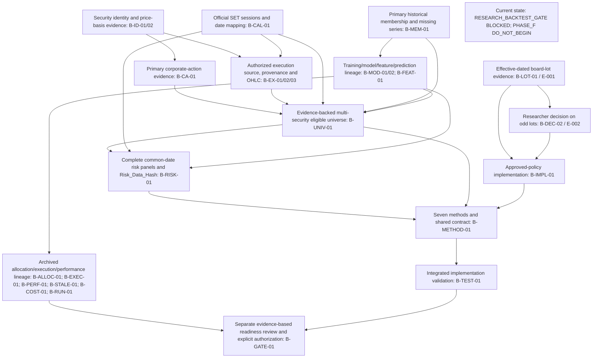

# Workstream 1.9 — Critical Path and Dependency Graph

## Current gate state

Evidence readiness remains blocked. The local Phase C/D candidate universe is
AOT-only (1 candidate symbol, 4 candidate member-date rows); fully verified
tradable rows are 0. Historical allocation readiness is 0/7. Notebook 06 has
static EW/IV paths only (2/7); ERC, HRP, MinVar, CVaR, and MPT are unsupported.
No new evidence, code, tests, or historical results were generated here.

## Dependency graph

The detached current-state node is a status annotation, not a workflow step or
authorization.

## Critical-path interpretation

1. Corporate-action/identity evidence, execution-source evidence, official
   sessions, and historical membership are independent recovery tracks initially;
   they converge before any security/date can be certified in the candidate
   universe.
2. Model and archive provenance can be recovered in parallel, but is required to
   make historical predictions, allocations, fills, and metrics reproducible.
3. A verified multi-security universe precedes risk panels. Panels require one
   shared ordered intersection and full windows; common dates do not authorize
   silently removing an eligible symbol.
4. Effective-dated lot evidence precedes resolving E-002 odd-lot treatment and
   order sizing. No inference from the legacy Notebook 05 constant is permitted.
5. Approved E-004 and E-029 decisions remove only their researcher-decision
   dependencies. E-004 still requires verified session and equity-segment
   evidence; E-029 does not create historical identifiers or fill archive gaps.
6. Implementation and all seven-method validation follow evidence and policy.
   A separate gate review remains necessary; no step in this graph authorizes
   Phase F.

## Resolved specification dependencies versus open evidence

| Item | Current decision/evidence state | What remains |
|---|---|---|
| E-004 | `APPROVED` Option B; 252 verified-session intervals/year; annualize only at 252 valid consecutive one-session intervals (253 marks). | Official sessions and valid equity segments are not established; short segments remain unannualized. |
| E-029 | `APPROVED` Option B; five required run/snapshot lineage references; `Risk_Data_Hash` separately required. | No inference/backfill for archives; historical lineage remains blocked. |
| E-001 / E-002 | E-001 `BLOCKED`; E-002 `NEEDS_RESEARCHER_APPROVAL`. | Primary effective-dated board-lot evidence, then researcher decision on odd lots/residuals. |
| Risk-free Rate / MAR | Both remain `NEEDS_RESEARCHER_APPROVAL`. | Separate researcher decisions; neither was covered by E-004. |
| Gate / Phase F | `BLOCKED` / `DO_NOT_BEGIN`. | Independent evidence-based review and explicit authorization after all critical prerequisites. |
