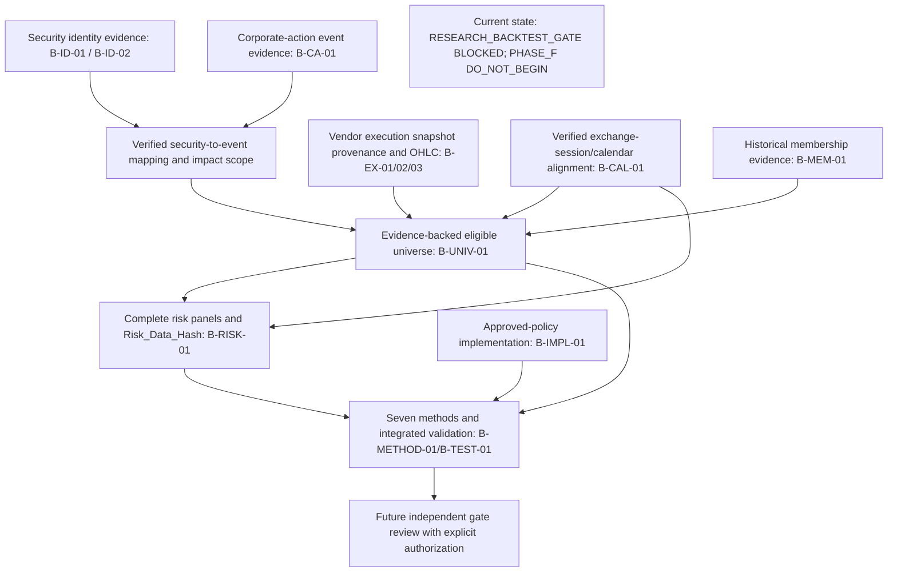

# Workstream 1.9.1 — Dependency Graph Review

## Finding: B-ID-01 and B-CA-01 are mutually informative evidence tracks

The prior blocker register lists `B-ID-01` and `B-ID-02` among the dependencies
for `B-CA-01`, and the prior Workstream 1.9 graph draws `ID --> CA`. A strict
one-way interpretation is not justified by the evidence reviewed:

- A verified security identity is needed to bind a corporate action to the
  correct security and ticker history.
- Issuer/event records and event terms may, in turn, help establish the
  security's identity, continuity, or transition.
- Evidence can be sought and assessed in parallel. Neither evidence track
  should be treated as wholly complete before the other begins.
- The dependency is best understood as a **convergence requirement** for a
  verified identity-to-event mapping, not a strict sequencing rule.

Accordingly, this corrected graph represents identity and corporate-action
evidence as parallel, mutually informative inputs to a joint mapping. It does
not modify the prior blocker register or clear either blocker.

## Corrected graph

The identity and event nodes are parallel evidence inputs; the join at `MAP`
means both are needed to certify the mapping. It does not imply a serial
`B-ID-01`-then-`B-CA-01` workflow. The disconnected `NOW` node is a status
annotation, not a future transition or authorization.

## Approach B correction in the graph

The execution node now identifies the **vendor snapshot provenance and OHLC**
requirements. It does not require official SET execution prices. The separate
calendar node remains necessary to verify exchange-session alignment for
session-based rules; Yahoo-observed dates are not relabeled as official SET
sessions. Vendor request metadata and the snapshot's known data-quality issues
remain unresolved.

## Status and scope

No canonical dependency register or Phase E decision was changed. Both
`B-ID-01` and `B-CA-01` remain `BLOCKED`; the graph only corrects the
interpretation of their relationship. Other data, universe, risk, implementation,
archive, and gate blockers remain unchanged.
