# Complete Research Backtest Dependency Graph

Workstream 1.9.2 is a read-only dependency model. The diagrams are complementary slices of one logical directed acyclic graph; their union is exactly the dependency topology in `dependency_edge_register.csv`. That CSV is authoritative for edge IDs, types, status, blockers and the rationale for every arrow. Node semantics and unchanged statuses are in `dependency_node_register.csv`.

**Arrow meaning:** the target depends on evidence, implementation, provenance or validation represented by the source. It does not assert that a source is present or passed. Blocker statuses are copied from the Workstream 1.9 reassessed matrix without changes. `RESOLVED_SPECIFICATION_ONLY` for B-DEC-04/B-DEC-29 is not evidence resolution.

**Status boundary:** no evidence is inferred, no historical identifier is backfilled, and the E-029 future manifest is deliberately disconnected from the historical B-RUN-01 chain. E-029 five references are lineage fields, not optimizer inputs; `Risk_Data_Hash` remains a separate E3 requirement.

## Frozen model, training evidence, and prediction attribution

Edge IDs: `M01, M02, M03, M04, M05, M06, M07, M08, M09, M10, M11, M12`.

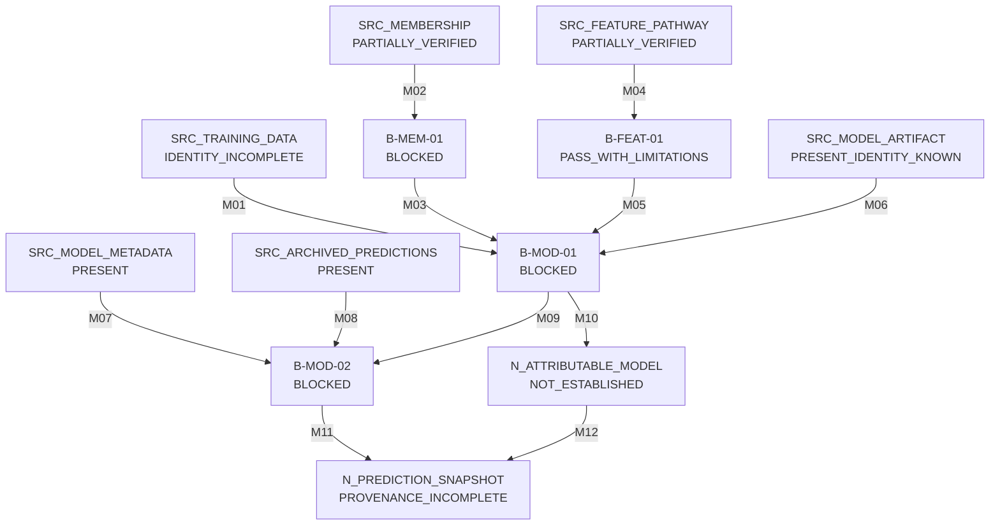

## Prediction-to-daily-Buy Universe lineage

Edge IDs: `U01, U02, U03, U04, U05`.

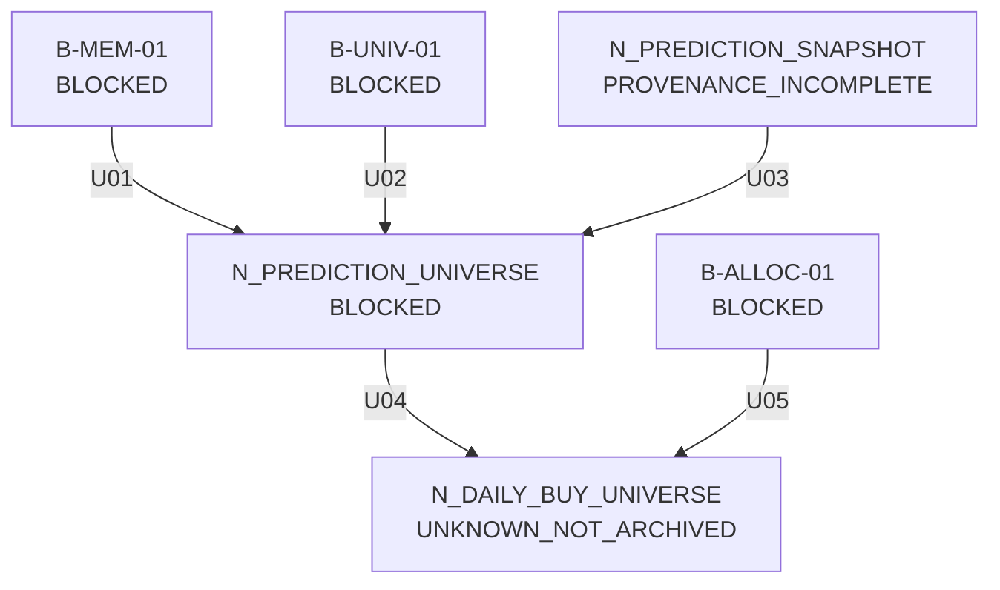

## Parallel identity and corporate-action evidence convergence

Edge IDs: `I01, I02, I03, I04, I05, I06, I07`.

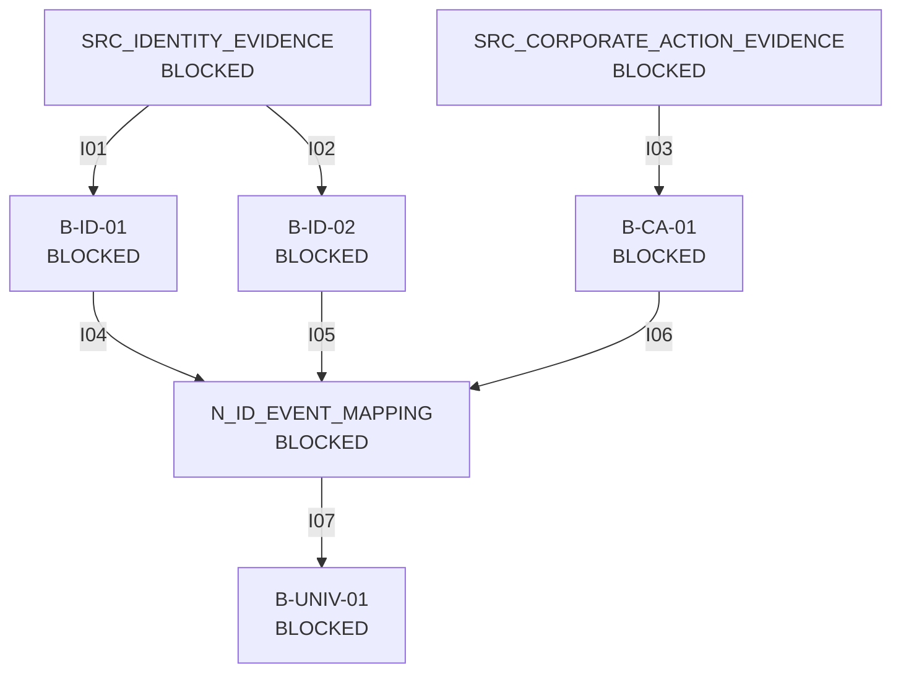

## Vendor provenance, session calendar, and OHLC quality

Edge IDs: `V01, V02, V03, V04, V05, V06, V07, V08`.

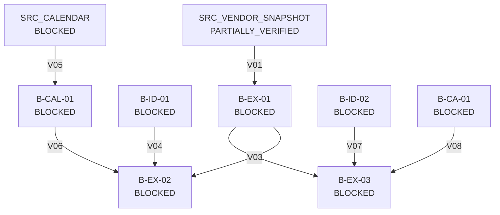

## Evidence convergence into the eligible universe

Edge IDs: `C01, C02, C03, C04, C05, C06, C07, C08, C09, C10, C11`.

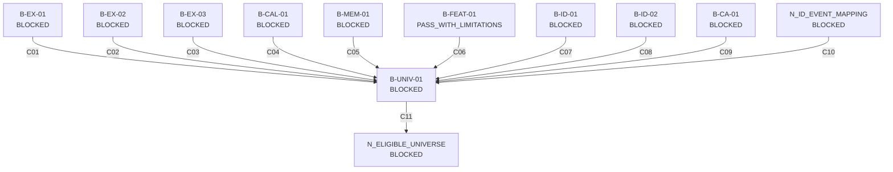

## Historical risk-panel evidence and Risk_Data_Hash lineage

Edge IDs: `R01, R02, R03, R04, R05, R06, R07, R08, R09`.

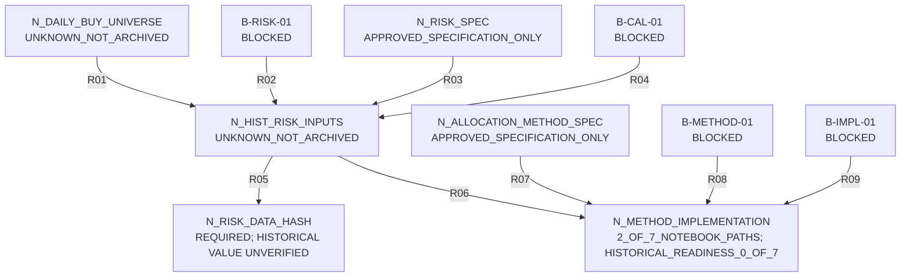

## Method implementation and archived allocation trace

Edge IDs: `R10, R11, R12, R13, R14`.

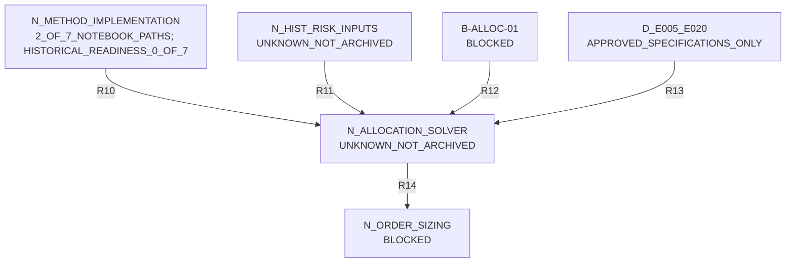

## Board-lot decision and order sizing

Edge IDs: `L01, L02, L03, L04, L05, L06, L07`.

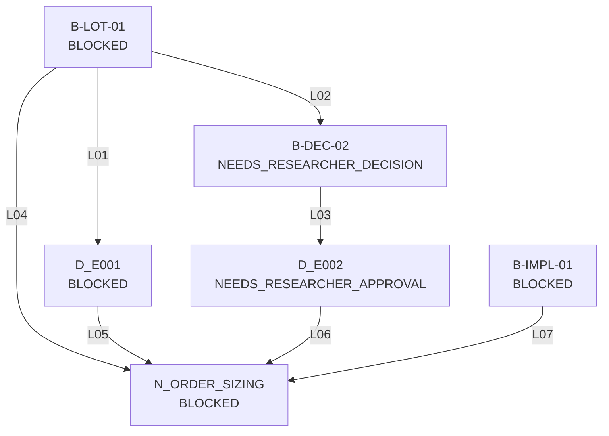

## Order sizing to historical execution evidence

Edge IDs: `L08, L09, L10, L11, L12, L13`.

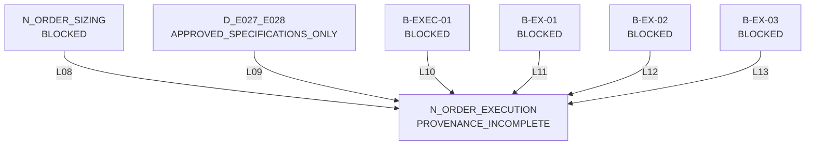

## Execution to portfolio valuation

Edge IDs: `VAL01, VAL02, VAL03, VAL04, VAL05`.

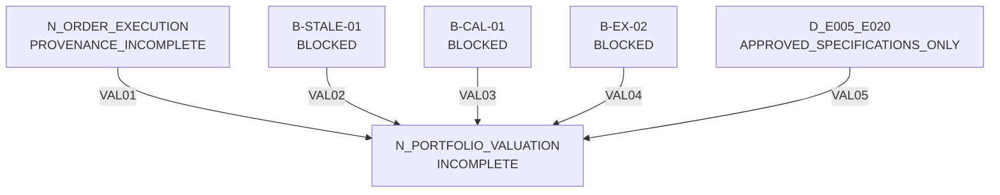

## Archived performance, costs, and unresolved risk conventions

Edge IDs: `PF01, PF02, PF03, PF04, PF05, PF06, PF07, PF08, PF09, PF10`.

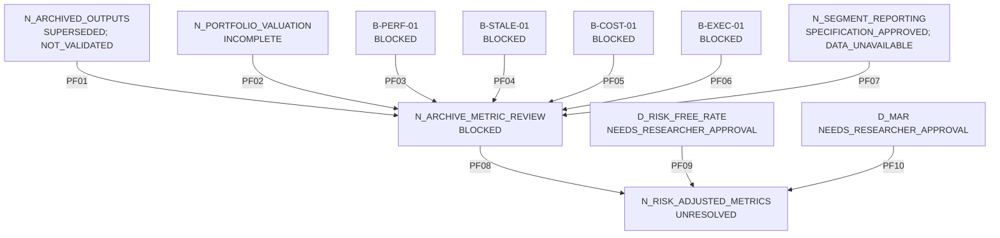

## E-004 segment reporting constraints

Edge IDs: `SEG01, SEG02, SEG03, SEG04, SEG05, SEG06`.

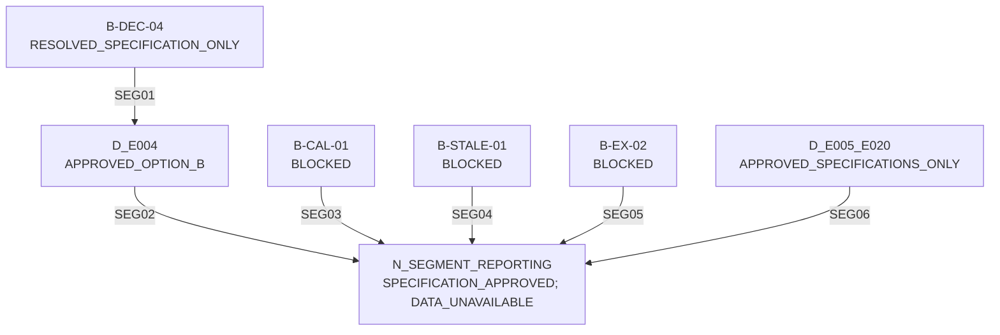

## Historical archived run provenance and reproducibility

Edge IDs: `ARCH01, ARCH02, ARCH03, ARCH04, ARCH05, ARCH06, ARCH07, ARCH08`.

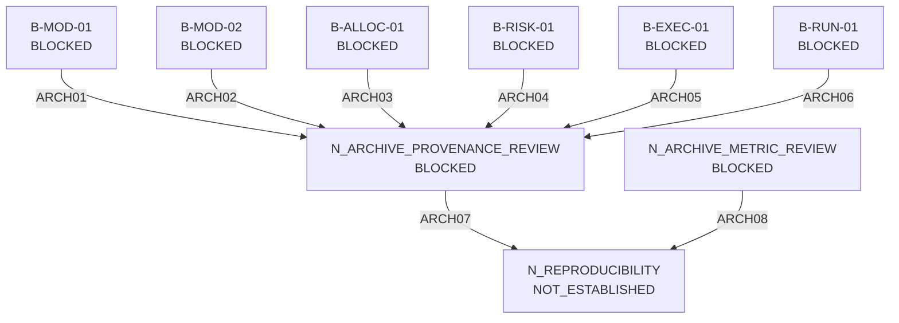

## E-029 future-only run/snapshot provenance

Edge IDs: `E2901, E2902, E2903, E2904, E2905, E2906, E2907, E2908, E2909, E2910, E2911, E2912, E2913, E2914`.

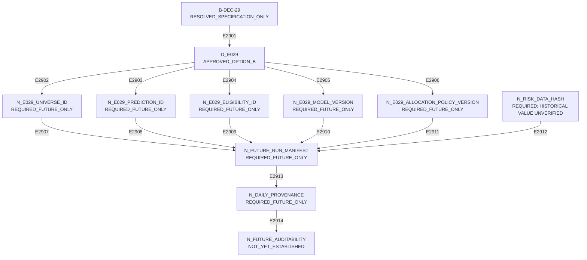

## Integrated validation and unchanged gate/Phase F state

Edge IDs: `G01, G02, G03, G04, G05, G06, G07, G08, G09, G10, G11, G12, G13, G14`.

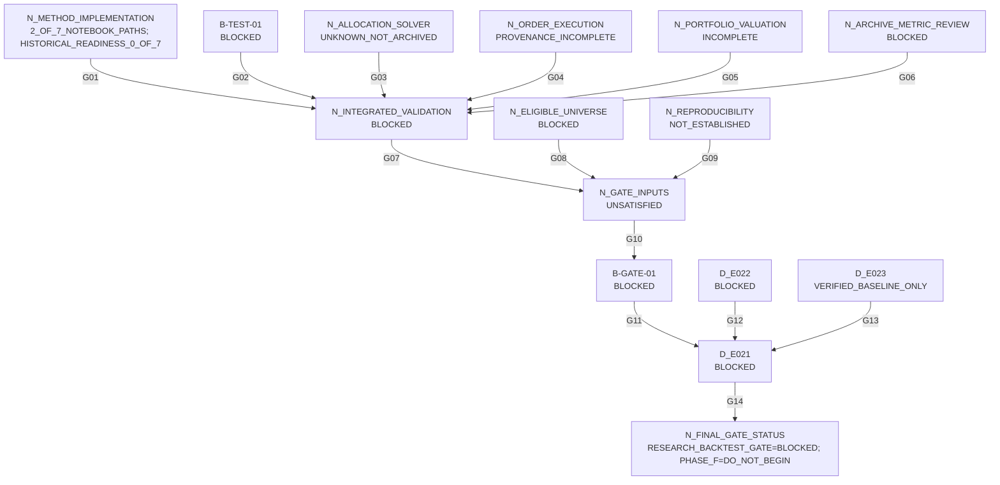

## Reading the graph

- B-ID-01, B-ID-02 and B-CA-01 are parallel, mutually informative evidence streams converging at `N_ID_EVENT_MAPPING`; there is no strict one-way identity-to-corporate-action prerequisite.
- Eligible-universe readiness requires identity/action, vendor provenance/quality, calendar, membership, feature limitations, and prediction evidence. AOT four candidate member-date rows are not a verified tradable universe.
- Approved E-005:E-020 and E-027/E-028 policies constrain implementation; they do not prove implementation or historical execution. EW/IV are the only supported Notebook 06 paths (2/7); historical readiness remains 0/7.
- Board-lot evidence precedes E-001; E-002 remains awaiting researcher approval. No 100-share assumption is used.
- E-004 Option B uses 252 verified exchange-session intervals/year and annualizes only >=252 valid consecutive one-session returns (253 marks). Shorter valid segments are unannualized; do not bridge/combine. Risk-free Rate and MAR remain separately unresolved.
- E-029 future manifest contains five approved identifiers plus separately required `Risk_Data_Hash`; it does not create IDs or repair archived historical provenance.
- Final controlled state remains `RESEARCH_BACKTEST_GATE = BLOCKED`, `PHASE_F = DO_NOT_BEGIN`.
